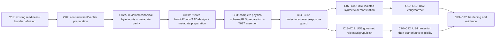

# Tasks: Feature 011 — Allergies and Clinical-Content Governance

> **Feature:** `011-allergies-clinical-content-governance` · **Plan status:** `PLAN_APPROVED` · **Ledger status:** `TASKS_APPROVED BASELINE; C02B DESIGN RECONCILED — REVIEW PENDING`  
> Date: 2026-10-06 (Africa/Cairo). **95 tasks / 29 checkpoints: 10 existing completed markers and 85 unchecked. C01/C02/C02A remain accepted. HND-DESIGN-001 is resolved by the recorded Product Owner/Architecture decision; C02B/T093–T095 is ready for bounded authorization after review, not executed or accepted. C03 remains paused; no T017/C04 execution is authorized.**
> Approval authority: [Product Owner decision](decisions/product-owner-approvals-2026-10-02.md); the hash-bound Plan/spec/reference files retain historical draft metadata unchanged.

## Inputs and frozen boundary

Read [spec](spec.md), [Plan](plan.md), [research](research.md), [data model](data-model.md), [OpenAPI](contracts/openapi.yaml), [governance boundaries](contracts/governance-boundaries.md), [UI state contract](contracts/ui-state-contract.md), [scope manifest](contracts/scope-manifest.json), [Artifact Canonicalization Contract v1](contracts/artifact-canonicalization-v1.md), [profile](contracts/artifact-canonicalization-v1.json), [fixed vectors](contracts/artifact-canonicalization-v1-vectors.json), [canonical parity ownership](contracts/artifact-canonicalization-parity-v1.json), [trusted handoff draft](contracts/trusted-release-handoff-v1.md), [handoff profile](contracts/trusted-release-handoff-v1.json), [handoff vectors](contracts/trusted-release-handoff-v1-vectors.json), [handoff parity ownership](contracts/trusted-release-handoff-parity-v1.json), [quickstart](quickstart.md) and [catalog reconciliation](../../docs/governance/SHIFAA-Feature-011-Reconciliation-2026-10-01.md). The four journeys J-01–J-04 map directly to US1–US4 below; execution order expresses dependencies, not invented product priorities.

Approved TEST-ONLY composition: `SHIFAA-F011-OPEN-UX-001-CANDIDATE@0.1.1-test-only`; source `SHIFAA-F011-P0-SOURCE@0.1.1-test-only`; manifest SHA-256 `59ea1788edbae023533a9e08da97bc3884e0e098ec6e80721272822b6439c432`. Preserve all 99 route-state variants and 746 approved reference PNGs/source/manifest bytes. The recorded Product Owner approval satisfies this feature's functional review authorization; do not invent another reviewer's signature or close program-wide design gates.

Exactly `FR-SAFE-002`, `FR-SAFE-008`, `FR-SAFE-012`, and the clinical-content publication slice of `FR-ADMIN-004`.
Exactly 19 target NFRs: `NFR-SEC-001`, `NFR-SEC-002`, `NFR-SEC-004`, `NFR-SEC-005`, `NFR-SEC-006`, `NFR-SEC-007`, `NFR-PRIV-002`, `NFR-PRIV-004`, `NFR-I18N-001`, `NFR-A11Y-001`, `NFR-PERF-002`, `NFR-DATA-001`, `NFR-DATA-002`, `NFR-API-001`, `NFR-API-002`, `NFR-OBS-001`, `NFR-QUALITY-001`, `NFR-PORT-001`, `NFR-PRIV-001`. Active IDs are present in approved PRD 2.1.3 and the assigned roadmap/traceability rows; no reserved/deferred requirement is introduced.

Exactly seven operations: `listAllergies`, `createAllergy`, `verifyAllergy`, `listClinicalContent`, `createClinicalContentRelease`, `signClinicalContentRelease`, `publishClinicalContentRelease`. Keep the existing verifyAllergy terminal-error/revision and listClinicalContent metadata/assigned-review reconciliations. No eighth operation, activation/cancellation endpoint, medical taxonomy, policy criterion or role is added.

No prescriptions, safety evaluation, warnings/contraindications, override/break-glass execution, dispensing, Feature 012, lab/vaccine policy, invented medical content or production enablement. Consume Feature 010 patient/encounter/care context without modifying its lifecycle or shadowing its resources.

## Rules and stage gates

- Each task has exactly one ID, optional `[P]`, story label only within a story phase, individual canonical requirement IDs, exact target paths, earlier dependencies and acceptance evidence. Boxes remain unchecked until their own evidence exists. Tests are required by the repository template.
- Red → bounded implementation/preparation → focused green/evidence within each checkpoint. C02 adds the explicit verifier producer, and C03 groups sequential physical preparation with its single bundle assertion; checkpoint size follows dependencies, not a fixed three-task count. Red means the intended missing behavior, not broken setup. Stop on failure or missing gate evidence; root owns checkpoint acceptance and ledger changes. Implementation requires later explicit authorization.
- New target files are proposals under verified existing repository roots; they are not present or executed yet. Existing files and generated output paths are named explicitly. Future generators take approved OpenAPI as source; generated output is never manually edited.
- CLI-generate forward migrations with the stated suffixes. Proposed `20261002001101`–`20261002001107` filenames below are deterministic handoff targets: if the installed CLI returns a different fresh timestamp or a filename conflicts, root records the actual replacement and runner binding before executing that task. Never rewrite historical migrations or guess clinical backfill.
- Both `shifaa-local-postgres` and `shifaa-local-supabase` are required for every SQL/concurrency/restore checkpoint. Use isolated databases, distinct physical connections, explicit barriers and observed `pg_locks`; no sleep-only/mocked/owner-role proof or skip-green. Shared database/harness work runs serially; no shared reset shortcut.
- OPEN-CLIN-001 permits engineering the mechanism with neutral synthetic fixtures; real qualification/admissibility/content/code/test-vector approval remains absent. OPEN-TECH-002 is an affected IMPLEMENTING prerequisite, not a claim that task generation creates physical/schema/RLS parity. C01 verifies existing baseline/tooling readiness and defines the required bundle without demanding future outputs. C02/C02A/C02B and C03 prepare generated contracts/client, reviewed canonical-byte and trusted-handoff input/metadata parity and the complete physical schema/RLS chain; T017 asserts the current bundle and applicable stage disposition before C04 onward consumes it. These preparatory tasks produce the prerequisite; they never claim gate closure. Missing, stale, failed or unaccepted evidence blocks affected consumers.
- OPEN-TECH-003 and OPEN-UX-002 retain affected VERIFYING requirements. Collect local engineering evidence with limitations and record missing formal authority; do not mark formal verification/release complete while applicable blockers remain.
- OPEN-UX-001 remains program-wide/final-identity governance, with only this exact Feature 011 functional TEST-ONLY prerequisite approved. OPEN-LEGAL-001, OPEN-LEGAL-002, OPEN-LEGAL-007 retain production effects. Never infer legal/clinical gate closure from synthetic publication.
- Native Auth owns sessions/AAL/AMR/revocation; no shadow authority, direct auth.sessions writes or client role headers. All application mutations use generated Core API clients; forced RLS/closed SQL and DTO projections are independent enforcement.
- Deferred installation/roadmap changes occur only at T088 under later implementation authorization; they add no functional scope and cannot prematurely mark 011 complete.

Before first route registration at T031 and the T035 demonstration, C06/T024–T026 must prove disabled-by-default exposure and kill-switch behavior. Actual route/UI consumers rerun these negatives before acceptance. C25/T082 retains later operational telemetry and guard regressions, never initial exposure authorization.

## Phase map, dependencies and isolated engineering demonstration

C01 does not require Feature 011 evidence that C02/C02A/C02B/C03 produce. C02B must be complete and accepted before T008; HND-DESIGN-001 is resolved by the recorded design decision, not by implementation. Evidence Port computes/verifies material hashes; only reference+verifiedSha256 crosses SQL. SQL hashes artifact v1 and enforces allocation/body structure. T016 uses a synthetic trusted producer; T017 asserts physical/generated parity only. C04 later proves real evidence/AES-GCM ports and T020 real-producer/SQL composition in both runtimes. C03/T008–T016 prepares and proves the full seven-migration contract/schema/RLS chain in isolated runtimes; T017 is the explicit affected-stage assertion before the first application/domain consumer, T019. There is no route registration in preparation. Any later SQL correction requires renewed parity evidence and assertion before its consumer proceeds. The assertion retains OPEN-TECH-002 and checks applicable owner/stage disposition; local preparation cannot substitute for required formal acceptance.

Default execution follows the explicit checkpoint array/dependency order. C02A/T090–T092 followed by C02B/T093–T095 executes between T007 and T008; these new stable IDs are not a numeric execution sequence. Existing IDs and prior task markers are preserved. C13 starts after T026, independently of US2; C23 joins T044 and T074. Every other checkpoint starts after the previous checkpoint within its branch. No database or application integration branch runs in parallel against shared state. All preparatory and consumer tasks still require later explicit implementation authorization.

| Phase      | Checkpoints         | Tasks                | Count |
| ---------- | ------------------- | -------------------- | ----: |
| Setup      | C01–C02, C02A, C02B | T001–T007, T090–T095 |    13 |
| Foundation | C03–C06             | T008–T026            |    19 |
| US1        | C07–C09             | T027–T035            |     9 |
| US2        | C10–C12             | T036–T044            |     9 |
| US3        | C13–C19             | T045–T065            |    21 |
| US4        | C20–C22             | T066–T074            |     9 |
| Hardening  | C23–C27             | T075–T089            |    15 |

**C09/T035 is an isolated synthetic engineering demonstration only**, after parity and exposure prerequisites. It demonstrates authorized self/clinician reporting and reads with explicit unknowns in patient /records. It is not a shippable MVP, deployment readiness, clinical readiness or completion of Feature 011. All remaining story/checkpoint obligations stay required.

| Story      | Evidence boundary after prerequisites                                                                                                                                                                                             |
| ---------- | --------------------------------------------------------------------------------------------------------------------------------------------------------------------------------------------------------------------------------- |
| US1 / J-01 | C09 demonstrates synthetic reads/reporting, self_reported creation, explicit unknowns and guardian/delegate read-only behavior.                                                                                                   |
| US2 / J-02 | C12 proves allowed verification edges, terminal error, linked new self_reported correction, complete history and clinic summary behavior.                                                                                         |
| US3 / J-03 | C19 proves synthetic draft creation, exact-artifact independent signing, authorized publication and initial/supersession/rollback races.                                                                                          |
| US4 / J-04 | C21/T071 accepts projection/UI only. Complete synthetic US4 acceptance requires C22/T072–T074 authoritative time, eligibility and authority-loss evidence as well; draft/body/signature identities never reach clinic projection. |

C02A owns the engineering byte contract before C03: T090 reviews the proposed fixed contract/vector artifacts and adds parity regressions; T091 generates metadata/extends verification without an encoder; T092 proves current metadata parity before T008 resumes. Historical C02 PASS covers existing wire shapes only and does not accept this extension. No C13 policy moves early; T045–T047 later consume the same contract and prove SQL/core equivalence. Missing, stale or unaccepted canonical inputs block C03. OPEN-TECH-002 remains open.

## Phase 1 — Setup: existing readiness and contract preparation

### C01 — Existing baseline/tooling readiness and required parity bundle

**Checkpoint:** 3 tasks in dependency order; accepted only with its focused evidence.

- [x] T001 [FR-SAFE-002, FR-SAFE-008, FR-SAFE-012, FR-ADMIN-004, NFR-QUALITY-001] Write scope/gate assertions against the exact 19-NFR/7-operation sets, approved UX hash, four routes, AC-01–16 and two catalog reconciliations; distinguish Feature 011 UX prerequisite from retained program gates; C01 tests existing baseline/tooling readiness and the evidence-bundle definition, never availability of future Feature 011 parity outputs — `tools/verify-feature-011-scope.test.mjs`
  - Depends on: `none`
  - Acceptance evidence: `specs/011-allergies-clinical-content-governance/evidence/implementation/C01-red.md records runnable tests failing only for the intended missing behavior, not fixtures/syntax; shared-harness rows also prove isolated runtime setup`

- [x] T002 [FR-SAFE-002, FR-SAFE-008, FR-SAFE-012, FR-ADMIN-004, NFR-QUALITY-001] Implement the read-only scope verifier; verify existing baseline/tooling prerequisites and define the OPEN-TECH-002 bundle (generated payload/client digests, full additive schema/RLS/grant/function-shape parity, both real-runtime non-owner evidence and applicable owner/stage disposition); C01 does not demand outputs from later producer tasks or authorize affected consumers — `tools/verify-feature-011-scope.mjs`; `specs/011-allergies-clinical-content-governance/evidence/implementation/gates.md`
  - Depends on: `T001`
  - Acceptance evidence: `Focused tests for C01 pass; targeted file diff matches the approved design and retains gates; both DB runtimes where SQL is affected`

- [x] T003 [FR-SAFE-002, FR-SAFE-008, FR-SAFE-012, FR-ADMIN-004, NFR-QUALITY-001] Run existing baseline/tooling, ACTIVE PRD ID, SPEC_APPROVED/PLAN_APPROVED and exact UX binding checks; record the evidence-bundle definition and stop for missing existing prerequisites; Feature 011 parity remains pending until its producer checkpoint and explicit assertion — `specs/011-allergies-clinical-content-governance/evidence/implementation/scope-gates.md`
  - Depends on: `T002`
  - Acceptance evidence: `specs/011-allergies-clinical-content-governance/evidence/implementation/scope-gates.md records existing readiness and a pending Feature 011 parity obligation, not a premature gate pass or OPEN-TECH-002 closure`

### C02 — Contract generators and seven-operation client

**Checkpoint:** 4 tasks in dependency order; accepted only with its focused evidence.

- [x] T004 [NFR-API-001, NFR-API-002, NFR-QUALITY-001] Add contract/client shape and generation tests for seven methods/paths, closed KnownUnknown unions, required headers, three listClinicalContent projections, cursor binding and existing RFC 9457 errors; test the contract verifier rejecting unresolved refs, missing generators, stale outputs and incomplete/missing physical-runtime evidence — `packages/contracts/src/feature-011.test.ts`; `packages/api-client/src/feature-011.test.ts`
  - Depends on: `T003`
  - Acceptance evidence: `specs/011-allergies-clinical-content-governance/evidence/implementation/C02-red.md records runnable tests failing only for the intended missing behavior, not fixtures/syntax; shared-harness rows also prove isolated runtime setup`

- [x] T005 [NFR-API-001, NFR-API-002, NFR-QUALITY-001] Implement schema/client generators using contracts/openapi.yaml as source; generate feature-011.ts with node tools/generate-feature-011-contract.mjs and node tools/generate-feature-011-client.mjs, add package exports and --check wiring; never hand-edit generated output — `tools/generate-feature-011-contract.mjs`; `tools/generate-feature-011-client.mjs`; `packages/contracts/src/feature-011.ts`; `packages/contracts/src/index.ts`; `packages/contracts/package.json`; `packages/api-client/src/feature-011.ts`; `packages/api-client/package.json`
  - Depends on: `T004`
  - Acceptance evidence: `Focused tests for C02 pass; targeted file diff matches the approved design and retains gates; both DB runtimes where SQL is affected`

- [x] T006 [NFR-API-001, NFR-API-002, NFR-QUALITY-001] Create tools/verify-feature-011-contracts.mjs from the approved OpenAPI, data model and catalog reconciliation: default quickstart invocation resolves all local refs and checks closed shapes, seven method/path mappings, five Idempotency-Key/three If-Match bindings, deterministic generated schema/client parity and digest-bound physical schema/RLS/grants/function shapes against both real runtime bundles; --contracts-only explicitly reports preparation-only, never stage readiness; missing/stale/owner-only evidence fails full verification — `tools/verify-feature-011-contracts.mjs`
  - Depends on: `T005`
  - Acceptance evidence: `Contract verifier negative/positive tests pass for the contracts-only preparation; default full verification fails until the physical evidence bundle exists; no parity/gate success is inferred from counts`

- [x] T007 [NFR-API-001, NFR-API-002, NFR-QUALITY-001] Run both generator --check commands plus closed-schema/client tests; second generation produces zero diff and both catalog reconciliations remain the same existing operations; run node tools/verify-feature-011-contracts.mjs --contracts-only and label the result contract preparation, pending physical parity — `specs/011-allergies-clinical-content-governance/evidence/implementation/contracts.md`
  - Depends on: `T006`
  - Acceptance evidence: `specs/011-allergies-clinical-content-governance/evidence/implementation/contracts.md records commands, assertion outcomes, fixture/migration/runtime digests and limitations; checkpoint stops on any failed or missing prerequisite`

### C02A — Canonical byte-contract inputs and generated metadata parity

**Checkpoint:** T090–T092 completed test-first under explicit C02A authorization. The four frozen contract artifacts are approved inputs; their historical draft labels remain byte-identical. See [RED evidence](evidence/implementation/C02A-red.md) and [canonical metadata parity](evidence/implementation/canonical-contract-parity.md). C02A is accepted by Product Owner + Architecture Lead in the current conversation; historical evidence/proposal labels remain unchanged. Its accepted boundary does not include the new C02B extension. This is metadata preparation, not physical parity, an encoder or gate closure.

- [x] T090 [FR-SAFE-002, FR-SAFE-012, FR-ADMIN-004, NFR-DATA-001, NFR-API-001, NFR-API-002, NFR-PORT-001, NFR-QUALITY-001] Own/review the proposed Artifact Canonicalization Contract v1, machine profile, fixed synthetic vectors and digest registry; add test-first generator/verifier regressions for profile/vector agreement, byte/material-digest integrity, missing inputs, mismatched registry hashes, stale generated metadata and unchanged seven-operation wire shapes; fixed expected bytes/digests are reviewed inputs, never regenerated by an encoder under test; no core or SQL encoder — `specs/011-allergies-clinical-content-governance/contracts/artifact-canonicalization-v1.md`; `specs/011-allergies-clinical-content-governance/contracts/artifact-canonicalization-v1.json`; `specs/011-allergies-clinical-content-governance/contracts/artifact-canonicalization-v1-vectors.json`; `specs/011-allergies-clinical-content-governance/contracts/artifact-canonicalization-parity-v1.json`; `packages/contracts/src/feature-011.test.ts`; `packages/api-client/src/feature-011.test.ts`
  - Depends on: `T007`
  - Acceptance evidence: `specs/011-allergies-clinical-content-governance/evidence/implementation/C02A-red.md records approved contract/vector input hashes and intended metadata/parity RED after legacy C02 regression; proposal review and all fixed-vector integrity checks precede metadata implementation; no C03 task completion or gate closure`

- [x] T091 [FR-SAFE-002, FR-SAFE-012, FR-ADMIN-004, NFR-DATA-001, NFR-API-001, NFR-API-002, NFR-PORT-001, NFR-QUALITY-001] Extend existing contract/client generators and verifier to consume the v1 profile, normative text, fixed vectors and parity registry; generate data-only feature011ArtifactCanonicalizationMetadata with contractId, normativeInputDigests and parityRegistrySha256 in both modules; enforce registry/vector integrity and reject missing/stale/inconsistent inputs or outputs; bind these inputs and artifact-canonicalization-v1 runtime assertion to full physical evidence; preserve every wire shape/method/header and implement no normalization/encoder/core policy — `tools/generate-feature-011-contract.mjs`; `tools/generate-feature-011-client.mjs`; `tools/verify-feature-011-contracts.mjs`; `packages/contracts/src/feature-011.ts`; `packages/api-client/src/feature-011.ts`
  - Depends on: `T090`
  - Acceptance evidence: `Focused C02A metadata/parity negatives and positives pass; source digests bind all canonical artifacts in contracts-only and full physical modes; metadata contains no executable encoder and existing C02 closed-schema/client tests remain GREEN`

- [x] T092 [FR-SAFE-002, FR-SAFE-012, FR-ADMIN-004, NFR-DATA-001, NFR-API-001, NFR-API-002, NFR-PORT-001, NFR-QUALITY-001] Run both generator --check commands, repeat generation with zero diff, closed-schema/client tests and contracts-only verification including canonical input/output metadata parity; record current input/output/tool hashes and Product Owner/Architecture byte-contract disposition before T008 resumes; missing physical evidence remains fail-closed and is not required before its C03 producer tasks — `specs/011-allergies-clinical-content-governance/evidence/implementation/canonical-contract-parity.md`
  - Depends on: `T091`
  - Acceptance evidence: `C02A evidence records reviewed v1 contract/vector hashes, RED to GREEN metadata parity and current closed wire regression; physicalParity remains PENDING and OPEN-TECH-002 open; no default T017 stage assertion or C03 implementation acceptance is inferred`

### C02B — Trusted release handoff contract and metadata preparation

**Checkpoint:** T093–T095 remain unchecked. The [recorded Product Owner/Architecture decision](decisions/trusted-handoff-design-2026-10-06.md) resolves HND-DESIGN-001 with trusted reference+verifiedSha256 (no raw bytes in SQL), exact five-field PROTECTED-BODY/1, fixed five-frame PROTECTED-AAD/1 and preflight/locked allocation/retry rules. These design inputs do not execute or accept C02B. T094 is metadata only; T095 requires explicit C02B acceptance before T008 resumes. Preserve prior C03 RED drafts and current gates.

- [ ] T093 [FR-SAFE-002, FR-ADMIN-004, NFR-SEC-001, NFR-SEC-002, NFR-DATA-001, NFR-API-001, NFR-PORT-001, NFR-QUALITY-001] Using the recorded HND-DESIGN-001 decision and complete handoff/body/AAD profile and fixed vectors, add test-first contract regressions for exact five-field envelope/12-byte nonce/16-byte tag, trusted reference+verifiedSha256/no raw bytes in SQL, exact five-frame AAD/workflow exclusion, lineage-relative preflight allocation/retry and C03 versus C04 responsibility; preserve canonical v1 bytes; no external I/O, encryption, encoder or DDL — `specs/011-allergies-clinical-content-governance/contracts/trusted-release-handoff-v1.md`; `specs/011-allergies-clinical-content-governance/contracts/trusted-release-handoff-v1.json`; `specs/011-allergies-clinical-content-governance/contracts/trusted-release-handoff-v1-vectors.json`; `specs/011-allergies-clinical-content-governance/contracts/trusted-release-handoff-parity-v1.json`; `packages/contracts/src/feature-011.test.ts`; `specs/011-allergies-clinical-content-governance/data-model.md`; `specs/011-allergies-clinical-content-governance/contracts/governance-boundaries.md`; `specs/011-allergies-clinical-content-governance/decisions/trusted-handoff-design-2026-10-06.md`
  - Depends on: `T092`
  - Acceptance evidence: `RED detects missing/stale/inconsistent handoff/body/AAD/model/governance/decision bindings before metadata preparation; fixed structural positives/negatives and exact AAD bytes are reviewed design inputs, not a task completion or actual evidence/GCM proof`

- [ ] T094 [FR-SAFE-002, FR-ADMIN-004, NFR-SEC-001, NFR-SEC-002, NFR-DATA-001, NFR-API-001, NFR-PORT-001, NFR-QUALITY-001] Bind recorded handoff/body/AAD/profile/vectors/parity-registry plus data-model/governance/decision hashes in generated metadata and existing verifier only; stale/missing/inconsistent inputs fail closed; preserve seven operation wire shapes and all canonical v1 metadata/bytes; generate no encoder and implement no evidence/protection adapter, AES-GCM, external I/O, DDL or route — `tools/generate-feature-011-contract.mjs`; `tools/generate-feature-011-client.mjs`; `tools/verify-feature-011-contracts.mjs`; `packages/contracts/src/feature-011.ts`; `packages/api-client/src/feature-011.ts`; `packages/api-client/src/feature-011.test.ts`
  - Depends on: `T093`
  - Acceptance evidence: `C02B metadata regressions turn GREEN with data-only input bindings; contracts-only verifies handoff/body/AAD/model/decision metadata and fixed vectors; default/full remains fail-closed without physical evidence; frozen canonical v1 bytes/digests and public wire shapes stay unchanged`

- [ ] T095 [FR-SAFE-002, FR-ADMIN-004, NFR-SEC-001, NFR-SEC-002, NFR-DATA-001, NFR-API-001, NFR-PORT-001, NFR-QUALITY-001] Record C02B current design/input/output hashes, test-first metadata evidence and explicit Product Owner/Architecture checkpoint acceptance; rerun legacy C02/C02A closed-wire regressions, both generators and --check, repeat generation with zero diff and contracts-only handoff/body/AAD parity; block T008 on missing/stale/unaccepted evidence; physical and real C04 producer evidence remain pending — `specs/011-allergies-clinical-content-governance/evidence/implementation/trusted-handoff-parity.md`
  - Depends on: `T094`
  - Acceptance evidence: `Complete recorded contract/profile/structural handoff/AAD vectors and current model/governance/decision/generated bindings plus explicit C02B acceptance are required before C03; HND-DESIGN-001 resolution is not task or checkpoint completion; no SQL/core encoder, physical/GCM/evidence-port or OPEN-TECH-002 closure claim`

## Phase 2 — Physical parity, stage assertion, protection, context and exposure

C03 is prerequisite preparation against approved contracts, not API exposure or story completion. Physical operation behavior/race acceptance remains in the later story checkpoints; early schema/RLS checks prove the full physical footprint and real non-owner enforcement. C06 installs exposure restriction before any feature route or surface consumes it.

### C03 — Full physical schema/RLS parity preparation and explicit OPEN-TECH-002 assertion

**Checkpoint:** 10 tasks in dependency order; accepted only with its focused evidence and the final explicit T017 assertion; preparing files alone is insufficient.

- [ ] T008 [FR-SAFE-002, FR-SAFE-008, FR-SAFE-012, FR-ADMIN-004, NFR-SEC-001, NFR-DATA-001, NFR-PRIV-004] Build isolated real-runtime fixtures/runners and schema/RLS assertions for new tables, non-owner executor/grants, predecessor data/signatures and forbidden direct/public/service-role access; cover all seven approved SQL operation bindings, projection/authority separation, signature capacity extension, grants, constraints and local refs before route registration; initial red asserts missing DDL, not absent application consumers; write the physical SQL behavior/negative/race vectors before the corresponding preparation DDL: append/error/correction, independent exact-artifact signing, current qualification/duty/authority loss, initial/successor/rollback/future-effective conflicts and closed status projections; API-bound native Auth behavior remains in story tests; add SQL tests consuming the reviewed v1 facts/exact bytes/SHA-256 and applicable rejection/declared-digest cases before DDL, including Unicode, key order and microseconds; no private SQL encoding; resume existing valid RED drafts only after accepted C02B; add synthetic trusted reference/verifiedSha256 and five-field protected-body structure/storage tests plus exact candidate ID/lineage-relative version, atomic stale/race rejection and no raw material/key/keyRef leakage tests before DDL; fixture handoffs contain no raw material; no SQL evidence hashing/resolution or application/KMS work — `infra/db/fixtures/feature-011.sql`; `infra/db/tests/feature-011-schema.sql`; `infra/db/tests/feature-011-rls.sql`; `tools/run-feature-011-postgres-test.mjs`; `tools/run-feature-011-concurrency-test.mjs`; `infra/db/tests/feature-011-allergy-create-read.sql`; `infra/db/tests/feature-011-allergy-verification.sql`; `infra/db/tests/feature-011-content-draft.sql`; `infra/db/tests/feature-011-signatures.sql`; `infra/db/tests/feature-011-publication.sql`; `infra/db/tests/feature-011-content-projections.sql`
  - Depends on: `T095`
  - Acceptance evidence: `specs/011-allergies-clinical-content-governance/evidence/implementation/C03-red.md records runnable tests failing only for the intended missing behavior, not fixtures/syntax; shared-harness rows also prove isolated runtime setup; capture intended missing-DDL RED for these physical SQL cases, then both-runtime GREEN/non-owner enforcement before T017; no route exposure or application acceptance is inferred; v1 fixed expected outputs are inputs, not generated from the SQL implementation; C02B accepted handoff/body/AAD/profile/vector hashes are prerequisites; SQL artifact hashing only and release allocation/binding are proved with synthetic envelopes; C04 owns actual exact-material hashing and AES-GCM acceptance`

- [ ] T009 [FR-SAFE-002, FR-SAFE-008, FR-SAFE-012, FR-ADMIN-004, NFR-SEC-001, NFR-DATA-001, NFR-PRIV-004] CLI-generate an additive foundation migration for data-model §§2–4 heads/revisions/receipts, series/releases, grants/designations/admissibility and restricted signature sidecar; enforce quoted constraints below, ENABLE/FORCE RLS, fixed empty search_path, PUBLIC EXECUTE revocation and shifaa_f011_executor NOLOGIN/NOSUPERUSER/NOBYPASSRLS/non-owner entrypoint execution; preserve five existing admin roles, audit history and canonical retention classes without production deletion automation; use exact private immutable body_contract_id text/body_key_ref text/body_nonce bytea/body_ciphertext bytea/body_auth_tag bytea columns (all NOT NULL), fixed body contract, 12-byte nonce/nonempty ciphertext/16-byte tag; no serialized JSON/text envelope or stored AAD; implement release-scoped id/series/artifact-version identity and retain published-root/successor uniqueness, removing obsolete global draft-version allocator and per-series draft-ordinal uniqueness as data-model §3.1 requires — `supabase/migrations/20261002001101_f011_foundation.sql`; `infra/db/policies/feature-011.sql`
  - Depends on: `T008`
  - Acceptance evidence: `Focused tests for C03 pass; targeted file diff matches the approved design and retains gates; both DB runtimes where SQL is affected; exact five-column protected-body and lineage-relative allocation constraints match the recorded Product Owner/Architecture decision; no keyRef exposure or raw material storage`

- [ ] T010 [FR-SAFE-008, NFR-SEC-001, NFR-SEC-004, NFR-SEC-005, NFR-SEC-006, NFR-API-001, NFR-API-002, NFR-DATA-001] CLI-generate the approved allergy read/create physical entrypoints with server-derived actor/context bindings, scoped list projections, self_reported creation, required substance/source and known/unknown representation, idempotency receipts and append-only storage enforcement; prepare DDL/RLS parity only, register no application route — `supabase/migrations/20261002001102_f011_allergy_entrypoints.sql`
  - Depends on: `T009`
  - Acceptance evidence: `Prepared migration is checked against the approved data-model/governance contract and early schema/RLS assertions; execute the complete chain in isolated runtimes before the parity assertion; operation behavior/race acceptance remains in its story checkpoint`

- [ ] T011 [FR-SAFE-008, NFR-SEC-001, NFR-SEC-004, NFR-SEC-005, NFR-DATA-001, NFR-SEC-006] CLI-generate the approved verification/correction physical guards: current authority locks, CAS append, attributable new reason/evidence, allowed confirmed/refuted transitions, terminal entered_in_error and explicit linked new self_reported assertion; prepare DDL/RLS parity only, register no application route — `supabase/migrations/20261002001103_f011_allergy_verification.sql`
  - Depends on: `T010`
  - Acceptance evidence: `Prepared migration is checked against the approved data-model/governance contract and early schema/RLS assertions; execute the complete chain in isolated runtimes before the parity assertion; operation behavior/race acceptance remains in its story checkpoint`

- [ ] T012 [FR-SAFE-002, FR-ADMIN-004, NFR-SEC-001, NFR-SEC-004, NFR-SEC-002, NFR-SEC-005, NFR-API-001] CLI-generate the approved content draft and governance/assigned-review read physical entrypoints: ADM-MEDICAL creation, assigned exact-release review, immutable artifact digest/version versus mutable workflow version and closed authority-selected projections; prepare DDL/RLS parity only, register no application route; implement only the reviewed SHIFAA-F011-ARTIFACT/1 byte rules and evidence reference/material-digest bindings; server canonical bytes/hash and caller-declared equality must match the fixed vectors, never a PostgreSQL JSON text rendering; consume accepted SHIFAA-F011-CREATE-RELEASE-HANDOFF/1: accept only trusted reference+verifiedSha256 results, validate A/B equality, construct canonical artifact bytes and compute artifact hash in SQL; raw evidence bytes and keys never enter PostgreSQL; structurally persist five typed protected-body fields only; lock/revalidate series/predecessor and recompute initial=1 or predecessor.artifactVersion+1, require candidate equality and persist exact allocated releaseId/version or reject atomically; no external resolution, material hashing, encryption or KMS in SQL — `supabase/migrations/20261002001104_f011_content_entrypoints.sql`
  - Depends on: `T011, T095`
  - Acceptance evidence: `Prepared migration is checked against the approved data-model/governance contract and early schema/RLS assertions; execute the complete chain in isolated runtimes before the parity assertion; operation behavior/race acceptance remains in its story checkpoint; physical consumer matches accepted handoff profile/vectors and preserves canonical v1; protected structure proof is not cryptographic acceptance; body columns, reconstructible five-frame AAD tuple/workflow exclusion and locked allocation equality match the accepted profile; SQL structural proof is not real cryptographic/evidence verification`

- [ ] T013 [FR-SAFE-012, FR-ADMIN-004, NFR-SEC-001, NFR-SEC-004, NFR-SEC-005, NFR-SEC-006, NFR-DATA-001] CLI-generate the approved narrow signing entrypoint and resource-scoped physician/pharmacist audit.signature_evidence extension: exact artifact bindings, independent persons/capacities, professional eligibility/designation/current grant, no creator self-approval, ordered authority/evidence locks and immutable sidecar/audit/outbox/receipt; preserve five admin roles; prepare DDL/RLS parity only, register no application route — `supabase/migrations/20261002001105_f011_content_signatures.sql`
  - Depends on: `T012`
  - Acceptance evidence: `Prepared migration is checked against the approved data-model/governance contract and early schema/RLS assertions; execute the complete chain in isolated runtimes before the parity assertion; operation behavior/race acceptance remains in its story checkpoint`

- [ ] T014 [FR-SAFE-002, FR-SAFE-012, FR-ADMIN-004, NFR-SEC-001, NFR-SEC-004, NFR-SEC-005, NFR-SEC-006, NFR-DATA-001] CLI-generate the approved publication entrypoint: idempotency-first series advisory guard, ordered candidate/predecessor/current authority/signature locks, unique initial root/successor, creator-independent ADM publisher, both current exact approvals and fresh final clock; explicit future-effective supersession/rollback with no ancestor reactivation; prepare DDL/RLS parity only, register no application route — `supabase/migrations/20261002001106_f011_content_publication.sql`
  - Depends on: `T013`
  - Acceptance evidence: `Prepared migration is checked against the approved data-model/governance contract and early schema/RLS assertions; execute the complete chain in isolated runtimes before the parity assertion; operation behavior/race acceptance remains in its story checkpoint`

- [ ] T015 [FR-SAFE-002, NFR-SEC-001, NFR-SEC-004, NFR-API-001, NFR-API-002, NFR-DATA-002] CLI-generate the approved closed metadata status SQL branch of existing listClinicalContent: current workforce/facility/status-read authority/purpose/AAL2, published complete-signature metadata/lineage/completeness only, no body/draft/unsigned/signature identity columns; prepare DDL/RLS parity only, register no application route — `supabase/migrations/20261002001107_f011_content_status_projection.sql`
  - Depends on: `T014`
  - Acceptance evidence: `Prepared migration is checked against the approved data-model/governance contract and early schema/RLS assertions; execute the complete chain in isolated runtimes before the parity assertion; operation behavior/race acceptance remains in its story checkpoint`

- [ ] T016 [FR-SAFE-002, FR-SAFE-008, FR-SAFE-012, FR-ADMIN-004, NFR-SEC-001, NFR-DATA-001, NFR-PRIV-004] Apply the full baseline plus all seven additive Feature 011 migrations and run schema/RLS/operation-binding/projection/signature-capacity parity matrices in both isolated runtimes as shifaa_api and the real non-owner executor; prove current_user/grants/pg_roles/FORCE flags, populated predecessor compatibility, exact generated payload/client and physical DDL digests, no fabricated backfill and no exposed Feature 011 route; run the prepared physical SQL behavior/negative/race vectors as well as shape/RLS parity before the assertion; execute the normative v1 positive/applicable negative vectors through the real physical SQL implementation in both runtimes and bind exact byte/hash results to the current canonical inputs/generated metadata under artifact-canonicalization-v1; primitive hashing alone is not physical-operation acceptance; prove accepted handoff using synthetic trusted reference/verifiedSha256 and structurally valid five-field protected envelopes in BOTH runtimes; prove canonical artifact bytes/hash, exact allocated releaseId/version binding and stale/conflicting allocation atomic rejection via independent-connection/barrier/pg_locks probes; raw material/keys do not enter SQL and keyRef does not leak; bind current handoff/body/AAD/vector/model/governance/decision/generated hashes; do NOT claim actual material hashing, evidence-port or AES-GCM acceptance — `specs/011-allergies-clinical-content-governance/evidence/implementation/schema-rls.md`
  - Depends on: `T015, T095`
  - Acceptance evidence: `specs/011-allergies-clinical-content-governance/evidence/implementation/schema-rls.md binds full chain, generated contract/client and runtime digests to non-owner parity assertions for all seven operation bindings; preparation is not clinical/story acceptance or formal gate closure; prepared physical SQL vectors pass in both runtimes; later story tests extend them through actual API/domain consumers; digest-bound artifact-canonicalization-v1 proof is required in both runtime bundles before T017; synthetic structural handoff evidence covers SQL only; actual evidence resolution/protection and real-producer composition remain C04/T018-T020; lineage-relative versions allow distinct competing/replacement drafts while publication guards remain unique; no stored free-form AAD or JSON/text protected envelope`

- [ ] T017 [FR-SAFE-002, FR-SAFE-008, FR-SAFE-012, FR-ADMIN-004, NFR-SEC-001, NFR-DATA-001, NFR-PRIV-004, NFR-API-001, NFR-API-002, NFR-QUALITY-001] Assert the affected OPEN-TECH-002 prerequisite only after contract/client and full physical schema/RLS preparation evidence exists: run default node tools/verify-feature-011-contracts.mjs, scope/trace checks and verify current digest-bound both-runtime online/non-owner proof plus applicable owner/stage disposition; block every affected application/domain consumer on missing, stale, failed or unaccepted evidence; retain OPEN-TECH-002 and never record global closure; require the accepted C02A canonical metadata/input bindings and T016 v1 runtime-vector evidence; contract proposal or primitive vector integrity cannot substitute for either producer; require accepted C02B handoff/body/AAD/model/decision metadata plus T016 physical proof only, with actual evidence/protection adapter acceptance explicitly pending C04; do not require later C04 producer evidence before its producer tasks — `specs/011-allergies-clinical-content-governance/evidence/implementation/open-tech-002-assertion.md`; `tools/verify-feature-011-scope.mjs`
  - Depends on: `T016, T006, T095`
  - Acceptance evidence: `Default contract verifier plus scope/trace checks pass against the full current bundle; open-tech-002-assertion.md records evidence references/digests and applicable stage disposition; missing evidence or required authority acceptance blocks subsequent IMPLEMENTING consumers without weakening or closing OPEN-TECH-002; assertion is physical/generated parity only, not C04 adapter acceptance`

**T009 binding data constraints (verbatim from data-model, not implementation discretion):**

- `KnownUnknown`: “knowledge=known plus value, or knowledge=unknown with no value”; “a missing required substance display/source is rejected”.
- Heads: “current_version positive integer”; “corrects_allergy_id nullable”; “deferred current-revision FK to the same allergy/patient/version”.
- Revisions: “supersedes_id nullable only at version 1”; “facility_id/encounter_id nullable for patient report”; “verification_reason_ciphertext and verification_evidence_ref nullable only for unverified creation”; “first revision has self_reported and no verification evidence”; “verified/error revisions require named actor/reason/evidence”; “Append-only UPDATE/DELETE rejection.”
- Receipts: “idempotency_record_id unique”; “Append-only”; “no raw clinical snapshot in generic platform response_body.”
- Series: “Unique content_type/governed_content_key/effective_scope_key”; “no eager current-release pointer that would promote future content.”
- Releases: “artifact_version positive; workflow_version positive”; “canonical artifact digest bytea(32)”; “supersedes_release_id nullable”; “status=draft or published”; “published_by_person_id/published_at nullable while draft”; “Unique series/artifact_version”; “self-predecessor forbidden”; “predecessor FK same series”; “initial iff predecessor absent”; “Unique published root per series, unique published successor per predecessor”.
- Authority evidence: “action=signClinicalContentRelease or listClinicalContent”; “capacity=physician/pharmacist nullable only for metadata-read action”; “facility_id nullable for governed global signer scope”; “active/revoked status”; “Unique live grant per person/action/scope/capacity”.
- Designations: “reviewer_capacity=physician/pharmacist”; “Missing evidence denies signing.”
- Admissibility: “absent/unresolved approval denies real eligibility”; “Synthetic fixture policy has no medical assertion and cannot satisfy production admission”; “No public provisioning API.”
- Signatures: “same-release/version role uniqueness constraint retains one decision per capacity”; “prevents one person satisfying both capacities”. Extend physician/pharmacist only for `resource_type=clinical.content_release`; preserve existing resource roles, evidence and immutable triggers.

All remaining field identities/FKs/validity/ownership/indexes in data-model §§1–8 are binding. No clinical enum, expiry, retention duration or license qualification rule is supplied by this ledger.

### C04 — Exact-byte clinical protection seam

**Checkpoint:** 3 tasks in dependency order; accepted only with its focused evidence.

- [ ] T018 [NFR-SEC-002, NFR-PORT-001, NFR-QUALITY-001] Add exact-byte evidence hashing/immutable-reference and AES-256-GCM roundtrip/random nonce/wrong key-version-context/tamper/intended plaintext tests plus native Node ESM/browser resolution negatives; use SAME accepted handoff/body/AAD fixed vectors; write preflight-before-locks, raw-bytes-never-SQL, fresh ID/nonce/envelope on rejected retry, committed replay without re-encryption and real-producer-to-prepared-SQL composition negatives before adapters — `services/api/test/feature-011-protection.test.ts`; `packages/core/src/feature-011/ports.test.ts`
  - Depends on: `T017`
  - Acceptance evidence: `specs/011-allergies-clinical-content-governance/evidence/implementation/C04-red.md records runnable tests failing only for the intended missing behavior, not fixtures/syntax; shared-harness rows also prove isolated runtime setup; C04 RED is missing real producer/crypto/composition behavior, never the already-prepared SQL contract or missing C02B design; fixed exact AAD bytes and evidence digests are reference inputs, not regenerated from the implementation under test`

- [ ] T019 [NFR-SEC-002, NFR-PORT-001, NFR-QUALITY-001] Add framework-free evidence/protection ports and the AES-256-GCM-only exact-byte adapter against SAME SHIFAA-F011-CREATE-RELEASE-HANDOFF/1, PROTECTED-BODY/1 and PROTECTED-AAD/1; Evidence Port resolves/verifies immutable bytes and emits only reference+verifiedSha256; Protection Port validates immutable versioned keyRef, uses fresh random 12-byte nonce/16-byte tag and exact five-frame AAD; allocate ID and preflight lineage-relative version before protection, call SQL only after evidence/protection work, and supply no raw material/keys; rejected pre-commit retry uses fresh ID/nonce/envelope outside locks; no IdentityCipher normalization, transient replay semantics, network/KMS under locks or early T017 bypass — `packages/core/src/feature-011/ports.ts`; `services/api/src/modules/feature-011/protection.ts`; `tools/run-feature-011-native-composition-test.mjs`
  - Depends on: `T018`
  - Acceptance evidence: `Focused tests for C04 pass; targeted file diff matches the approved design and retains gates; both DB runtimes where SQL is affected; producer matches the accepted handoff and approved cryptographic binding; no SQL external I/O; exact versioned key reference/AAD/retry and preflight contracts are respected; no raw evidence bytes enter PostgreSQL`

- [ ] T020 [NFR-SEC-002, NFR-PORT-001, NFR-QUALITY-001] Run real exact immutable material SHA-256/reference and AES-256-GCM roundtrip/random nonce/wrong key-version-context/tamper/intended plaintext tests, fixed exact five-frame AAD/workflow-exclusion vectors and native/browser checks; prove actual C04 producer composes with previously prepared SQL in BOTH runtimes against current accepted input hashes: SQL artifact hash and allocation equality remain independent, raw material/keys never enter SQL or sinks, private keyRef never leaks; instrument preflight/lock phases and retries to prove no evidence/network/KMS call under locks, fresh rejected-attempt ID/nonce/envelope and committed replay without re-encryption; synthetic C03 envelopes cannot substitute — `specs/011-allergies-clinical-content-governance/evidence/implementation/protection-portability.md`
  - Depends on: `T019, T016, T095`
  - Acceptance evidence: `specs/011-allergies-clinical-content-governance/evidence/implementation/protection-portability.md records commands, assertion outcomes, fixture/migration/runtime digests and limitations; checkpoint stops on any failed or missing prerequisite; current both-runtime real-producer/physical-consumer composition proof is required alongside adapter evidence; record limits and keep OPEN gates retained; C04 real material hashes and cryptographic/AAD composition are proved against authoritative release fields and current SQL contract; no expected bytes regenerated from encoder under test`

### C05 — Shared trusted context and transaction plumbing

**Checkpoint:** 3 tasks in dependency order; accepted only with its focused evidence.

- [ ] T021 [NFR-SEC-001, NFR-SEC-004, NFR-SEC-005, NFR-SEC-006, NFR-API-002, NFR-OBS-001, NFR-SEC-007] Add negative native Auth/AAL/purpose/consent/current-authority and patient-person UUID mapping tests; define deterministic lock-order, replay, rollback and redaction assertions before repositories — `services/api/test/feature-011-context.test.ts`; `services/api/test/feature-011-transaction.postgres.integration.test.ts`
  - Depends on: `T020`
  - Acceptance evidence: `specs/011-allergies-clinical-content-governance/evidence/implementation/C05-red.md records runnable tests failing only for the intended missing behavior, not fixtures/syntax; shared-harness rows also prove isolated runtime setup`

- [ ] T022 [NFR-SEC-001, NFR-SEC-004, NFR-SEC-005, NFR-SEC-006, NFR-API-002, NFR-OBS-001, NFR-SEC-007] Implement shared Feature 010/identity context resolution, short transaction wrapper, idempotency-first lock sequence, receipt protection, audit/minimum outbox and existing health/admin abuse controls; verify predecessor administrative writer order, FOR SHARE non-key revocation conflicts and no network/KMS calls while locked; never mutate auth.sessions/encounter lifecycles or trust client AAL/role — `services/api/src/modules/feature-011/context.ts`; `services/api/src/adapters/postgres/feature-011-transaction.ts`; `services/api/src/modules/feature-011/events.ts`
  - Depends on: `T021`
  - Acceptance evidence: `Focused tests for C05 pass; targeted file diff matches the approved design and retains gates; both DB runtimes where SQL is affected`

- [ ] T023 [NFR-SEC-001, NFR-SEC-004, NFR-SEC-005, NFR-SEC-006, NFR-API-002, NFR-OBS-001, NFR-SEC-007] Run trusted-context and real transaction probes in both runtimes with pg_locks/barriers, sentinels and failure injection; denies have no protected body/partial effects and permitted metadata alone reaches transport — `specs/011-allergies-clinical-content-governance/evidence/implementation/shared-transaction.md`
  - Depends on: `T022`
  - Acceptance evidence: `specs/011-allergies-clinical-content-governance/evidence/implementation/shared-transaction.md records commands, assertion outcomes, fixture/migration/runtime digests and limitations; checkpoint stops on any failed or missing prerequisite`

### C06 — Disabled-by-default exposure and kill-switch prerequisite

**Checkpoint:** 3 tasks in dependency order; accepted only with its focused evidence.

- [ ] T024 [NFR-SEC-001, NFR-SEC-004, NFR-SEC-006, NFR-SEC-007, NFR-PRIV-001, NFR-QUALITY-001] Add negative tests for disabled-by-default Feature 011 exposure: missing/false/invalid config, production or real-content/PHI attempt, kill-switch activation and dependency/gate failure deny all seven API operations and four feature UI surfaces; no route side effect, clinical data fetch or offline mutation queue; enabled use is explicit isolated synthetic engineering only — `services/api/test/feature-011-exposure.test.ts`; `tests/e2e/feature-011-exposure.test.ts`
  - Depends on: `T023`
  - Acceptance evidence: `specs/011-allergies-clinical-content-governance/evidence/implementation/exposure-red.md records intended guard failures with isolated synthetic fixtures and native authority preserved`

- [ ] T025 [NFR-SEC-001, NFR-SEC-004, NFR-SEC-006, NFR-SEC-007, NFR-PRIV-001, NFR-QUALITY-001] Implement the shared disabled-by-default exposure/kill-switch prerequisite in existing configuration and API composition; require explicit isolated synthetic engineering mode and current stage prerequisites, fail closed for production/real-content use, guard registration and dispatch for all seven operations and four feature surfaces without enabling or adding routes; later UI/API wiring must consume this guard — `services/api/src/modules/feature-011/config.ts`; `services/api/src/app.ts`
  - Depends on: `T024`
  - Acceptance evidence: `Exposure negative tests pass before first feature route registration; guard can be consumed by generated-client surface wiring without clinical data prefetch or offline queues; no production enablement switch is introduced`

- [ ] T026 [NFR-SEC-001, NFR-SEC-004, NFR-SEC-006, NFR-SEC-007, NFR-PRIV-001, NFR-QUALITY-001] Prove default-off/invalid-config/kill-switch/gate/dependency failure denies Feature 011 at composition and dispatch, all seven operation bindings and all four surface exposures; explicit isolated synthetic enablement still retains auth/consent/AAL/authority checks; record prerequisite evidence before first route registration and the US1 engineering demonstration — `specs/011-allergies-clinical-content-governance/evidence/implementation/exposure-prerequisite.md`
  - Depends on: `T025`
  - Acceptance evidence: `specs/011-allergies-clinical-content-governance/evidence/implementation/exposure-prerequisite.md records all-operation/all-surface guard negatives, absence of effects/fetches and exact config/build bindings; later API/UI checkpoints rerun these negatives against actual registered consumers before acceptance`

## Phase 3 — US1 / J-01: read and report an allergy

**Independent test criterion:** Self patient and authorized clinician can create only self_reported, readers see only authorized current/history and explicit known/unknown fields; GUA/DEL cannot create. Can be tested with foundation fixtures without US2–US4.

### C07 — Allergy creation/value policy

**Checkpoint:** 3 tasks in dependency order; accepted only with its focused evidence.

- [ ] T027 [P] [US1] [FR-SAFE-008, NFR-DATA-001, NFR-PORT-001] Test required substance display/source, known versus unknown, optional-input unknown normalization, validated coding and PAT-self/CLN versus GUA/DEL creation; creation always self_reported — `packages/core/src/feature-011/allergy-policy.test.ts`
  - Depends on: `T026`
  - Acceptance evidence: `specs/011-allergies-clinical-content-governance/evidence/implementation/C07-red.md records runnable tests failing only for the intended missing behavior, not fixtures/syntax; shared-harness rows also prove isolated runtime setup`

- [ ] T028 [P] [US1] [FR-SAFE-008, NFR-DATA-001, NFR-PORT-001] Implement pure creation/value policies with exact KnownUnknown constraints from data-model §1, source/recorder provenance and self-only patient/authorized clinician guards; do not invent severity/reaction/onset enumerations or medical deduplication — `packages/core/src/feature-011/allergy-policy.ts`
  - Depends on: `T027`
  - Acceptance evidence: `Focused tests for C07 pass; targeted file diff matches the approved design and retains gates; both DB runtimes where SQL is affected`

- [ ] T029 [US1] [FR-SAFE-008, NFR-DATA-001, NFR-PORT-001] Run positive/property/negative vectors proving no clinical fabrication, silent known-value loss or clinician-create confirmation; capture AC-01 and creation part of AC-03 — `specs/011-allergies-clinical-content-governance/evidence/implementation/allergy-fields.md`
  - Depends on: `T028`
  - Acceptance evidence: `specs/011-allergies-clinical-content-governance/evidence/implementation/allergy-fields.md records commands, assertion outcomes, fixture/migration/runtime digests and limitations; checkpoint stops on any failed or missing prerequisite`

### C08 — listAllergies and createAllergy end to end

**Checkpoint:** 3 tasks in dependency order; accepted only with its focused evidence.

- [ ] T030 [US1] [FR-SAFE-008, NFR-SEC-001, NFR-SEC-004, NFR-SEC-005, NFR-SEC-006, NFR-API-001, NFR-API-002, NFR-DATA-001] Extend the prepared physical SQL cases through the real API/domain consumers: real API/DB tests for current/history reads, bounded scoped cursors, self/CLN creation, GUA/DEL read-only, cross-patient/facility denial, immutable first revision and encrypted canonical receipt — `infra/db/tests/feature-011-allergy-create-read.sql`; `services/api/test/feature-011-allergies.integration.test.ts`
  - Depends on: `T029`
  - Acceptance evidence: `specs/011-allergies-clinical-content-governance/evidence/implementation/C08-red.md records runnable tests failing only for the intended missing behavior, not fixtures/syntax; shared-harness rows also prove isolated runtime setup; preserve early physical SQL GREEN and capture intended missing API/domain behavior as RED rather than requiring already-prepared SQL to fail again`

- [ ] T031 [US1] [FR-SAFE-008, NFR-SEC-001, NFR-SEC-004, NFR-SEC-005, NFR-SEC-006, NFR-API-001, NFR-API-002, NFR-DATA-001] Implement allergy repository/use cases/routes over the prepared and parity-checked physical entrypoints with server-derived actors and exact patient-person encounter mapping; register only listAllergies/createAllergy behind the previously proven disabled-by-default exposure guard, required Idempotency-Key, minimum outbox, encrypted one-effect receipt and closed DTOs; rerun default contract/physical parity checks after any prepared SQL correction and before route exposure — `services/api/src/adapters/postgres/feature-011-allergies.ts`; `services/api/src/modules/feature-011/allergies.ts`; `services/api/src/routes/feature-011-allergies.ts`; `services/api/src/app.ts`
  - Depends on: `T030, T017, T026`
  - Acceptance evidence: `Focused tests for C08 pass; targeted file diff matches the approved design and retains gates; both DB runtimes where SQL is affected; default contract verifier reasserts current physical/schema/RLS digests before consumer registration; previously proven exposure negatives pass against the actual route`

- [ ] T032 [US1] [FR-SAFE-008, NFR-SEC-001, NFR-SEC-004, NFR-SEC-005, NFR-SEC-006, NFR-API-001, NFR-API-002, NFR-DATA-001] Exercise two operations through native-auth boundary and both actual online-role runtimes; canonical replay stays original after a later revision, context/cursor spoofing and representative creation fail without leaks — `specs/011-allergies-clinical-content-governance/evidence/implementation/allergy-create-read.md`
  - Depends on: `T031`
  - Acceptance evidence: `specs/011-allergies-clinical-content-governance/evidence/implementation/allergy-create-read.md records commands, assertion outcomes, fixture/migration/runtime digests and limitations; checkpoint stops on any failed or missing prerequisite`

### C09 — Patient /records reporting checkpoint

**Checkpoint:** 3 tasks in dependency order; accepted only with its focused evidence.

- [ ] T033 [US1] [FR-SAFE-008, NFR-I18N-001, NFR-A11Y-001, NFR-DATA-002, NFR-PRIV-001] Add component/browser/native acceptance tests for approved patient compositions, existing F010 referral coexistence, authorized representative read-only, notice/consent and report/review/receipt/degraded states — `apps/patient/test/feature-011-records.test.tsx`; `apps/patient/test/feature-011-records.browser.spec.ts`
  - Depends on: `T032`
  - Acceptance evidence: `specs/011-allergies-clinical-content-governance/evidence/implementation/C09-red.md records runnable tests failing only for the intended missing behavior, not fixtures/syntax; shared-harness rows also prove isolated runtime setup`

- [ ] T034 [US1] [FR-SAFE-008, NFR-I18N-001, NFR-A11Y-001, NFR-DATA-002, NFR-PRIV-001] Extend existing /records through a Feature 011 allergy component/session facade and shared i18n module using generated client/primitives; preserve existing authorized reads, explicit unknowns, localized Cairo/Gregorian dates, operation-specific report confirmation and offline/no-queue/original-receipt reconciliation; consume the established exposure guard before feature render/data fetch, and rerun disabled/kill-switch negatives for this actual surface — `apps/patient/app/records.tsx`; `apps/patient/src/feature-011-allergies.ts`; `apps/patient/src/components/feature-011/AllergyRecords.tsx`; `packages/i18n/src/feature-011.ts`
  - Depends on: `T033, T026`
  - Acceptance evidence: `Focused tests for C09 pass; targeted file diff matches the approved design and retains gates; both DB runtimes where SQL is affected`

- [ ] T035 [US1] [FR-SAFE-008, NFR-I18N-001, NFR-A11Y-001, NFR-DATA-002, NFR-PRIV-001] Run an isolated synthetic engineering demonstration only of US1 in AR/EN RTL/LTR at all patient viewports; verify keyboard/focus/announcements/targets/motion and notice/withdrawal without unsafe allergy-free inference or F010 regression; require exposure guard negatives to pass against the real demo wiring; this is not a shippable MVP, deployment readiness, clinical readiness or Feature 011 completion — `specs/011-allergies-clinical-content-governance/evidence/implementation/us1-checkpoint.md`
  - Depends on: `T034, T026`
  - Acceptance evidence: `specs/011-allergies-clinical-content-governance/evidence/implementation/us1-checkpoint.md records commands, assertion outcomes, fixture/migration/runtime digests and limitations; checkpoint stops on any failed or missing prerequisite`

## Phase 4 — US2 / J-02: verify and correct an allergy

**Independent test criterion:** Authorized clinician switches approved outcomes with fresh reason/evidence/version; terminal error cannot exit and correction creates a new linked self_reported assertion. Depends on US1, not clinical-content stories.

### C10 — Allowed verification and terminal correction policy

**Checkpoint:** 3 tasks in dependency order; accepted only with its focused evidence.

- [ ] T036 [US2] [FR-SAFE-008, NFR-DATA-001, NFR-PORT-001] Add exhaustive allowed/denied edge and KnownUnknown correction vectors, same-state new-key rejection, verified reset denial, terminal error and same-patient new-assertion linkage — `packages/core/src/feature-011/allergy-verification.test.ts`
  - Depends on: `T035`
  - Acceptance evidence: `specs/011-allergies-clinical-content-governance/evidence/implementation/C10-red.md records runnable tests failing only for the intended missing behavior, not fixtures/syntax; shared-harness rows also prove isolated runtime setup`

- [ ] T037 [US2] [FR-SAFE-008, NFR-DATA-001, NFR-PORT-001] Implement pure verification/correction policy requiring a new reason/evidence/version on allowed edges; preserve original recorder/source/time and distinguish supersedes revision from corrects assertion; entered_in_error has no outgoing edge and corrected assertion starts self_reported — `packages/core/src/feature-011/allergy-verification.ts`
  - Depends on: `T036`
  - Acceptance evidence: `Focused tests for C10 pass; targeted file diff matches the approved design and retains gates; both DB runtimes where SQL is affected`

- [ ] T038 [US2] [FR-SAFE-008, NFR-DATA-001, NFR-PORT-001] Prove self_reported→confirmed/refuted/error, confirmed↔refuted and confirmed/refuted→error only; reject all terminal exits, same-state new effects, self/cross-patient correction and verification inheritance; AC-02 — `specs/011-allergies-clinical-content-governance/evidence/implementation/allergy-transitions.md`
  - Depends on: `T037`
  - Acceptance evidence: `specs/011-allergies-clinical-content-governance/evidence/implementation/allergy-transitions.md records commands, assertion outcomes, fixture/migration/runtime digests and limitations; checkpoint stops on any failed or missing prerequisite`

### C11 — verifyAllergy append and concurrency

**Checkpoint:** 3 tasks in dependency order; accepted only with its focused evidence.

- [ ] T039 [US2] [FR-SAFE-008, NFR-SEC-001, NFR-SEC-004, NFR-SEC-005, NFR-DATA-001, NFR-SEC-006] Extend the prepared physical SQL cases through the real API/domain consumers: two-session same-If-Match verify races, revocation-first/action-first and expired context schedules, erroneous-record correction and immutable historical-row/evidence assertions — `infra/db/tests/feature-011-allergy-verification.sql`; `services/api/test/feature-011-allergy-race.postgres.integration.test.ts`
  - Depends on: `T038`
  - Acceptance evidence: `specs/011-allergies-clinical-content-governance/evidence/implementation/C11-red.md records runnable tests failing only for the intended missing behavior, not fixtures/syntax; shared-harness rows also prove isolated runtime setup; preserve early physical SQL GREEN and capture intended missing API/domain behavior as RED rather than requiring already-prepared SQL to fail again`

- [ ] T040 [US2] [FR-SAFE-008, NFR-SEC-001, NFR-SEC-004, NFR-SEC-005, NFR-DATA-001, NFR-SEC-006] Wire verifyAllergy through the prepared parity-checked verify/correction guards into the existing feature repository/use case/route; claim idempotency then lock head/domain and current authority FOR SHARE in documented order, recheck time/consent/encounter and append atomically via CAS; rerun default contract/physical parity checks after any prepared SQL correction and before route exposure — `services/api/src/adapters/postgres/feature-011-allergies.ts`; `services/api/src/modules/feature-011/allergies.ts`; `services/api/src/routes/feature-011-allergies.ts`
  - Depends on: `T039`
  - Acceptance evidence: `Focused tests for C11 pass; targeted file diff matches the approved design and retains gates; both DB runtimes where SQL is affected; default contract verifier reasserts current physical/schema/RLS digests before consumer registration; previously proven exposure negatives pass against the actual route`

- [ ] T041 [US2] [FR-SAFE-008, NFR-SEC-001, NFR-SEC-004, NFR-SEC-005, NFR-DATA-001, NFR-SEC-006] In both runtimes prove one appended revision/one conflict, observed non-key revocation blocking and exact serial outcome; original rows unchanged and corrected error produces linked version-1 self_reported assertion — `specs/011-allergies-clinical-content-governance/evidence/implementation/allergy-version-races.md`
  - Depends on: `T040`
  - Acceptance evidence: `specs/011-allergies-clinical-content-governance/evidence/implementation/allergy-version-races.md records commands, assertion outcomes, fixture/migration/runtime digests and limitations; checkpoint stops on any failed or missing prerequisite`

### C12 — Clinic patient-summary verification checkpoint

**Checkpoint:** 3 tasks in dependency order; accepted only with its focused evidence.

- [ ] T042 [US2] [FR-SAFE-008, NFR-I18N-001, NFR-A11Y-001, NFR-DATA-002] Add AR/EN summary tests for four statuses/history/explicit unknowns, fresh reasons/evidence, confirm/refute/error/correction dialogs, current F010 context, stale/authority-loss/receipt recovery — `apps/clinic/test/feature-011-summary.test.tsx`; `apps/clinic/test/feature-011-summary.browser.spec.ts`
  - Depends on: `T041`
  - Acceptance evidence: `specs/011-allergies-clinical-content-governance/evidence/implementation/C12-red.md records runnable tests failing only for the intended missing behavior, not fixtures/syntax; shared-harness rows also prove isolated runtime setup`

- [ ] T043 [US2] [FR-SAFE-008, NFR-I18N-001, NFR-A11Y-001, NFR-DATA-002] Extend existing clinic patient summary with approved shared-primitive allergy workspace and generated client; operation-specific CTAs, distinct filled-danger error/outlined correction, full-width compact values, readable dates and unchanged F010 context/navigation; consume the established exposure guard before feature render/data fetch, and rerun disabled/kill-switch negatives for this actual surface — `apps/clinic/src/app/patients/[id]/summary/page.tsx`; `apps/clinic/src/components/feature-011/AllergySummary.tsx`; `apps/clinic/src/lib/feature-011-api.ts`; `packages/i18n/src/feature-011.ts`
  - Depends on: `T042, T026`
  - Acceptance evidence: `Focused tests for C12 pass; targeted file diff matches the approved design and retains gates; both DB runtimes where SQL is affected`

- [ ] T044 [US2] [FR-SAFE-008, NFR-I18N-001, NFR-A11Y-001, NFR-DATA-002] Demonstrate US2 independently using US1 assertion fixtures in live synthetic AR/EN compact/medium/wide journeys; history survives each edge and no prescription/override control or offline verification exists — `specs/011-allergies-clinical-content-governance/evidence/implementation/us2-checkpoint.md`
  - Depends on: `T043`
  - Acceptance evidence: `specs/011-allergies-clinical-content-governance/evidence/implementation/us2-checkpoint.md records commands, assertion outcomes, fixture/migration/runtime digests and limitations; checkpoint stops on any failed or missing prerequisite`

## Phase 5 — US3 / J-03: govern clinical-content releases

**Independent test criterion:** Independent eligible non-admin physician/pharmacist sign the exact immutable artifact; action-specific ADM creator/publisher separation, initial/successor/future/rollback rules and current authority checks hold. Foundation fixtures suffice without US1/US2.

### C13 — Canonical immutable artifact and draft policy

**Checkpoint:** 3 tasks in dependency order; accepted only with its focused evidence.

- [ ] T045 [US3] [FR-SAFE-002, FR-SAFE-012, FR-ADMIN-004, NFR-DATA-001, NFR-DATA-002, NFR-PORT-001] Test canonical envelope byte encoding/order, server versus caller digest, source/effective scope/code/test-vector bindings, artifact version separate from workflow, initial flag and immutable changes; consume the same reviewed v1 profile/fixed vectors and object-key permutations; test exact byte lengths, null/initial distinction, Unicode preservation, six-digit UTC instants and applicable negatives, without redefining serialization; define actual both-runtime SQL/core equivalence tests before the core encoder, reusing the approved non-owner harness with runnable RED caused by the missing core encoder — `packages/core/src/feature-011/content-artifact.test.ts`; `tools/verify-feature-011-artifact-equivalence.test.mjs`
  - Depends on: `T026`
  - Acceptance evidence: `specs/011-allergies-clinical-content-governance/evidence/implementation/C13-red.md records runnable tests failing only for the intended missing behavior, not fixtures/syntax; shared-harness rows also prove isolated runtime setup; SQL/core equivalence tests are written now and fail for the missing core implementation after already-prepared SQL vector checks pass`

- [ ] T046 [P] [US3] [FR-SAFE-002, FR-SAFE-012, FR-ADMIN-004, NFR-DATA-001, NFR-DATA-002, NFR-PORT-001] Implement pure canonical artifact/draft policy using owner-approved scope identity or neutral synthetic registry; SHA-256 binds source/effective instant/initial-predecessor/body/code/test-vector digests, no medical taxonomy; draft/unsigned eligibility always denied; implement the core encoder against SHIFAA-F011-ARTIFACT/1 and its already-owned vectors only; do not choose a new field order, representation or normalization, and do not rewrite expected vectors — `packages/core/src/feature-011/content-artifact.ts`
  - Depends on: `T045`
  - Acceptance evidence: `Focused tests for C13 pass; targeted file diff matches the approved design and retains gates; both DB runtimes where SQL is affected`

- [ ] T047 [US3] [FR-SAFE-002, FR-SAFE-012, FR-ADMIN-004, NFR-DATA-001, NFR-DATA-002, NFR-PORT-001] Run digest sensitivity/equivalence and malformed/wrong-binding vectors; a workflow increment cannot change artifact_version/digest and absence of real admissibility never passes; compare core encoder bytes/hash to the normative fixed vectors AND the already-prepared SQL encoder in both real PostgreSQL runtimes as the approved non-owner executor, including key permutations/Unicode/microseconds and applicable negatives; any divergence blocks consumers and any byte-rule change needs explicit new-version review — `specs/011-allergies-clinical-content-governance/evidence/implementation/content-artifact.md`; `tools/verify-feature-011-artifact-equivalence.test.mjs`
  - Depends on: `T046`
  - Acceptance evidence: `specs/011-allergies-clinical-content-governance/evidence/implementation/content-artifact.md records commands, assertion outcomes, fixture/migration/runtime digests and limitations; checkpoint stops on any failed or missing prerequisite; record exact normative/core/SQL byte and digest equality plus real-role/runtime identity in both runtimes, not a digest-format or owner-only check`

### C14 — createClinicalContentRelease and restricted governance read

**Checkpoint:** 3 tasks in dependency order; accepted only with its focused evidence.

- [ ] T048 [US3] [FR-SAFE-002, FR-ADMIN-004, NFR-SEC-001, NFR-SEC-004, NFR-SEC-002, NFR-SEC-005, NFR-API-001] Extend the prepared physical SQL cases through the real API/domain consumers: native API/DB tests for ADM-MEDICAL action-specific create/read, exact assigned reviewer read, non-admin signer/no create, encryption/digest/source evidence and invalid real admission — `infra/db/tests/feature-011-content-draft.sql`; `services/api/test/feature-011-content-draft.integration.test.ts`
  - Depends on: `T047`
  - Acceptance evidence: `specs/011-allergies-clinical-content-governance/evidence/implementation/C14-red.md records runnable tests failing only for the intended missing behavior, not fixtures/syntax; shared-harness rows also prove isolated runtime setup; preserve early physical SQL GREEN and capture intended missing API/domain behavior as RED rather than requiring already-prepared SQL to fail again`

- [ ] T049 [US3] [FR-SAFE-002, FR-ADMIN-004, NFR-SEC-001, NFR-SEC-004, NFR-SEC-002, NFR-SEC-005, NFR-API-001] Wire prepared parity-checked content draft/governance-read entrypoints into repository/routes for createClinicalContentRelease and listClinicalContent governance/assigned_review behind the established exposure guard; releaseId required for assigned read, authority-selected closed fields, no generic signer admin listing; rerun default contract/physical parity checks after any prepared SQL correction and before route exposure — `services/api/src/adapters/postgres/feature-011-content.ts`; `services/api/src/modules/feature-011/content.ts`; `services/api/src/routes/feature-011-content.ts`; `services/api/src/app.ts`
  - Depends on: `T048`
  - Acceptance evidence: `Focused tests for C14 pass; targeted file diff matches the approved design and retains gates; both DB runtimes where SQL is affected; default contract verifier reasserts current physical/schema/RLS digests before consumer registration; previously proven exposure negatives pass against the actual route`

- [ ] T050 [US3] [FR-SAFE-002, FR-ADMIN-004, NFR-SEC-001, NFR-SEC-004, NFR-SEC-002, NFR-SEC-005, NFR-API-001] Both runtimes prove immutable encrypted draft and exact assigned-only body inspection with independent read authority, denied grantless/real-admission creation and no draft/unsigned decision effect; AC-04 — `specs/011-allergies-clinical-content-governance/evidence/implementation/content-draft.md`
  - Depends on: `T049`
  - Acceptance evidence: `specs/011-allergies-clinical-content-governance/evidence/implementation/content-draft.md records commands, assertion outcomes, fixture/migration/runtime digests and limitations; checkpoint stops on any failed or missing prerequisite`

### C15 — Independent professional signing policy

**Checkpoint:** 3 tasks in dependency order; accepted only with its focused evidence.

- [ ] T051 [US3] [FR-SAFE-012, FR-ADMIN-004, NFR-SEC-004, NFR-DATA-001, NFR-PORT-001] Test required senior-physician/medical-director and clinical-pharmacist evidence/designation, current explicit grant/purpose/AAL2, distinct people/creator, wrong digest/version, rejected decision and no ADM prerequisite — `packages/core/src/feature-011/content-signature.test.ts`
  - Depends on: `T050`
  - Acceptance evidence: `specs/011-allergies-clinical-content-governance/evidence/implementation/C15-red.md records runnable tests failing only for the intended missing behavior, not fixtures/syntax; shared-harness rows also prove isolated runtime setup`

- [ ] T052 [US3] [FR-SAFE-012, FR-ADMIN-004, NFR-SEC-004, NFR-DATA-001, NFR-PORT-001] Implement signing policy and evidence port checks without inventing qualification criteria; bind approvals to immutable artifact version/digest and accept non-ADM eligible signers; signing grants no create/publish/status-read/admin rights — `packages/core/src/feature-011/content-signature.ts`; `services/api/src/modules/feature-011/signature-evidence.ts`
  - Depends on: `T051`
  - Acceptance evidence: `Focused tests for C15 pass; targeted file diff matches the approved design and retains gates; both DB runtimes where SQL is affected`

- [ ] T053 [US3] [FR-SAFE-012, FR-ADMIN-004, NFR-SEC-004, NFR-DATA-001, NFR-PORT-001] Pure/evidence-port matrix proves one person cannot satisfy both capacities or sign their creation, unresolved professional designation denies, and first workflow change preserves second signer's artifact binding; AC-05–06 — `specs/011-allergies-clinical-content-governance/evidence/implementation/signature-policy.md`
  - Depends on: `T052`
  - Acceptance evidence: `specs/011-allergies-clinical-content-governance/evidence/implementation/signature-policy.md records commands, assertion outcomes, fixture/migration/runtime digests and limitations; checkpoint stops on any failed or missing prerequisite`

### C16 — signClinicalContentRelease and authority races

**Checkpoint:** 3 tasks in dependency order; accepted only with its focused evidence.

- [ ] T054 [US3] [FR-SAFE-012, FR-ADMIN-004, NFR-SEC-001, NFR-SEC-004, NFR-SEC-005, NFR-SEC-006, NFR-DATA-001] Extend the prepared physical SQL cases through the real API/domain consumers: both-runtime races for two signers using one workflow ETag, qualification/designation/grant non-key revocation in both orders, same-person dual capacities, rejection uniqueness and immutable signature sidecar — `infra/db/tests/feature-011-signatures.sql`; `services/api/test/feature-011-signature-race.postgres.integration.test.ts`
  - Depends on: `T053`
  - Acceptance evidence: `specs/011-allergies-clinical-content-governance/evidence/implementation/C16-red.md records runnable tests failing only for the intended missing behavior, not fixtures/syntax; shared-harness rows also prove isolated runtime setup; preserve early physical SQL GREEN and capture intended missing API/domain behavior as RED rather than requiring already-prepared SQL to fail again`

- [ ] T055 [US3] [FR-SAFE-012, FR-ADMIN-004, NFR-SEC-001, NFR-SEC-004, NFR-SEC-005, NFR-SEC-006, NFR-DATA-001] Wire the prepared parity-checked narrow signing entrypoint and clinical-resource-scoped signature extension into signClinicalContentRelease with Idempotency-Key/If-Match; append signature/audit/outbox/receipt and increment workflow only; rerun default contract/physical parity checks after any prepared SQL correction and before route exposure — `services/api/src/adapters/postgres/feature-011-content.ts`; `services/api/src/modules/feature-011/content.ts`; `services/api/src/routes/feature-011-content.ts`
  - Depends on: `T054`
  - Acceptance evidence: `Focused tests for C16 pass; targeted file diff matches the approved design and retains gates; both DB runtimes where SQL is affected; default contract verifier reasserts current physical/schema/RLS digests before consumer registration; previously proven exposure negatives pass against the actual route`

- [ ] T056 [US3] [FR-SAFE-012, FR-ADMIN-004, NFR-SEC-001, NFR-SEC-004, NFR-SEC-005, NFR-SEC-006, NFR-DATA-001] Real connections prove one CAS success/one conflict then reloaded independent second signature on unchanged digest/artifact; all authority-loss schedules deny or record valid serial order, no private keys or admin privilege expansion — `specs/011-allergies-clinical-content-governance/evidence/implementation/version-signature-races.md`
  - Depends on: `T055`
  - Acceptance evidence: `specs/011-allergies-clinical-content-governance/evidence/implementation/version-signature-races.md records commands, assertion outcomes, fixture/migration/runtime digests and limitations; checkpoint stops on any failed or missing prerequisite`

### C17 — Initial, successor and rollback policy

**Checkpoint:** 3 tasks in dependency order; accepted only with its focused evidence.

- [ ] T057 [US3] [FR-SAFE-002, FR-SAFE-012, FR-ADMIN-004, NFR-DATA-001, NFR-DATA-002] Test first-only initial marker, same-series current predecessor, strict increasing effective instant, absent-root/competing/future successors, cycles/overlap, independent publication and new-release rollback — `packages/core/src/feature-011/content-publication.test.ts`
  - Depends on: `T056`
  - Acceptance evidence: `specs/011-allergies-clinical-content-governance/evidence/implementation/C17-red.md records runnable tests failing only for the intended missing behavior, not fixtures/syntax; shared-harness rows also prove isolated runtime setup`

- [ ] T058 [US3] [FR-SAFE-002, FR-SAFE-012, FR-ADMIN-004, NFR-DATA-001, NFR-DATA-002] Implement pure publication/eligibility policy with explicit initial/supersession chain, server instant selection and no ancestor fallback on lost approval; reserved future successor rejects competing rollback, no activation/cancel/bypass operation — `packages/core/src/feature-011/content-publication.ts`
  - Depends on: `T057`
  - Acceptance evidence: `Focused tests for C17 pass; targeted file diff matches the approved design and retains gates; both DB runtimes where SQL is affected`

- [ ] T059 [US3] [FR-SAFE-002, FR-SAFE-012, FR-ADMIN-004, NFR-DATA-001, NFR-DATA-002] Before/at/after effective boundaries select at most one eligible chain; real admissibility/approval gates fail closed, rollback never reuses signatures or reactivates old artifact; AC-08 and AC-13 policy — `specs/011-allergies-clinical-content-governance/evidence/implementation/publication-policy.md`
  - Depends on: `T058`
  - Acceptance evidence: `specs/011-allergies-clinical-content-governance/evidence/implementation/publication-policy.md records commands, assertion outcomes, fixture/migration/runtime digests and limitations; checkpoint stops on any failed or missing prerequisite`

### C18 — publishClinicalContentRelease serialization

**Checkpoint:** 3 tasks in dependency order; accepted only with its focused evidence.

- [ ] T060 [US3] [FR-SAFE-002, FR-SAFE-012, FR-ADMIN-004, NFR-SEC-001, NFR-SEC-004, NFR-SEC-005, NFR-SEC-006, NFR-DATA-001] Extend the prepared physical SQL cases through the real API/domain consumers: absent-root/same-predecessor publication races and publish-versus-signing/reviewer/publisher/issuer revocation barriers; cross-series/equal-date/cycle/overlap and waits-crossing-effective-boundary negatives — `infra/db/tests/feature-011-publication.sql`; `services/api/test/feature-011-publication-race.postgres.integration.test.ts`
  - Depends on: `T059`
  - Acceptance evidence: `specs/011-allergies-clinical-content-governance/evidence/implementation/C18-red.md records runnable tests failing only for the intended missing behavior, not fixtures/syntax; shared-harness rows also prove isolated runtime setup; preserve early physical SQL GREEN and capture intended missing API/domain behavior as RED rather than requiring already-prepared SQL to fail again`

- [ ] T061 [US3] [FR-SAFE-002, FR-SAFE-012, FR-ADMIN-004, NFR-SEC-001, NFR-SEC-004, NFR-SEC-005, NFR-SEC-006, NFR-DATA-001] Wire the prepared parity-checked publication entrypoint into publishClinicalContentRelease; preserve idempotency-first series/candidate/predecessor/current authority/signature lock order, unique initial root/successor, fresh final clock, creator-independent ADM publisher and both current exact approvals; rerun default contract/physical parity checks after any prepared SQL correction and before route exposure — `services/api/src/adapters/postgres/feature-011-content.ts`; `services/api/src/modules/feature-011/content.ts`; `services/api/src/routes/feature-011-content.ts`
  - Depends on: `T060`
  - Acceptance evidence: `Focused tests for C18 pass; targeted file diff matches the approved design and retains gates; both DB runtimes where SQL is affected; default contract verifier reasserts current physical/schema/RLS digests before consumer registration; previously proven exposure negatives pass against the actual route`

- [ ] T062 [US3] [FR-SAFE-002, FR-SAFE-012, FR-ADMIN-004, NFR-SEC-001, NFR-SEC-004, NFR-SEC-005, NFR-SEC-006, NFR-DATA-001] Both runtimes prove one root/one successor, future reservation, no publication before complete current approvals, no deadlock from reversed locks and no stale transaction-time eligibility; exact durable evidence/counts, no torn outcome — `specs/011-allergies-clinical-content-governance/evidence/implementation/publication-races.md`
  - Depends on: `T061`
  - Acceptance evidence: `specs/011-allergies-clinical-content-governance/evidence/implementation/publication-races.md records commands, assertion outcomes, fixture/migration/runtime digests and limitations; checkpoint stops on any failed or missing prerequisite`

### C19 — Admin/assigned-review composition checkpoint

**Checkpoint:** 3 tasks in dependency order; accepted only with its focused evidence.

- [ ] T063 [US3] [FR-SAFE-002, FR-SAFE-012, FR-ADMIN-004, NFR-I18N-001, NFR-A11Y-001, NFR-DATA-002] Add tests for all 35 approved admin states, scoped reviewer navigation/authority, exact artifact review, distinct workflow counter, initial/signature/publication/supersession/future/rollback dialogs and gate labels — `apps/admin/test/feature-011-content.test.tsx`; `apps/admin/test/feature-011-content.browser.spec.ts`
  - Depends on: `T062`
  - Acceptance evidence: `specs/011-allergies-clinical-content-governance/evidence/implementation/C19-red.md records runnable tests failing only for the intended missing behavior, not fixtures/syntax; shared-harness rows also prove isolated runtime setup`

- [ ] T064 [US3] [FR-SAFE-002, FR-SAFE-012, FR-ADMIN-004, NFR-I18N-001, NFR-A11Y-001, NFR-DATA-002] Implement only existing /clinical-content family with approved primitives/generated client and shared bilingual keys; operation-specific draft/sign-exact-version/publish/supersede/rollback CTAs, distinct error correction, controlled technical breaks, stable footer and TEST-ONLY notices; consume the established exposure guard before feature render/data fetch, and rerun disabled/kill-switch negatives for this actual surface — `apps/admin/src/app/clinical-content/page.tsx`; `apps/admin/src/components/feature-011/ClinicalContentWorkspace.tsx`; `apps/admin/src/lib/feature-011-api.ts`; `packages/i18n/src/feature-011.ts`
  - Depends on: `T063, T026`
  - Acceptance evidence: `Focused tests for C19 pass; targeted file diff matches the approved design and retains gates; both DB runtimes where SQL is affected`

- [ ] T065 [US3] [FR-SAFE-002, FR-SAFE-012, FR-ADMIN-004, NFR-I18N-001, NFR-A11Y-001, NFR-DATA-002] Demonstrate US3 independently with synthetic approved initial and successor publications plus reviewer-only non-ADM signing; live AR/EN four viewports preserve independence/unknown/gated states and no Feature 012 decision UI — `specs/011-allergies-clinical-content-governance/evidence/implementation/us3-checkpoint.md`
  - Depends on: `T064`
  - Acceptance evidence: `specs/011-allergies-clinical-content-governance/evidence/implementation/us3-checkpoint.md records commands, assertion outcomes, fixture/migration/runtime digests and limitations; checkpoint stops on any failed or missing prerequisite`

## Phase 6 — US4 / J-04: metadata-only status and authoritative eligibility

**Independent test criterion:** Explicitly authorized clinic staff see only published complete-signature metadata with honest future/unavailable eligibility and no body/draft/signer/mutation exposure. Depends on US3 fixtures, not allergy verification.

C21 ends with projection/UI evidence only. Complete synthetic US4 acceptance ends at C22/T074 after authoritative eligibility and authority-loss tests; UI fixtures cannot prove those invariants.

### C20 — Closed clinic metadata status projection

**Checkpoint:** 3 tasks in dependency order; accepted only with its focused evidence.

- [ ] T066 [US4] [FR-SAFE-002, NFR-SEC-001, NFR-SEC-004, NFR-API-001, NFR-API-002, NFR-DATA-002] Extend the prepared physical SQL cases through the real API/domain consumers: SQL/API/client leakage tests for body/draft/unsigned/signer identities/evidence URLs/digests and projection/cursor spoofing; require explicit status grant, current workforce/facility, purpose/AAL2 — `infra/db/tests/feature-011-content-projections.sql`; `services/api/test/feature-011-content-projections.integration.test.ts`
  - Depends on: `T065`
  - Acceptance evidence: `specs/011-allergies-clinical-content-governance/evidence/implementation/C20-red.md records runnable tests failing only for the intended missing behavior, not fixtures/syntax; shared-harness rows also prove isolated runtime setup; preserve early physical SQL GREEN and capture intended missing API/domain behavior as RED rather than requiring already-prepared SQL to fail again`

- [ ] T067 [US4] [FR-SAFE-002, NFR-SEC-001, NFR-SEC-004, NFR-API-001, NFR-API-002, NFR-DATA-002] Wire the prepared parity-checked closed status SQL into the allowlisted DTO branch of existing listClinicalContent; fetch only published complete-signature metadata/lineage/completeness booleans, no clinical body columns and no authority derived from requested projection; rerun default contract/physical parity checks after any prepared SQL correction and before route exposure — `services/api/src/adapters/postgres/feature-011-content.ts`; `services/api/src/modules/feature-011/content.ts`; `services/api/src/routes/feature-011-content.ts`
  - Depends on: `T066`
  - Acceptance evidence: `Focused tests for C20 pass; targeted file diff matches the approved design and retains gates; both DB runtimes where SQL is affected; default contract verifier reasserts current physical/schema/RLS digests before consumer registration; previously proven exposure negatives pass against the actual route`

- [ ] T068 [US4] [FR-SAFE-002, NFR-SEC-001, NFR-SEC-004, NFR-API-001, NFR-API-002, NFR-DATA-002] Both real-role runtimes plus HTTP/generated client structurally deny every forbidden field and cross-projection cursor; governed reviewer/ADM reads remain separately authorized and list operation count unchanged — `specs/011-allergies-clinical-content-governance/evidence/implementation/content-projections.md`
  - Depends on: `T067`
  - Acceptance evidence: `specs/011-allergies-clinical-content-governance/evidence/implementation/content-projections.md records commands, assertion outcomes, fixture/migration/runtime digests and limitations; checkpoint stops on any failed or missing prerequisite`

### C21 — Clinic /clinical-content/status checkpoint

**Checkpoint:** 3 tasks in dependency order; accepted only with its focused evidence.

- [ ] T069 [US4] [FR-SAFE-002, NFR-I18N-001, NFR-A11Y-001, NFR-DATA-002] Add tests for all 15 approved clinic status states and both locales, no body/signer/draft/admin controls, readable effective dates, future/synthetic/unavailable and offline/stale recovery — `apps/clinic/test/feature-011-content-status.test.tsx`; `apps/clinic/test/feature-011-content-status.browser.spec.ts`
  - Depends on: `T068`
  - Acceptance evidence: `specs/011-allergies-clinical-content-governance/evidence/implementation/C21-red.md records runnable tests failing only for the intended missing behavior, not fixtures/syntax; shared-harness rows also prove isolated runtime setup`

- [ ] T070 [US4] [FR-SAFE-002, NFR-I18N-001, NFR-A11Y-001, NFR-DATA-002] Implement existing clinic /clinical-content/status family with generated closed projection, current context and shared i18n/primitives; status remains metadata only with no create/sign/publish controls, compact stacked rows/localized dates and no silent safety inference; consume the established exposure guard before feature render/data fetch, and rerun disabled/kill-switch negatives for this actual surface — `apps/clinic/src/app/clinical-content/status/page.tsx`; `apps/clinic/src/components/feature-011/ClinicalContentStatus.tsx`; `apps/clinic/src/lib/feature-011-api.ts`; `packages/i18n/src/feature-011.ts`
  - Depends on: `T069, T026`
  - Acceptance evidence: `Focused tests for C21 pass; targeted file diff matches the approved design and retains gates; both DB runtimes where SQL is affected`

- [ ] T071 [US4] [FR-SAFE-002, NFR-I18N-001, NFR-A11Y-001, NFR-DATA-002] Verify clinic metadata projection/UI acceptance only against synthetic published fixtures in live AR/EN all clinic viewports: permission/unknown/future presentation, allowlisted fields/action absence, authoritative refresh wiring and no offline queue; do not claim complete US4 acceptance before the later authoritative eligibility and authority-loss checkpoint — `specs/011-allergies-clinical-content-governance/evidence/implementation/us4-checkpoint.md`
  - Depends on: `T070`
  - Acceptance evidence: `specs/011-allergies-clinical-content-governance/evidence/implementation/us4-checkpoint.md records projection/UI evidence only and explicitly defers complete US4 acceptance to the authoritative eligibility/authority-loss checkpoint`

### C22 — Time-qualified eligibility and lost approval

**Checkpoint:** 3 tasks in dependency order; accepted only with its focused evidence.

- [ ] T072 [US4] [FR-SAFE-002, FR-SAFE-012, NFR-SEC-004, NFR-DATA-001, NFR-DATA-002] Add selection/read races around first/successor effective instants and reviewer/issuer/license/designation/admissibility expiry/revocation after publication; invalid approval must not expose an ancestor fallback — `services/api/test/feature-011-eligibility.postgres.integration.test.ts`
  - Depends on: `T071`
  - Acceptance evidence: `specs/011-allergies-clinical-content-governance/evidence/implementation/C22-red.md records runnable tests failing only for the intended missing behavior, not fixtures/syntax; shared-harness rows also prove isolated runtime setup`

- [ ] T073 [US4] [FR-SAFE-002, FR-SAFE-012, NFR-SEC-004, NFR-DATA-001, NFR-DATA-002] Complete authoritative current-eligibility selection and dependency failure guards in content repository/use case, rechecking current bindings/instant without activation job or Feature 012 consumer; preserve all historical signature evidence — `services/api/src/adapters/postgres/feature-011-content.ts`; `services/api/src/modules/feature-011/content.ts`
  - Depends on: `T072`
  - Acceptance evidence: `Focused tests for C22 pass; targeted file diff matches the approved design and retains gates; both DB runtimes where SQL is affected`

- [ ] T074 [US4] [FR-SAFE-002, FR-SAFE-012, NFR-SEC-004, NFR-DATA-001, NFR-DATA-002] Both runtimes with controlled clocks/barriers show no early eligibility, no stale approval, no ancestor reactivation and no metadata permission escalation; unavailable never implies safe; only here combine preceding projection/UI evidence with authoritative eligibility and authority-loss results for complete synthetic US4 acceptance — `specs/011-allergies-clinical-content-governance/evidence/implementation/eligibility-boundaries.md`
  - Depends on: `T073`
  - Acceptance evidence: `specs/011-allergies-clinical-content-governance/evidence/implementation/eligibility-boundaries.md records commands, assertion outcomes, fixture/migration/runtime digests and limitations; checkpoint stops on any failed or missing prerequisite; complete US4 acceptance requires preceding projection/UI evidence and these authoritative time/authority-loss results`

## Phase 7 — Shared hardening, maintenance and final evidence

### C23 — All-mutation idempotency and fault recovery

**Checkpoint:** 3 tasks in dependency order; accepted only with its focused evidence.

- [ ] T075 [NFR-SEC-005, NFR-API-002, NFR-DATA-001, NFR-PRIV-001] Add races for all five mutation keys/bindings, in-progress outcomes, body/path/If-Match/facility/encounter mismatch, newer-version canonical replay and lost native session/consent/care/grant replay authority — `services/api/test/feature-011-idempotency-race.postgres.integration.test.ts`
  - Depends on: `T044, T074`
  - Acceptance evidence: `specs/011-allergies-clinical-content-governance/evidence/implementation/C23-red.md records runnable tests failing only for the intended missing behavior, not fixtures/syntax; shared-harness rows also prove isolated runtime setup`

- [ ] T076 [NFR-SEC-005, NFR-API-002, NFR-DATA-001, NFR-PRIV-001] Harden shared wrapper/operation receipt binding and deliberate retry behavior for before-commit failure, after-commit disconnect and bounded deadlock/serialization retry with original key; reauthorize before decrypt and never rebuild from current state — `services/api/src/adapters/postgres/feature-011-transaction.ts`; `services/api/src/modules/feature-011/context.ts`
  - Depends on: `T075`
  - Acceptance evidence: `Focused tests for C23 pass; targeted file diff matches the approved design and retains gates; both DB runtimes where SQL is affected`

- [ ] T077 [NFR-SEC-005, NFR-API-002, NFR-DATA-001, NFR-PRIV-001] Separate sessions in both runtimes prove exactly one effect/original encrypted snapshot and no duplicate signature/audit/outbox; changed bindings conflict, revoked/withdrawn authority denies body and all fault schedules are atomic — `specs/011-allergies-clinical-content-governance/evidence/implementation/idempotency-races.md`
  - Depends on: `T076`
  - Acceptance evidence: `specs/011-allergies-clinical-content-governance/evidence/implementation/idempotency-races.md records commands, assertion outcomes, fixture/migration/runtime digests and limitations; checkpoint stops on any failed or missing prerequisite`

### C24 — Populated recovery and immutable evidence/outbox

**Checkpoint:** 3 tasks in dependency order; accepted only with its focused evidence.

- [ ] T078 [NFR-DATA-001, NFR-SEC-001, NFR-SEC-002, NFR-SEC-006, NFR-PRIV-004, FR-SAFE-002, FR-SAFE-012] Add full-chain upgrade/restore and immutable UPDATE/DELETE denial tests for histories/signatures/sidecar/receipts; inject audit/outbox/receipt failure and event redelivery with fresh rollback fixture — `infra/db/tests/feature-011-storage-invariants.sql`; `services/api/test/feature-011-restore.postgres.integration.test.ts`; `services/worker/src/feature-011-outbox.test.ts`
  - Depends on: `T077`
  - Acceptance evidence: `specs/011-allergies-clinical-content-governance/evidence/implementation/C24-red.md records runnable tests failing only for the intended missing behavior, not fixtures/syntax; shared-harness rows also prove isolated runtime setup`

- [ ] T079 [NFR-DATA-001, NFR-SEC-001, NFR-SEC-002, NFR-SEC-006, NFR-PRIV-004, FR-SAFE-002, FR-SAFE-012] Implement isolated populated restore runner and minimal existing-worker outbox handling/deduplication where required; retries/dead letters cannot publish/evaluate content, retention holds preserve evidence and no new notification/vendor/medical consumer is added — `tools/run-feature-011-restore-test.mjs`; `services/worker/src/feature-011-outbox.ts`; `infra/runbooks/feature-011-recovery.md`
  - Depends on: `T078`
  - Acceptance evidence: `Focused tests for C24 pass; targeted file diff matches the approved design and retains gates; both DB runtimes where SQL is affected`

- [ ] T080 [NFR-DATA-001, NFR-SEC-001, NFR-SEC-002, NFR-SEC-006, NFR-PRIV-004, FR-SAFE-002, FR-SAFE-012] Both runtimes restore row/digest/signature/lineage/receipt counts, RLS/grants and replay/version continuity; new independently signed rollback works only with valid chain, no cascade erasure/old-signature reuse; AC-11/13 — `specs/011-allergies-clinical-content-governance/evidence/implementation/restore-rollback.md`
  - Depends on: `T079`
  - Acceptance evidence: `specs/011-allergies-clinical-content-governance/evidence/implementation/restore-rollback.md records commands, assertion outcomes, fixture/migration/runtime digests and limitations; checkpoint stops on any failed or missing prerequisite`

### C25 — Privacy, security, redaction and operational observability

**Checkpoint:** 3 tasks in dependency order; accepted only with its focused evidence.

- [ ] T081 [NFR-SEC-001, NFR-SEC-002, NFR-SEC-004, NFR-SEC-006, NFR-SEC-007, NFR-PRIV-001, NFR-PRIV-002, NFR-PRIV-004, NFR-OBS-001] Add sentinels/API abuse/security/privacy tests for URLs/logs/analytics/outbox/audit allowed fields, forging signer/AAL/role, missing consent, production gate denial and no offline or super-admin bypass — `tests/e2e/feature-011-security-privacy.spec.ts`; `services/api/test/feature-011-redaction.test.ts`
  - Depends on: `T080`
  - Acceptance evidence: `specs/011-allergies-clinical-content-governance/evidence/implementation/C25-red.md records runnable tests failing only for the intended missing behavior, not fixtures/syntax; shared-harness rows also prove isolated runtime setup`

- [ ] T082 [NFR-SEC-001, NFR-SEC-002, NFR-SEC-004, NFR-SEC-006, NFR-SEC-007, NFR-PRIV-001, NFR-PRIV-002, NFR-PRIV-004, NFR-OBS-001] Harden minimal correlated telemetry/deadlock/conflict/replay/publication/dependency metrics and operational response using existing observability/configuration; regress the already-installed exposure/kill-switch guard, protection/consent/retention fail-closed controls and redaction without invented clinical or legal policy; this is not initial exposure authorization — `services/api/src/modules/feature-011/config.ts`; `services/api/src/modules/feature-011/events.ts`; `infra/runbooks/feature-011-governance.md`
  - Depends on: `T081, T026`
  - Acceptance evidence: `Focused tests for C25 pass; targeted file diff matches the approved design and retains gates; both DB runtimes where SQL is affected`

- [ ] T083 [NFR-SEC-001, NFR-SEC-002, NFR-SEC-004, NFR-SEC-006, NFR-SEC-007, NFR-PRIV-001, NFR-PRIV-002, NFR-PRIV-004, NFR-OBS-001] Security/abuse/redaction tests and both-role RLS negatives pass with synthetic sentinels; accepted evidence attribution remains, forbidden PHI/secrets absent and production flags cannot bypass OPEN-CLIN/legal gates; AC-03/09/11/14 — `specs/011-allergies-clinical-content-governance/evidence/implementation/redaction-atomicity.md`
  - Depends on: `T082`
  - Acceptance evidence: `specs/011-allergies-clinical-content-governance/evidence/implementation/redaction-atomicity.md records commands, assertion outcomes, fixture/migration/runtime digests and limitations; checkpoint stops on any failed or missing prerequisite`

### C26 — Live bilingual accessibility and disclosed load

**Checkpoint:** 3 tasks in dependency order; accepted only with its focused evidence.

- [ ] T084 [NFR-I18N-001, NFR-A11Y-001, NFR-DATA-002, NFR-PERF-002, NFR-PORT-001, NFR-QUALITY-001] Add integrated four-route parity/native-browser/accessibility and load assertions at approved reference combinations, both reads/five mutations, 10,000 assertions/history and 1,000 neutral artifacts with concurrency 1/10/25 — `tests/e2e/feature-011-accessibility.spec.ts`; `tools/feature-011-performance.test.ts`
  - Depends on: `T083`
  - Acceptance evidence: `specs/011-allergies-clinical-content-governance/evidence/implementation/C26-red.md records runnable tests failing only for the intended missing behavior, not fixtures/syntax; shared-harness rows also prove isolated runtime setup`

- [ ] T085 [NFR-I18N-001, NFR-A11Y-001, NFR-DATA-002, NFR-PERF-002, NFR-PORT-001, NFR-QUALITY-001] Implement approved live acceptance runner and reproducible load tool, wire focused verification scripts, retain reference PNG hashes and stage-gate checks; collect full state inventory, focus/screen-reader/reflow/contrast/reduced-motion and technical-value/CTA parity without new scope — `tools/feature-011-accessibility-playwright.config.ts`; `tools/feature-011-performance.ts`; `tools/run-feature-011-acceptance.mjs`; `package.json`
  - Depends on: `T084`
  - Acceptance evidence: `Focused tests for C26 pass; targeted file diff matches the approved design and retains gates; both DB runtimes where SQL is affected`

- [ ] T086 [NFR-I18N-001, NFR-A11Y-001, NFR-DATA-002, NFR-PERF-002, NFR-PORT-001, NFR-QUALITY-001] Record live AR/EN for all 99 state variants with applicable viewports and native/browser checks; disclose devices/network/runtime/fixture digests, read p95≤400 ms and mutation p95≤800 ms excluding vendors, contention outcomes and OPEN-TECH-003/OPEN-UX-002 formal limitations or unmet gate disposition — `specs/011-allergies-clinical-content-governance/evidence/implementation/ar-en-acceptance.md`
  - Depends on: `T085`
  - Acceptance evidence: `specs/011-allergies-clinical-content-governance/evidence/implementation/ar-en-acceptance.md records commands, assertion outcomes, fixture/migration/runtime digests and limitations; checkpoint stops on any failed or missing prerequisite`

### C27 — Deferred maintenance and final engineering evidence

**Checkpoint:** 3 tasks in dependency order; accepted only with its focused evidence.

- [ ] T087 [FR-SAFE-002, FR-SAFE-008, FR-SAFE-012, FR-ADMIN-004, NFR-API-001, NFR-QUALITY-001, NFR-PORT-001] Add coverage/gate assertions for all ACs, requirement implementation/verification links and exact scopes, approved UX digest, both runtime evidence and generated/physical schema parity — `tools/verify-feature-011-evidence.mjs`
  - Depends on: `T086`
  - Acceptance evidence: `specs/011-allergies-clinical-content-governance/evidence/implementation/C27-red.md records runnable tests failing only for the intended missing behavior, not fixtures/syntax; shared-harness rows also prove isolated runtime setup`

- [ ] T088 [FR-SAFE-002, FR-SAFE-008, FR-SAFE-012, FR-ADMIN-004, NFR-API-001, NFR-QUALITY-001, NFR-PORT-001] Refresh installation checklist and add completed/remaining roadmap checkboxes without changing frozen ownership/scope or prematurely completing 011; extend format:check coverage for mutable 010/011 task/evidence documents while excluding approval-bound spec/Plan/reference/source/manifest assets from automatic reformatting, update feature-specific canonical trace/data/API evidence and wire verification checks; wire the existing quickstart contract verifier in the validation flow — `docs/TEAM-INSTALLATION-CHECKLIST.md`; `docs/governance/SHIFAA-Remaining-Specs-Roadmap.md`; `docs/traceability/SHIFAA-Traceability-Matrix.md`; `docs/architecture/SHIFAA-Data-RLS.md`; `docs/architecture/SHIFAA-API-Catalog.md`; `package.json`
  - Depends on: `T087`
  - Acceptance evidence: `Focused tests for C27 pass; targeted file diff matches the approved design and retains gates; both DB runtimes where SQL is affected`

- [ ] T089 [FR-SAFE-002, FR-SAFE-008, FR-SAFE-012, FR-ADMIN-004, NFR-API-001, NFR-QUALITY-001, NFR-PORT-001] Run focused node tools/verify-feature-011-contracts.mjs plus generators/scope/physical-RLS/evidence checks and applicable predecessor integration, then canonical corepack pnpm verify in coordinated environment; preserve first failure/unrelated drift, attach live AR/EN and limitations; no inferred merge/production/gate closure — `specs/011-allergies-clinical-content-governance/evidence/implementation/integration-gates.md`
  - Depends on: `T088`
  - Acceptance evidence: `specs/011-allergies-clinical-content-governance/evidence/implementation/integration-gates.md records commands, assertion outcomes, fixture/migration/runtime digests and limitations; checkpoint stops on any failed or missing prerequisite`

## Acceptance closure map

Every AC-01–16 remains unchanged; these are future evidence obligations, not completed claims. C03/C06 additionally bind parity and exposure prerequisites where applicable.

| Acceptance criterion | Checkpoints                                 |
| -------------------- | ------------------------------------------- |
| AC-01                | C07, C08, C09                               |
| AC-02                | C10, C11, C12                               |
| AC-03                | C03, C05, C06, C08, C11, C25                |
| AC-04                | C02A, C02B, C13, C14                        |
| AC-05                | C02A, C02B, C15, C16, C18, C19              |
| AC-06                | C15, C16, C18                               |
| AC-07                | C02A, C02B, C16, C18                        |
| AC-08                | C17, C18, C20, C22                          |
| AC-09                | C03, C05, C06, C11, C16, C18, C20, C22, C25 |
| AC-10                | C08, C11, C16, C18, C23                     |
| AC-11                | C02B, C04, C05, C16, C18, C24, C25          |
| AC-12                | C09, C12, C19, C21, C26                     |
| AC-13                | C17, C18, C24                               |
| AC-14                | C03, C05, C06, C09, C23, C25                |
| AC-15                | C26                                         |
| AC-16                | C02A, C02B, C01, C02, C03, C04, C06, C27    |

## Requirement implementation and verification coverage

Every canonical target has bounded implementation and verification tasks. [Machine-readable task map](contracts/task-map.json) includes all paths, dependencies, mappings and original-to-remediated ID correspondence.

| Requirement       | Implementation tasks                                                                                             | Verification tasks                                                                             |
| ----------------- | ---------------------------------------------------------------------------------------------------------------- | ---------------------------------------------------------------------------------------------- |
| `FR-ADMIN-004`    | T002, T091, T094, T009, T012, T013, T014, T046, T049, T052, T055, T058, T061, T064, T088                         | T003, T092, T095, T016, T017, T047, T050, T053, T056, T059, T062, T065, T089                   |
| `FR-SAFE-002`     | T002, T091, T094, T009, T012, T014, T015, T046, T049, T058, T061, T064, T067, T070, T073, T079, T088             | T003, T092, T095, T016, T017, T047, T050, T059, T062, T065, T068, T071, T074, T080, T089       |
| `FR-SAFE-008`     | T002, T009, T010, T011, T028, T031, T034, T037, T040, T043, T088                                                 | T003, T016, T017, T029, T032, T035, T038, T041, T044, T089                                     |
| `FR-SAFE-012`     | T002, T091, T009, T013, T014, T046, T052, T055, T058, T061, T064, T073, T079, T088                               | T003, T092, T016, T017, T047, T053, T056, T059, T062, T065, T074, T080, T089                   |
| `NFR-A11Y-001`    | T034, T043, T064, T070, T085                                                                                     | T035, T044, T065, T071, T086                                                                   |
| `NFR-API-001`     | T005, T006, T091, T094, T010, T012, T015, T031, T049, T067, T088                                                 | T007, T092, T095, T017, T032, T050, T068, T089                                                 |
| `NFR-API-002`     | T005, T006, T091, T010, T015, T022, T031, T067, T076                                                             | T007, T092, T017, T023, T032, T068, T077                                                       |
| `NFR-DATA-001`    | T091, T094, T009, T010, T011, T013, T014, T028, T031, T037, T040, T046, T052, T055, T058, T061, T073, T076, T079 | T092, T095, T016, T017, T029, T032, T038, T041, T047, T053, T056, T059, T062, T074, T077, T080 |
| `NFR-DATA-002`    | T015, T034, T043, T046, T058, T064, T067, T070, T073, T085                                                       | T035, T044, T047, T059, T065, T068, T071, T074, T086                                           |
| `NFR-I18N-001`    | T034, T043, T064, T070, T085                                                                                     | T035, T044, T065, T071, T086                                                                   |
| `NFR-OBS-001`     | T022, T082                                                                                                       | T023, T083                                                                                     |
| `NFR-PERF-002`    | T085                                                                                                             | T086                                                                                           |
| `NFR-PORT-001`    | T091, T094, T019, T028, T037, T046, T052, T085, T088                                                             | T092, T095, T020, T029, T038, T047, T053, T086, T089                                           |
| `NFR-PRIV-001`    | T025, T034, T076, T082                                                                                           | T026, T035, T077, T083                                                                         |
| `NFR-PRIV-002`    | T082                                                                                                             | T083                                                                                           |
| `NFR-PRIV-004`    | T009, T079, T082                                                                                                 | T016, T017, T080, T083                                                                         |
| `NFR-QUALITY-001` | T002, T005, T006, T091, T094, T019, T025, T085, T088                                                             | T003, T007, T092, T095, T017, T020, T026, T086, T089                                           |
| `NFR-SEC-001`     | T094, T009, T010, T011, T012, T013, T014, T015, T022, T025, T031, T040, T049, T055, T061, T067, T079, T082       | T095, T016, T017, T023, T026, T032, T041, T050, T056, T062, T068, T080, T083                   |
| `NFR-SEC-002`     | T094, T012, T019, T049, T079, T082                                                                               | T095, T020, T050, T080, T083                                                                   |
| `NFR-SEC-004`     | T010, T011, T012, T013, T014, T015, T022, T025, T031, T040, T049, T052, T055, T061, T067, T073, T082             | T023, T026, T032, T041, T050, T053, T056, T062, T068, T074, T083                               |
| `NFR-SEC-005`     | T010, T011, T012, T013, T014, T022, T031, T040, T049, T055, T061, T076                                           | T023, T032, T041, T050, T056, T062, T077                                                       |
| `NFR-SEC-006`     | T010, T011, T013, T014, T022, T025, T031, T040, T055, T061, T079, T082                                           | T023, T026, T032, T041, T056, T062, T080, T083                                                 |
| `NFR-SEC-007`     | T022, T025, T082                                                                                                 | T023, T026, T083                                                                               |

## Parallel execution examples

- **US1:** after C06, T027 writes pure allergy tests; T045 defines artifact and both-runtime equivalence tests serially when shared database state is involved. After their own RED tests, T028 and T046 may implement separate pure policy files. At most two workers with separate files; no package export/fixture changes.
- **US2:** no parallel marker. Verification shares allergy repository/migration/context and clinic integration; finish each checkpoint before the next.
- **US3:** the C13 code-only example above is the only declared parallel opportunity. Signing/publication checkpoints and all physical preparation share release/authority/evidence locks or harnesses and run serially.
- **US4:** no parallel marker. Closed SQL/API serialization precedes UI consumption; authoritative eligibility tests share content state and both runtimes.

## Implementation and integration strategy

1. Obtain later explicit implementation authorization. C01 verifies existing readiness and defines pending evidence. C02/C02A/C02B/C03 produce generated contract/client and full physical schema/RLS parity; T017 asserts the current bundle and required stage disposition before affected consumers. Stop on failure, missing evidence or missing required authority acceptance; OPEN-TECH-002 stays retained.
2. Complete protection/context and C06 exposure restriction plus negatives before T031 registers the first routes. Actual API/UI consumers repeat the guard negatives before acceptance. T035 is an isolated synthetic engineering demonstration only, without shippable MVP, deployment or clinical readiness claims.
3. Finish verification/correction and independently testable governance, then metadata projection/UI and authoritative eligibility/authority-loss. T071 is projection/UI-only; complete synthetic US4 acceptance ends at T074.
4. Complete both-runtime race/RLS/restore/replay evidence, immutable evidence/redaction and all four live bilingual surfaces. C25 retains late operational/observability hardening and exposure regressions. Distinguish local engineering evidence from formal OPEN-TECH-003/OPEN-UX-002 acceptance.
5. At T088 carry out the two deferred maintenance items with frozen scope/ownership preserved. At T089 run default contract verification plus focused checks, then coordinated canonical verification once; preserve the first failure and unrelated generated drift. No successful task/static check substitutes for runtime/clinical/formal approval.
6. Future integration requires local verify/live AR/EN → feature-branch push → linked issue/spec PR → current required checks → **STOP for Yousef Osama squash merge** → confirm remote main/close issues → clean-only worktree/branch cleanup. This task remediation grants none of those actions.
7. No production PHI/content rollout, destructive down-migration, Feature 012 consumer or gate override. Kill switch/recovery preserves history, and rollback is a fresh independently signed successor.

**TASKS_DRAFTED — AWAITING PRODUCT OWNER REVIEW.** This remediation executes no task. The separately authorized `$speckit-analyze` rerun reports in chat only; **STOP after Analyze** for review.
