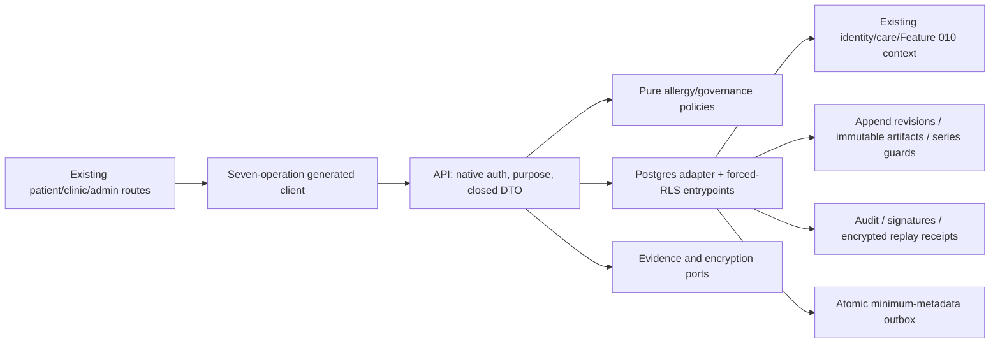

# Implementation Plan: Allergies and Clinical-Content Governance

> Feature 011 · Spec 0.12 / SPEC_APPROVED · Owner Yousef Osama · 2026-10-01 (Africa/Cairo)
> **PLAN_DRAFTED — approval pending.** Documentation and contracts only.

## 1. Approved inputs

| Input                        | Version / evidence                                                                          | Approval/gate                                                                                                               |
| ---------------------------- | ------------------------------------------------------------------------------------------- | --------------------------------------------------------------------------------------------------------------------------- |
| [Clarified spec](spec.md)    | 0.12; eleven unique answers; Q1–Q3 resolved                                                 | Product Owner SPEC_APPROVED in this conversation; Plan only authorized                                                      |
| Active scope                 | PRD 2.1.3 and roadmap assigned 011 row; [exact manifest](contracts/scope-manifest.json)     | FR-SAFE-002/008/012 + clinical-content publication slice of FR-ADMIN-004; exactly 19 NFRs / 7 operations                    |
| Constitution                 | 2.1.0 ratified                                                                              | Articles I–XV below                                                                                                         |
| Master / supporting baseline | Master 2.1.3; UI 0.9.2; compliance 1.1.0; checked-in architecture/Data-RLS/API/traceability | [Two catalog reconciliations](../../docs/governance/SHIFAA-Feature-011-Reconciliation-2026-10-01.md); no operation addition |
| Starting code                | 670b1e0fe15c719b98179805f2628d1b478a55dd                                                    | Existing Feature 010/native-auth context reused; no code change                                                             |
| Clinical/legal/design        | Spec §14 retained OPEN gates                                                                | No real-content, professional, legal or Feature 011 composition approval inferred                                           |

## 2. Constitution check

Pre-design and post-design results match. PASS means compliant by design, not implemented evidence. OPEN-UX-001 blocks affected-UI PLAN_APPROVED; architecture drafting is permitted. No constitutional exception is requested.

| Article                                | Result and evidence                                                                                                                                         |
| -------------------------------------- | ----------------------------------------------------------------------------------------------------------------------------------------------------------- |
| I Least privilege/default deny         | PASS — independent API/forced-RLS checks and closed field projections; data-model §7                                                                        |
| II Internal typed identity             | PASS — native-auth person UUID and mapped patient ID, no external identifier authority                                                                      |
| III Canonical care relationships       | PASS — existing self/GUA/DEL reads; only self patient or authorized clinician creates                                                                       |
| IV Facility membership/attribution     | PASS — live named workforce/professional context checked under locks                                                                                        |
| V Patient-centric purpose-limited data | PASS — patient-owned assertions; Feature 010 context grants no universal visibility                                                                         |
| VI Dual clinical governance            | PASS — two independent required-capacity approvals bind exact artifact/code/test vectors; OPEN-CLIN-001 blocks real approval, permits mechanism engineering |
| VII Regulated evidence gate            | PASS — synthetic-only engineering; OPEN-LEGAL-001/002/007 production restrictions retained                                                                  |
| VIII Separation of duties              | PASS — creator cannot sign/publish self; distinct eligible physician/pharmacist; structural checks                                                          |
| IX MFA/purpose                         | PASS — native AAL2/purpose for workforce/admin/signers/status readers; client role/AAL never authority                                                      |
| X Portable domain logic                | PASS — pure core policies; database/Auth/evidence adapters outside core                                                                                     |
| XI One app per surface                 | PASS — existing patient/clinic/admin surfaces only                                                                                                          |
| XII Arabic-first consent/privacy       | PASS — existing granular notice/consent/withdrawal, including replay                                                                                        |
| XIII Accessibility/localization        | BLOCKED — OPEN-UX-001 prevents affected-UI PLAN_APPROVED until Feature 011 compositions/references approved; OPEN-UX-002 retains formal VERIFYING gate      |
| XIV Safety UI clarity                  | PASS — explicit unknown/self-reported/future/synthetic states and stable confirmations; no warning/override evaluation                                      |
| XV Human authority over AI             | PASS — attributable human actions only; no AI or invented clinical rules                                                                                    |

OPEN-TECH-002 remains an affected IMPLEMENTING prerequisite; OPEN-TECH-003 an affected VERIFYING prerequisite. Planning prose does not close physical/generated-contract or reference-environment gates.

| Retained gate  | Effect preserved                                                                                                                  |
| -------------- | --------------------------------------------------------------------------------------------------------------------------------- |
| OPEN-CLIN-001  | Real clinical qualification/admissibility/content/code/test-vector approval remains open; synthetic mechanism engineering allowed |
| OPEN-TECH-002  | Affected IMPLEMENTING requires physical/generated-contract/schema/RLS parity evidence                                             |
| OPEN-TECH-003  | Affected VERIFYING requires approved reference-environment evidence; local results are limited                                    |
| OPEN-UX-001    | Affected-UI PLAN_APPROVED requires approved Feature 011 compositions/references                                                   |
| OPEN-UX-002    | Affected VERIFYING requires formal design/accessibility/reference evidence                                                        |
| OPEN-LEGAL-001 | Production sensitive-data/controller/processor/lawful-basis/residency evidence remains gated                                      |
| OPEN-LEGAL-002 | Production retention/deletion schedule remains unapproved; no guessed duration                                                    |
| OPEN-LEGAL-007 | Controlling Arabic instruments/counsel mapping required for production legal claims                                               |

## 3. Technical context

Existing targets: apps/patient, apps/clinic, apps/admin, services/api; packages/core, contracts, api-client, auth, i18n, design-system and observability. Feature modules follow existing feature-010 route/module/adapter conventions; these locations are proposed, not created.

Checked-in root Node 24.18.0 / pnpm 11.13.0 / TypeScript 7.0.2; Fastify 5.11.3, supabase-js 2.112.2, postgres 3.4.9, TypeBox 0.34.52, Supabase CLI 2.113.0, PostgreSQL major 17. Patient Expo 57.0.15 / RN 0.86.2 / React 19.2.3 / TS 6.0.3; web Next 16.3.0 / React 19.2.8. No upgrade proposed.

Reuse packages/auth/src/index.ts, services/api/src/adapters/postgres/identity-repository.ts, Feature 010 context adapters, platform.idempotency_records, clinical.claim_idempotency_v1, audit.signature_evidence and transactional audit/outbox foundations.

In-region read p95 ≤400 ms and mutation p95 ≤800 ms excluding external vendors; disclose synthetic workload and preserve OPEN-TECH-003 formal-environment limits. No new vendor. Existing verifier/encryption ports fail closed and run no network calls while locks are held. [Research](research.md) resolves engineering choices; clinical admissibility remains clinical-owner evidence, not a guessed allowlist.

## 4. Proposed design and dependency flow

No app-to-app or core-to-vendor import. Consume context without changing encounter/appointment/queue lifecycles. Allergy heads serialize append-only versions. Content-series guards handle missing-root and successor races. Immutable artifact version/digest are separate from CAS workflow version; the first signature cannot invalidate the second. Time-based selection never makes future content immediately eligible.

## 5. Work products

### Data and migration

[data-model.md](data-model.md) defines heads/revisions, content series/releases, scoped authority/designation/admissibility evidence, signature bindings and encrypted canonical receipts. Reuse audit.signature_evidence with clinical-resource-scoped physician/pharmacist capacities; no new platform-admin role.

Append-only history, terminal error, correction links, exact digest bindings and unique published roots/successors preserve provenance. FOR SHARE protects non-key authority revocation; deterministic lock order and CAS prevent overwrites. ENABLE/FORCE RLS, non-owner/NOBYPASSRLS execution, minimum grants and explicit column projections apply to support tables too.

Later CLI-generated expand migrations validate populated baseline data without guessed clinical backfill or historical migration edits. After evidence writes, roll-forward/complete restore replace destructive down-migration. Inherit designated-field encryption and retention classifications; OPEN-LEGAL-002 keeps production retention/deletion automation gated.

### API and generated clients

[OpenAPI](contracts/openapi.yaml) and [boundary contract](contracts/governance-boundaries.md) retain exactly seven existing operations. Only verifyAllergy and listClinicalContent catalog wording changes; methods/paths stay fixed. Clinic metadata and assigned-reviewer inspection are separately authorized projections; signing confers no ADM-MEDICAL power.

All mutations require Idempotency-Key; verification/signing/publication require If-Match. Replay reauthorizes current context before returning the encrypted original snapshot. Same-key changed bindings conflict; authorized same-key replay retains its original result even after newer versions. Scope-bound opaque cursors, existing problem vocabulary/rate controls and attributable requests apply. Generated schemas/client remain later work.

### UI, localization, and accessibility

[UI state contract](contracts/ui-state-contract.md) retains canonical spec routes and existing primitives. Every route covers loading/empty/unknown/error/permission/offline/stale/success, AR/RTL and EN/LTR, bidi isolation, focus/keyboard/screen reader, 200% text/reflow, contrast/targets and reduced motion.

Terminal-error/revision confirmations capture new reason/evidence; correction creates a linked assertion. Governance shows exact source/version/digest/effective date/capacity and synthetic/gate labels. No offline mutation queue, risk score, prescriptions/warnings or override controls. OPEN-UX-001 remains an approval blocker.

### Events, notifications, and vendors

Reuse existing outbox for accepted effects only, with event/request correlation, operation, opaque resource/version, outcome and time. No patient identifiers, substance/reaction/body, token or signature material in transport/telemetry. Event IDs deduplicate; replay emits no second audit/signature/event. Existing retry/dead-letter controls cannot republish content. No new notification journey/template/vendor or Feature 012 evaluation consumer. Vendor-specific tests are N/A; authority/evidence dependency failure must deny.

### Security, privacy, and abuse controls

Closed schemas reject client actor/signer/status/approval assertions. Native session, professional qualification, grant, purpose and resource context are independently checked at API/DB boundaries. No super-admin bypass. RLS plus SQL/DTO allowlists protects clinic metadata and encrypted receipts.

No PHI/secrets in logs, URLs, analytics or evidence artifacts. Existing consent/withdrawal governs fresh reads and replay. Production flags remain off under clinical/legal gates.

## 6. Test and evidence plan

Planned evidence only. [Quickstart](quickstart.md) specifies both real database runtimes, independent connections, deterministic barriers/pg_locks, non-owner executor tests and populated restore. Owner-only SQL/mocks do not establish guarantees. Evidence paths below are future outputs, not results.

| Acceptance / requirements                | Level and synthetic vector                                                                           | Future evidence under evidence/implementation/          |
| ---------------------------------------- | ---------------------------------------------------------------------------------------------------- | ------------------------------------------------------- |
| AC-01 / SAFE-008                         | core/contract/API/DB; required substance/source, known/unknown fields, both creation actors          | allergy-fields.md: always self_reported, no fabrication |
| AC-02 / DATA-001                         | all allowed/denied edges, terminal error, linked correction and original history                     | allergy-transitions.md                                  |
| AC-03 / SEC-001/007                      | API + forced-RLS; self/GUA/DEL reads and denied creation, cross-patient/facility                     | authority-rls.md: no leak/effect                        |
| AC-04 / SAFE-002                         | synthetic draft and absent real admissibility                                                        | content-draft.md: no real decision eligibility          |
| AC-05 / SAFE-012 / ADMIN-004 slice       | non-admin eligible signers, separate ADM creator/publisher, first release                            | signatures.md: exact independent approvals              |
| AC-06 / SEC-004                          | self-sign/publish, same-person dual role, wrong/expired evidence, rejection                          | signature-denials.md: no privilege elevation            |
| AC-07 / DATA-001                         | both-runtime artifact/workflow/signature races                                                       | version-signature-races.md: no mixed approval           |
| AC-08 / DATA-002                         | future root/successor and exact time boundary; conflicting initial/successor publication             | publication-races.md: one chain, no fallback            |
| AC-09 / SEC-001/004                      | revocation-first/action-first, purpose/AAL/context, native Auth dependency failure; clinic allowlist | authority-races.md: fail closed                         |
| AC-10 / SEC-005 / API-002                | duplicate/reused key, stale CAS, crash before/after commit, lost replay authority                    | idempotency-races.md: one effect/original receipt       |
| AC-11 / SEC-002/006 / OBS-001            | sentinels, atomic rollback, append-only evidence, outbox redaction                                   | redaction-atomicity.md                                  |
| AC-12 / I18N-001 / A11Y-001              | native Node + browser/native live AR/EN; offline/reconnect, focus/scale/motion                       | ar-en-acceptance.md; retained UX limits                 |
| AC-13 / PRIV-004                         | populated migration/restore and fresh independently signed rollback                                  | restore-rollback.md: complete history/RLS               |
| AC-14 / PRIV-001/002                     | notice/consent/withdrawal and gated production attempts                                              | privacy-gates.md: no real-PHI enablement                |
| AC-15 / PERF-002                         | disclosed regional synthetic load, both reads/five mutations                                         | performance.md: exact p95 targets/environment limits    |
| AC-16 / API-001 / QUALITY-001 / PORT-001 | exact manifest, generated parity, architecture/native resolution/full verify                         | integration-gates.md: PR-only delivery                  |

Exactly nineteen target NFRs remain in the manifest. Every AC-01–16 is mapped. Vendor failure/overrides are outside scope; existing dependency failures are AC-09.

## 7. Delivery sequence

Design dependencies only; no tasks/checkpoint execution authorized.

1. Obtain PLAN_APPROVED and OPEN-UX-001 Feature 011 composition/reference evidence; establish affected OPEN-TECH-002 prerequisites.
2. Freeze contracts and neutral fixtures; design both-runtime harness assertions before production code.
3. Expand migration/forced-RLS tests. Pure core tests may proceed independently with fixed fixtures and separate files; no parallel shared-DB writers.
4. API/repository atomicity, authorization/replay/version/signature/publication races; serial isolated DB verification.
5. Generate contracts/client and require parity before apps consume them.
6. Approved UI/localization/degraded states/native-browser resolution; app work may parallelize only with separate ownership and fixed shared primitives.
7. Outbox/dependency failure/redaction/kill-switch checks, no new vendor adapter.
8. Both-runtime restore/concurrency/RLS, live bilingual acceptance/a11y/visual, disclosed performance. Satisfy affected OPEN-TECH-003/UX-002 at VERIFYING.
9. Trace/evidence and deferred repository maintenance: refresh docs/TEAM-INSTALLATION-CHECKLIST.md; add completed/remaining feature checkboxes to docs/governance/SHIFAA-Remaining-Specs-Roadmap.md, preserving frozen ownership/scope and not prematurely completing 011.
10. Local verify + live AR/EN → feature-branch push/linked PR → current required checks → stop for Yousef Osama squash merge → confirm remote main/close issues → cleanup.

Maintenance is not functional scope; both target docs remain unchanged in Plan.

## 8. Rollout, rollback, and operations

Start with isolated synthetic-only cohort and feature exposure disabled by default. No production PHI/real eligibility while applicable gates remain open. Reuse existing configuration; any later scoped flag cannot bypass gates.

Expand migrations, validate both initialization chains and populated restore, then API and approved UI. No historical contraction/drop. Kill switch disables mutations/eligibility exposure with explicit unavailable status, preserves evidence and baseline-authorized reads.

After writes, disable exposure and use forward repair/complete restore. Clinical rollback creates a fresh independently signed release superseding the currently effective release; a reserved future successor conflicts, with no bypass/cancellation operation. No deletion, in-place reactivation or reused signatures.

Later feature runbook captures correlated deadlock/conflict/replay-denial/publication/dependency rates; alert thresholds derive from measured engineering baseline. Existing operator/on-call controls apply, no new notification journey or invented clinical threshold.

## 9. Plan approval

| Gate                   | Reviewer                                             | Decision/date                                   | Evidence/blocker                                                                                       |
| ---------------------- | ---------------------------------------------------- | ----------------------------------------------- | ------------------------------------------------------------------------------------------------------ |
| Architecture/data      | Product Owner + assigned authority                   | Pending                                         | Design and required both-runtime evidence                                                              |
| Security/privacy/legal | Assigned authority + Counsel/DPO as applicable       | Pending; production gates retained              | OPEN-LEGAL-001/002/007; no real PHI                                                                    |
| Clinical               | Independent required-capacity physician + pharmacist | OPEN-CLIN-001 retained                          | Mechanism engineering permitted; real qualification/admissibility/content/code/test vectors unapproved |
| Design/accessibility   | Product Owner + assigned authority                   | BLOCKED for affected-UI PLAN_APPROVED           | OPEN-UX-001 Feature 011 references; OPEN-UX-002 retained                                               |
| QA/Product             | Yousef Osama under current operating model           | SPEC_APPROVED 2026-10-01; Plan approval pending | [Document validation](evidence/plan-validation.md), no runtime claim                                   |

STOP after Plan. Next command: $speckit-tasks after PLAN_APPROVED and applicable stage evidence. No Tasks, Analyze, implementation, migration, generated client, commit, push or main modification.
