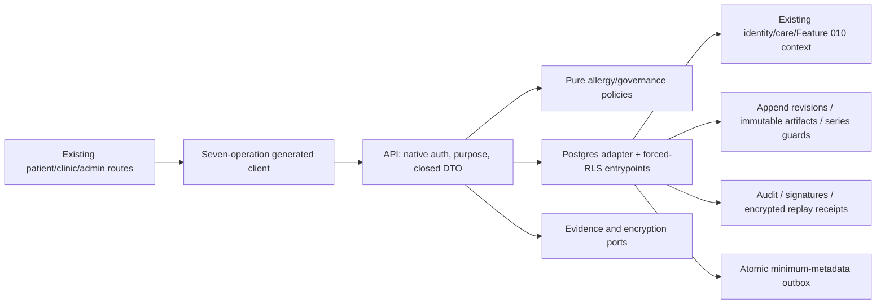

# Implementation Plan: Allergies and Clinical-Content Governance

> Feature 011 · Spec 0.12 / SPEC_APPROVED · Recovery version EVIDENCE-FOUNDATION · Owner Yousef Osama · 2026-10-06 (Africa/Cairo)
> **PLAN_RECOVERY_DRAFT — REVIEW REQUIRED; PRIOR PLAN APPROVAL SUSPENDED.** Implementation fully paused.

[Recovery authority and gate record](decisions/plan-recovery-2026-10-06.md) supersedes the old lifecycle status without deleting history. The [original Plan capture](evidence/plan-recovery/plan.md) retains its exact pre-recovery bytes, including its earlier omissions. The current 95-task/29-checkpoint ledger is historical recovery input, not implementation authority. Historical C01/C02/C02A and partial C03 RED evidence are preserved pending recovered-Plan revalidation. No C02B, C03, T017 or later execution is authorized.

## 1. Approved inputs

| Input                        | Version / evidence                                                                          | Approval/gate                                                                                                               |
| ---------------------------- | ------------------------------------------------------------------------------------------- | --------------------------------------------------------------------------------------------------------------------------- |
| [Clarified spec](spec.md)    | 0.12; eleven unique answers; Q1–Q3 resolved                                                 | Product Owner SPEC_APPROVED retained; Plan recovery only authorized                                                      |
| Active scope                 | PRD 2.1.3 and roadmap assigned 011 row; [exact manifest](contracts/scope-manifest.json)     | FR-SAFE-002/008/012 + clinical-content publication slice of FR-ADMIN-004; exactly 19 NFRs / 7 operations                    |
| Constitution                 | 2.1.0 ratified                                                                              | Articles I–XV below                                                                                                         |
| Master / supporting baseline | Master 2.1.3; UI 0.9.2; compliance 1.1.0; checked-in architecture/Data-RLS/API/traceability | [Two catalog reconciliations](../../docs/governance/SHIFAA-Feature-011-Reconciliation-2026-10-01.md); no operation addition |
| Starting code                | 670b1e0fe15c719b98179805f2628d1b478a55dd                                                    | Existing Feature 010/native-auth context reused; no code change                                                             |
| Clinical/legal/design        | Spec §14 retained OPEN gates                                                                | PO approved the TEST-ONLY capture; required Feature 011 Design Lead approval/designation is absent; clinical/legal gates retained                                           |

## 2. Constitution check

Pre-design and post-design results match. PASS means compliant by design, not implemented evidence. OPEN-UX-001 blocks affected-UI PLAN_APPROVED; architecture drafting is permitted. No constitutional exception is requested.

| Article                                | Result and evidence                                                                                                                                         |
| -------------------------------------- | ----------------------------------------------------------------------------------------------------------------------------------------------------------- |
| I Least privilege/default deny         | PASS — independent API/forced-RLS checks and closed field projections; data-model §7                                                                        |
| II Internal typed identity             | PASS — native-auth person UUID and mapped patient ID, no external identifier authority                                                                      |
| III Canonical care relationships       | PASS — existing self/GUA/DEL reads; only self patient or authorized clinician creates                                                                       |
| IV Facility membership/attribution     | PASS — live named workforce/professional context checked under locks                                                                                        |
| V Patient-centric purpose-limited data | PASS — patient-owned assertions; Feature 010 context grants no universal visibility                                                                         |
| VI Dual clinical governance            | PASS — two independent required-capacity approvals bind exact artifact/code/test vectors; OPEN-CLIN-001 blocks real approval, permits mechanism engineering |
| VII Regulated evidence gate            | PASS — synthetic-only engineering; OPEN-LEGAL-001/002/007 production restrictions retained                                                                  |
| VIII Separation of duties              | PASS — creator cannot sign/publish self; distinct eligible physician/pharmacist; structural checks                                                          |
| IX MFA/purpose                         | PASS — native AAL2/purpose for workforce/admin/signers/status readers; client role/AAL never authority                                                      |
| X Portable domain logic                | PASS — pure core policies; database/Auth/evidence adapters outside core                                                                                     |
| XI One app per surface                 | PASS — existing patient/clinic/admin surfaces only                                                                                                          |
| XII Arabic-first consent/privacy       | PASS — existing granular notice/consent/withdrawal, including replay                                                                                        |
| XIII Accessibility/localization        | BLOCKED — OPEN-UX-001 prevents affected-UI PLAN_APPROVED until Feature 011 compositions/references approved; OPEN-UX-002 retains formal VERIFYING gate      |
| XIV Safety UI clarity                  | PASS — explicit unknown/self-reported/future/synthetic states and stable confirmations; no warning/override evaluation                                      |
| XV Human authority over AI             | PASS — attributable human actions only; no AI or invented clinical rules                                                                                    |

OPEN-TECH-002 remains an affected IMPLEMENTING prerequisite; OPEN-TECH-003 an affected VERIFYING prerequisite. Planning prose does not close physical/generated-contract or reference-environment gates.

| Retained gate  | Effect preserved                                                                                                                  |
| -------------- | --------------------------------------------------------------------------------------------------------------------------------- |
| OPEN-CLIN-001  | Real clinical qualification/admissibility/content/code/test-vector approval remains open; synthetic mechanism engineering allowed |
| OPEN-TECH-002  | Affected IMPLEMENTING requires physical/generated-contract/schema/RLS parity evidence                                             |
| OPEN-TECH-003  | Affected VERIFYING requires approved reference-environment evidence; local results are limited                                    |
| OPEN-UX-001    | Affected-UI PLAN_APPROVED requires approved Feature 011 compositions/references                                                   |
| OPEN-UX-002    | Affected VERIFYING requires formal design/accessibility/reference evidence                                                        |
| OPEN-LEGAL-001 | Production sensitive-data/controller/processor/lawful-basis/residency evidence remains gated                                      |
| OPEN-LEGAL-002 | Production retention/deletion schedule remains unapproved; no guessed duration                                                    |
| OPEN-LEGAL-007 | Controlling Arabic instruments/counsel mapping required for production legal claims                                               |

## 3. Technical context

Existing targets: apps/patient, apps/clinic, apps/admin, services/api; packages/core, contracts, api-client, auth, i18n, design-system and observability. Feature modules follow existing feature-010 route/module/adapter conventions; these locations are proposed, not created.

Checked-in root Node 24.18.0 / pnpm 11.13.0 / TypeScript 7.0.2; Fastify 5.11.3, supabase-js 2.112.2, postgres 3.4.9, TypeBox 0.34.52, Supabase CLI 2.113.0, PostgreSQL major 17. Patient Expo 57.0.15 / RN 0.86.2 / React 19.2.3 / TS 6.0.3; web Next 16.3.0 / React 19.2.8. No upgrade proposed.

Reuse packages/auth/src/index.ts, services/api/src/adapters/postgres/identity-repository.ts, Feature 010 context adapters, platform.idempotency_records, clinical.claim_idempotency_v1, audit.signature_evidence and transactional audit/outbox foundations.

In-region read p95 ≤400 ms and mutation p95 ≤800 ms excluding external vendors; disclose synthetic workload and preserve OPEN-TECH-003 formal-environment limits. No new vendor. Planned evidence/protection ports fail closed; existing contract tooling is preparation evidence only. No network, evidence resolution or KMS/HSM calls may occur while locks are held. [Research](research.md) records recovered decisions and rejected alternatives; clinical admissibility remains clinical-owner evidence, not a guessed allowlist.

## 4. Proposed design and dependency flow

No app-to-app or core-to-vendor import. Consume context without changing encounter/appointment/queue lifecycles. Allergy heads serialize append-only versions. Content-series guards handle missing-root and successor races. Immutable artifact version/digest are separate from CAS workflow version; the first signature cannot invalidate the second. Time-based selection never makes future content immediately eligible.

### 4.1. Owned cross-layer contracts and digest responsibilities

This Plan owns the contracts before any physical consumer; Tasks may implement and prove them but may not choose serialization, storage, allocation or trust boundaries. The accepted [architecture decision](decisions/trusted-handoff-design-2026-10-06.md) is incorporated as design, not execution acceptance.

| Contract / fact | Producer and normative authority | Consumer / acceptance boundary |
| --- | --- | --- |
| SHIFAA-F011-ARTIFACT/1 | Frozen [text](contracts/artifact-canonicalization-v1.md), profile, fixed V01–V07/negative vectors and parity registry | SQL constructs the exact fourteen-field UTF-8 length-framed envelope and computes artifact SHA-256; later pure-core encoder must match the SAME bytes/hash in both runtimes |
| Evidence material SHA-256 | Trusted service Evidence Port resolves exact immutable unencrypted bytes and verifies reference/material association | PostgreSQL receives only reference + verifiedSha256; validates canonical syntax and equality with artifact facts; never receives or hashes raw evidence material |
| declaredDigest | Optional external assertion in the unchanged public request | SQL requires exact equality with its own canonical artifact digest; never authoritative by itself |
| SHIFAA-F011-CREATE-RELEASE-HANDOFF/1 | Trusted service assembly only; exact closed [contract/profile](contracts/trusted-release-handoff-v1.md) | Narrow private SQL consumer validates facts, reference/hash equality, allocation and opaque protected-body structure; external callers cannot author trusted fields |
| SHIFAA-F011-PROTECTED-BODY/1 | Application Protection Port: AES-256-GCM only, immutable/versioned external key reference, fresh random nonce | SQL stores exactly five typed opaque fields; no PostgreSQL encryption/decryption, key, external evidence or KMS/HSM work |
| SHIFAA-F011-PROTECTED-AAD/1 | Application deterministically reconstructs the five-field context below | SQL enforces the authoritative persisted ID/version/key-reference tuple; C04 proves real cryptographic authentication, not C03 synthetic fixtures |

Artifact canonicalization uses the frozen prefix, fourteen-field order, S<byte-length>:<exact UTF-8 payload>, framing and N, initial/null marker. Preserve Unicode without normalization, six-digit UTC microseconds and lowercase digest/UUID rules exactly. Field 8 retains the predecessor release UUID for successors; current release ID, physical series ID, artifactVersion, workflowVersion and protected-body metadata do not enter the artifact envelope. Signatures separately bind current resource ID and immutable artifact version/digest. Neither JSON insertion order, SQL JSON rendering, locale nor ciphertext participates in this signing format. Fixed expected bytes/digests are inputs; never regenerate them from an implementation under test.

### 4.2. Protected body and authenticated context

Exactly five immutable NOT NULL fields on clinical.content_releases implement BODY/1: body_contract_id text = SHIFAA-F011-PROTECTED-BODY/1; body_key_ref exact nonempty strict UTF-8 text; body_nonce bytea of 12 octets; body_ciphertext nonempty bytea; body_auth_tag bytea of 16 octets. No algorithm agility, key material, extra keyVersion, free-form AAD or JSON/text persisted envelope. The trusted Protection Port establishes immutable/versioned keyRef and rejects mutable aliases; SQL treats keyRef as opaque. Private keyRef never appears in public/clinic DTOs, logs, audit metadata, receipts or outbox. These five fields protect the clinical-content body; they do not silently redefine allergy/receipt protection contracts.

AAD/1 is the exact prefix SHIFAA-F011-PROTECTED-AAD/1; followed by exactly five S<byte-length>:<UTF-8 payload>, frames: resourceType=clinical.content_release; resourceId=canonical lowercase release UUID; fieldId=body; artifactVersion=positive minimal unsigned decimal ASCII; keyRef=exact immutable envelope reference. Use UTF-8 octet lengths with no JSON, escaping, locale, Unicode or whitespace normalization. workflowVersion is excluded because signature/publication changes must not invalidate an immutable body. Reconstruct AAD from persisted id/artifact_version/body_key_ref and constants; do not persist a second payload. [Fixed AAD vectors](contracts/trusted-release-handoff-v1-vectors.json) define exact bytes, including Unicode and malformed cases.

### 4.3. Allocation, locked admission, retry and replay

1. Detect an already committed idempotent result through the existing currently authorized stored-result path before another evidence/protection attempt. Reauthorize before exposing the result. If commit outcome is unknown, resolve stored status first; never blindly encrypt a possibly committed operation again.
2. For a new attempt, the trusted service allocates a fresh releaseId and obtains authoritative series/predecessor facts without later write locks. Candidate artifactVersion is initial=1 or predecessor.artifactVersion+1. Evidence Port resolves/verifies immutable material and Protection Port encrypts the intended content using candidate ID/version/keyRef AAD, all before the lock-holding mutation.
3. PostgreSQL claims the idempotency scope first, then the series advisory guard, ascending stable UUID domain/series/candidate/predecessor locks, then the fixed authority-fact order in data-model §6. It revalidates current lineage/version/authority/admission/time and independently recomputes expected artifactVersion. Candidate equality is mandatory; SQL must not silently substitute a new version/predecessor or change AAD.
4. Persist the same allocated ID/version, immutable facts/reference+verified hashes, opaque body, signature/audit/outbox/receipt effects and completed idempotency metadata atomically. Stale/conflicting allocation rejects the entire mutation without partial release/evidence/success audit/outbox/receipt.
5. A rejected pre-commit version/race or retryable transaction attempt restarts outside locks using fresh preflight, releaseId, random nonce and protected envelope; preserve public idempotency/request bindings. Derived allocation/encryption randomness is not part of the public request hash. Successful committed replay returns the stored result and creates/encrypts nothing again. A concurrent winner is replayed after current authorization, not inserted twice.

No network, evidence-resolution or KMS/HSM call occurs while PostgreSQL locks are held. Content-body protection completes in preflight before those locks; bounded local receipt AES-GCM using a before-transaction prepared capability is the sole protection exception under locks, defined by RECEIPT/1 below; this BODY/1 protocol does not define that receipt. Local persistence and current DB checks do not authenticate external material or perform cryptography. Historical lock/RLS evidence cannot substitute for the new handoff and allocation proofs.

### 4.4. Superseded invariant and competing drafts

Retire next_artifact_version as a draft allocator and unique(series_id, artifact_version) as a per-series draft-ordinal invariant. Initial/replacement-after-rejection drafts may share version 1; same-predecessor competitors may share predecessor.version+1 under distinct release IDs. Use id primary identity and release-scoped unique(id, series_id, artifact_version); retain same-series lineage constraints, unique published root per series and unique published successor per predecessor. No single draft counter authorizes publication. Exact signature resource_id/resource_version/digest bindings remain immutable. The rejected global-ordinal alternative conflicts with the accepted lineage-relative allocation and competing/replacement draft semantics; [research](research.md) records the rationale.

### 4.5. R2 authorized review, allergy protection and atomic receipts

The accepted self-debate findings SD-01/02/03 exposed missing Plan architecture, not new product requirements. [R2 decision](decisions/plan-recovery-r2-2026-10-06.md) records their correction as REVIEW REQUIRED without changing the Spec or retroactively approving R1. The [current evidence matrix](evidence/plan-recovery-evidence-foundation-matrix.md) supersedes the historical incomplete R2 matrix and enumerates every operation and both content read projections.

- [Authorized review disclosure](contracts/artifact-review-disclosure-v1.md): existing artifactReview has three exact strings, losslessly decoded/re-encoded UTF-8 material only. Trusted Evidence Port resolves immutable reference, recomputes SHA-256 and checks BOTH reference and release-bound digest before current scoped governance/reviewer disclosure. Create/publish required review responses are pre-resolved before write locks and separately disclosure-authorized. Clinic projection cannot fetch/decrypt/material-resolve it. No raw evidence SQL input, generic receipt/log/audit/outbox/telemetry material; dedicated exact-response ciphertext is permitted. A required unrepresentable binary material is a genuine public-contract conflict and must stop, not invent base64/schema. None was found in current normative fixtures.
- [Allergy protection v1](contracts/allergy-protection-v1.md): one closed protected facts payload and optional separately protected reason per revision, exact KnownUnknown fields and source provenance, no clinical scalar protocol/enum invention. Application AES-256-GCM, immutable/versioned keyRef, fresh 12-byte nonce/16-byte tag, five facts and five nullable reason typed columns. Six-field AAD binds allergy revision resource type, stable allergy ID, revision ID/version, field identifier and keyRef, excluding head/status/workflow. Service allocates/encrypts before locks; SQL independently requires current head/If-Match/predecessor/candidate version/transition/authority equality. Fresh revised facts preserve original source or explicitly correct only allowed fields. Terminal error correction is a new linked self_reported assertion.
- [Atomic receipt v1](contracts/mutation-receipt-v1.md): ALL five mutations use before-transaction external receipt-capability preparation, then ONE transaction with authoritative SQL domain result -> generated-schema exact canonical response -> bounded LOCAL receipt AES-GCM -> narrow finalization -> audit/outbox/completed-idempotency commit. A private typed immutable clinical.mutation_commit_obligations table plus deferred COMMIT constraints prevents domain-only commit. Five explicit protected receipt columns and immutable response tuple; twelve-field reconstructible AAD binds receipt/idempotency/operation/resource/version/status/permitted headers/keyRef. No plaintext durable/generic response or after-commit completion. Encryption/serialization failure rolls back all components. Committed replay reauthorizes current action/disclosure, decrypts the ORIGINAL receipt and returns original bytes/status/allowed headers; it never reconstructs newer state or re-encrypts. Unknown commit is resolved through an authoritative existing scope claim/lookup before another attempt.

Only bounded local receipt AES-GCM with a capability prepared before the transaction may execute under locks. External evidence/network/KMS/HSM work and domain allergy/body protection remain prohibited there. Capability is attempt-scoped, never persisted/exported/logged, and disposed on every outcome; no production provider behavior or guaranteed managed-runtime zeroization is invented. An overlapping loser may already have encrypted preflight data; it commits no second effect. Rejected retries use fresh identity/nonces/envelopes; committed replay does not encrypt.

[Data model §11](data-model.md) fixes the predecessor-compatible lock rank: idempotency -> series advisory -> Feature-011 domain -> required F010 encounter -> facility/credential/membership/admin facts -> care/patient/person -> consent/participant -> new clinical authorities/designation/admission -> audit chain/new effect/receipt finalization. Actual predecessor exclusive writer ordering is cited, not left for implementation. GUCs are verified repository-set attribution/context, not native-session cryptographic authentication; client spoofing/direct SQL and trusted context-setting are distinct test boundaries.

### 4.6. Shared evidence foundation and temporal ownership

[SHIFAA-F011-VERIFIED-EVIDENCE-BINDING/1](contracts/verified-evidence-binding-v1.md) is a small closed-profile engineering foundation, not a public operation, generic physical evidence table, boolean trust flag, ontology or rules engine. It defines material/signing/credential/designation/signing-authority/admissibility/allergy-provenance producers, exact result shapes, typed storage and authoritative comparison. No public wire shape, ARTIFACT/1 or BODY/AAD bytes change. [Profile](contracts/verified-evidence-binding-v1.json), [fixed vectors](contracts/verified-evidence-binding-v1-vectors.json) and [current parity](contracts/verified-evidence-binding-parity-v1.json) are P3 inputs, not implemented/generated parity.

Historical evidence snapshot, current eligibility and domain decision are separate. Existing credentials/designations/grants provide no proven safe successor lineage: EXACT_BOUND_ROW_VERSION_ONLY applies, including captured eligibility fields. Revocation/expiry/version change/unrelated replacement cannot rehabilitate an old signature. Preserve history and obtain a fresh decision; existing one-final-capacity-decision means a NEW independently reviewed draft where necessary. No same-lineage exception or automatic regrant interpretation. Public evidenceRef comes only from the verified historical signature sidecar. Rejected valid decisions use identical binding; invalid attempts do not create accepted evidence.

Signing preparation validates reference authenticity/exact signer/capacity/decision/release/immutable version/digest before locks and assembles current credential/designation/grant snapshots. SQL compares every independently derivable field under fixed locks; source authenticity remains the trusted producer's proof. Typed clinical.content_signature_bindings stores full immutable basis without duplicating audit-owned facts; stable ID FKs plus snapshot versions permit revocation updates. Deferred reciprocal constraints enforce audit/resource/sidecar consistency.

Admissibility approval is exact-artifact, not merely governed-scope: current approval row AND immutable binding name release ID/artifactVersion/ARTIFACT digest, scope/policy/supporting references and source provenance. Controlled offline governed provisioning occurs AFTER draft creation with explicit exact clinical-owner approval (synthetic only in engineering), not a public endpoint or automatic draft eligibility. Publication requires exactly one current eligible exact binding, with captured approval version/facts matching. Fresh governed admission binding is possible after changed approval; it never rewrites history.

Allergy verificationEvidenceRef is supporting clinician-decision provenance, not independent proof of clinical truth. Existing license-document buckets are unsuitable. Minimal private immutable support metadata names patient/assertion/predecessor/target/attestor; trusted acceptance checks existence/exact scope; one-use revision binding prevents substitution/cross-record reuse. No evidence upload service/document storage. Protection/receipt remain unchanged.

Coding is optional in approved Spec/OpenAPI. No approved real terminology source is identified: omitted/explicit unknown accepted; new known coding without approved matching source rejected with existing validation-failed, never silently coerced or falsely validated. Syntax is not terminology verification. Preserve unchanged historical known values without asserting fresh validation; synthetic known fixtures remain isolated mechanism proof. No vendor/medical policy selected.

P3 freezes profiles, typed columns/FKs/deferred constraints and matrix before physical consumers. P4 BOTH runtimes proves synthetic SQL association/current versions/uniqueness/RLS/races only. P6 proves actual source authenticity/failures/producer-to-SQL composition. P5 never demands later real proof; OPEN-TECH-002 remains OPEN. P7 SQL/core/fixed ARTIFACT equivalence is unchanged. No generated code/adapters/DDL/Tasks executed.

## 5. Work products

Historical R2 disposition: [R2-SD-04](evidence/plan-recovery-r2-self-debate.md) caused FAIL; that review remains unchanged. The accepted shared-evidence recovery direction now owns the missing architecture in §4.6; current readiness is determined only by the new validation/review, never inferred from historical approvals.

### Data and migration

[data-model.md](data-model.md) defines heads/revisions, content series/releases, scoped authority/designation/admissibility evidence, signature bindings and encrypted canonical receipts. Reuse audit.signature_evidence with clinical-resource-scoped physician/pharmacist capacities; no new platform-admin role.

Append-only history, terminal error, correction links, exact digest bindings and unique published roots/successors preserve provenance. FOR SHARE protects non-key authority revocation; deterministic lock order and CAS prevent overwrites. ENABLE/FORCE RLS, non-owner/NOBYPASSRLS execution, minimum grants and explicit column projections apply to support tables too.

Later CLI-generated expand migrations validate populated baseline data without guessed clinical backfill or historical migration edits. After evidence writes, roll-forward/complete restore replace destructive down-migration. Inherit designated-field encryption and retention classifications; OPEN-LEGAL-002 keeps production retention/deletion automation gated.

### API and generated clients

[OpenAPI](contracts/openapi.yaml) and [boundary contract](contracts/governance-boundaries.md) retain exactly seven existing operations. Only verifyAllergy and listClinicalContent catalog wording changes; methods/paths stay fixed. Clinic metadata and assigned-reviewer inspection are separately authorized projections; signing confers no ADM-MEDICAL power.

All mutations require Idempotency-Key; verification/signing/publication require If-Match. Replay reauthorizes current context before returning the encrypted original snapshot. Same-key changed bindings conflict; authorized same-key replay retains its original result even after newer versions. Scope-bound opaque cursors, existing problem vocabulary/rate controls and attributable requests apply. C02 generated schemas/client and C02A canonical metadata are preserved historical evidence pending revalidation; handoff metadata and physical parity are not accepted.

### UI, localization, and accessibility

[UI state contract](contracts/ui-state-contract.md) retains canonical spec routes and existing primitives. Every route covers loading/empty/unknown/error/permission/offline/stale/success, AR/RTL and EN/LTR, bidi isolation, focus/keyboard/screen reader, 200% text/reflow, contrast/targets and reduced motion.

Terminal-error/revision confirmations capture new reason/evidence; correction creates a linked assertion. Governance shows exact source/version/digest/effective date/capacity and synthetic/gate labels. No offline mutation queue, risk score, prescriptions/warnings or override controls. OPEN-UX-001 remains an approval blocker.

### Events, notifications, and vendors

Reuse existing outbox for accepted effects only, with event/request correlation, operation, opaque resource/version, outcome and time. No patient identifiers, substance/reaction/body, token or signature material in transport/telemetry. Event IDs deduplicate; replay emits no second audit/signature/event. Existing retry/dead-letter controls cannot republish content. No new notification journey/template/vendor or Feature 012 evaluation consumer. Vendor-specific tests are N/A; authority/evidence dependency failure must deny.

### Security, privacy, and abuse controls

Closed schemas reject client actor/signer/status/approval assertions. Native session, professional qualification, grant, purpose and resource context are independently checked at API/DB boundaries. No super-admin bypass. RLS plus SQL/DTO allowlists protects clinic metadata and encrypted receipts.

No PHI/secrets in logs, URLs, analytics or evidence artifacts. Existing consent/withdrawal governs fresh reads and replay. Production flags remain off under clinical/legal gates.

## 6. Test and evidence plan

Planned evidence only. [Quickstart](quickstart.md) specifies both real database runtimes, independent connections, deterministic barriers/pg_locks, non-owner executor tests and populated restore. Owner-only SQL/mocks do not establish guarantees. Evidence paths below are future outputs, not results. Historical captures are separately classified in the recovery record; none accepts current changed inputs.

| Acceptance / requirements                | Level and synthetic vector                                                                           | Future evidence under evidence/implementation/          |
| ---------------------------------------- | ---------------------------------------------------------------------------------------------------- | ------------------------------------------------------- |
| AC-01 / SAFE-008                         | core/contract/API/DB; required substance/source, known/unknown fields, both creation actors          | allergy-fields.md: always self_reported, no fabrication |
| AC-02 / DATA-001                         | all allowed/denied edges, terminal error, linked correction and original history                     | allergy-transitions.md                                  |
| AC-03 / SEC-001/007                      | API + forced-RLS; self/GUA/DEL reads and denied creation, cross-patient/facility                     | authority-rls.md: no leak/effect                        |
| AC-04 / SAFE-002                         | synthetic draft and absent real admissibility                                                        | content-draft.md: no real decision eligibility          |
| AC-05 / SAFE-012 / ADMIN-004 slice       | non-admin eligible signers, separate ADM creator/publisher, first release                            | signatures.md: exact independent approvals              |
| AC-06 / SEC-004                          | self-sign/publish, same-person dual role, wrong/expired evidence, rejection                          | signature-denials.md: no privilege elevation            |
| AC-07 / DATA-001                         | both-runtime artifact/workflow/signature races                                                       | version-signature-races.md: no mixed approval           |
| AC-08 / DATA-002                         | future root/successor and exact time boundary; conflicting initial/successor publication             | publication-races.md: one chain, no fallback            |
| AC-09 / SEC-001/004                      | revocation-first/action-first, purpose/AAL/context, native Auth dependency failure; clinic allowlist | authority-races.md: fail closed                         |
| AC-10 / SEC-005 / API-002                | duplicate/reused key, stale CAS, crash before/after commit, lost replay authority                    | idempotency-races.md: one effect/original receipt       |
| AC-11 / SEC-002/006 / OBS-001            | sentinels, atomic rollback, append-only evidence, outbox redaction                                   | redaction-atomicity.md                                  |
| AC-12 / I18N-001 / A11Y-001              | native Node + browser/native live AR/EN; offline/reconnect, focus/scale/motion                       | ar-en-acceptance.md; retained UX limits                 |
| AC-13 / PRIV-004                         | populated migration/restore and fresh independently signed rollback                                  | restore-rollback.md: complete history/RLS               |
| AC-14 / PRIV-001/002                     | notice/consent/withdrawal and gated production attempts                                              | privacy-gates.md: no real-PHI enablement                |
| AC-15 / PERF-002                         | disclosed regional synthetic load, both reads/five mutations                                         | performance.md: exact p95 targets/environment limits    |
| AC-16 / API-001 / QUALITY-001 / PORT-001 | exact manifest, generated parity, architecture/native resolution/full verify                         | integration-gates.md: PR-only delivery                  |

Exactly nineteen target NFRs remain in the manifest. Every AC-01–16 is mapped. Vendor failure/overrides are outside scope; existing dependency failures are AC-09.

### 6.1. Acceptance stages without circular dependencies

| Ordered stage | Required evidence | What it cannot claim |
| --- | --- | --- |
| P1 generated public parity | Seven closed OpenAPI operations, headers/methods/paths, generated schemas/client, legacy regressions, repeated generation with zero-byte diff | Canonical byte implementation, handoff metadata, physical behavior or OPEN-TECH-002 closure |
| P2 frozen canonical parity | Approved four-file hashes, fixed fourteen-field vectors, metadata binding, stale/missing/inconsistent failure | SQL/core encoder or real evidence resolution |
| P3 trusted-handoff parity | Current handoff/profile/fixed BODY/AAD/allocation vectors, model/governance/decision hashes; metadata only | Real adapters, DDL, AES-GCM or C02B task execution during recovery |
| P4 physical preparation (historical C03 responsibility) | Full baseline/additive chain in BOTH isolated PostgreSQL runtimes; actual non-owner/NOBYPASSRLS roles, FORCE RLS/grants/functions, fixed artifact bytes/hash, synthetic opaque envelopes, candidate ID/version and lineage/authority races | Real evidence hashes, AES-GCM roundtrip, genuine key qualification or clinical content approval |
| P5 affected physical/generated assertion (historical T017 responsibility) | Accepted P1–P4 evidence with current digest bindings and applicable owner/stage disposition; fail closed on missing/stale/failed/unaccepted inputs | Global OPEN-TECH-002 closure or evidence from the later real producer |
| P6 real producer/composition (historical C04 responsibility) | Real Evidence Port hashes exact immutable bytes; AES-GCM/AAD/random nonce/key-version/context/tamper/intended-plaintext proof; real producer -> prepared SQL in BOTH runtimes; no external work under locks; fresh-attempt/committed-replay proof | Production KMS/content/legal readiness or later core equivalence |
| P7 later SQL/core equivalence | Pure-core encoder uses unchanged ARTIFACT/1 contract/vectors; byte-for-byte/hash-for-hash comparison with actual SQL in BOTH runtimes | Redefining serialization or regenerating expected vectors |

P4 consumes P3 plus synthetic handoffs, not P6. P5 requires P4, not the implementation it unlocks at P6. P6 composes against P4 without requiring P7; SQL owns the authoritative artifact hash independently. Later consumers rerun affected parity/assertion after SQL or input changes. These stage names are design dependencies, not new task/checkpoint IDs. The 95-task ledger will be rebuilt only after recovered Plan review/approval. No stage grants execution permission. R2 P3 also freezes allergy/receipt payloads, envelope columns, handoffs/AAD/response serialization and commit-obligation enforcement; P4 consumes synthetic structural fixtures for all three protection families, including deferred receipt finalization; P6 proves real allergy/body/receipt producer composition for all five mutations plus exact authorized review disclosure. No physical stage claims real crypto, and no real producer stage can choose a missing storage contract.

## 7. Delivery sequence

Design dependencies only; implementation remains fully paused.

1. Complete recovered architecture/data review and digest-bound Plan-family approval; obtain the missing Feature 011 Design Lead approval/designation plus PO baseline approval for affected UI. Retain all production/verification gates.
2. Regenerate Tasks only under subsequent explicit authorization; crosswalk historical obligations/evidence and revalidate preserved C01/C02/C02A/C03 RED work against recovered inputs. Do not transfer completion markers automatically.
3. Establish P1–P3 contract/metadata/vector prerequisites before any physical consumer. Default/full verification remains fail-closed pending physical evidence.
4. Test-first P4 physical preparation in both isolated runtimes using synthetic trusted envelopes, then the separate P5 owner/stage assertion. No real adapter acceptance is required before its producer exists.
5. Test-first P6 real evidence/protection producers and both-runtime SQL composition. Prove P7 later SQL/core byte equivalence using the frozen vectors.
6. Install disabled-by-default exposure/kill-switch restrictions and negative tests before first API/UI route exposure or any isolated synthetic engineering demonstration. A demonstration is not a shippable MVP, deployment readiness or clinical readiness.
7. Wire separately authorized application consumers and approved AR/EN UI; preserve native/browser resolution, no offline mutation queue, authority/replay/version/signature/publication races and metadata-only clinic projection. No shared-DB parallel writers.
8. Complete restore/concurrency/RLS, operational redaction/dependency failure, live bilingual/a11y/visual and disclosed performance proof. OPEN-TECH-003/UX-002 keep VERIFYING restrictions.
9. Preserve deferred maintenance: refresh docs/TEAM-INSTALLATION-CHECKLIST.md and add completed/remaining checkboxes to docs/governance/SHIFAA-Remaining-Specs-Roadmap.md without changing scope/ownership or prematurely completing 011. Neither target is edited here.
10. Eventual local verify + live AR/EN → feature-branch PR + required checks → stop for Yousef squash merge → confirm remote main/close issues → cleanup. No Git integration is authorized by recovery.

## 8. Rollout, rollback, and operations

Start with isolated synthetic-only cohort and feature exposure disabled by default. No production PHI/real eligibility while applicable gates remain open. Reuse existing configuration; any later scoped flag cannot bypass gates.

Expand migrations, validate both initialization chains and populated restore, then API and approved UI. No historical contraction/drop. Kill switch disables mutations/eligibility exposure with explicit unavailable status, preserves evidence and baseline-authorized reads.

After writes, disable exposure and use forward repair/complete restore. Clinical rollback creates a fresh independently signed release superseding the currently effective release; a reserved future successor conflicts, with no bypass/cancellation operation. No deletion, in-place reactivation or reused signatures.

Later feature runbook captures correlated deadlock/conflict/replay-denial/publication/dependency rates; alert thresholds derive from measured engineering baseline. Existing operator/on-call controls apply, no new notification journey or invented clinical threshold.

## 9. Plan approval and recovery disposition

| Gate | Required authority | Current disposition | Evidence / restriction |
| --- | --- | --- | --- |
| Product Spec | Product Owner under operating model | SPEC_APPROVED retained | Spec 0.12 unchanged; no product contradiction discovered |
| Architecture/data/recovered Plan | Yousef under pre-implementation operating model; subsequent attributable review/approval | PRIOR APPROVAL SUSPENDED; recovered family REVIEW REQUIRED | [Recovery decision](decisions/plan-recovery-2026-10-06.md); [fresh architecture/data review](evidence/plan-recovery-architecture-review.md); no runtime claim |
| Design / OPEN-UX-001 | Product Owner + Design Lead | PENDING; affected-UI PLAN_APPROVED blocked | PO approved candidate 0.1.1-test-only, manifest 59ea1788edbae023533a9e08da97bc3884e0e098ec6e80721272822b6439c432; no authoritative Feature 011 Design Lead approval/designation recorded; Feature 010 acting role does not transfer |
| OPEN-TECH-002 | API Lead + Data Lead + QA Lead per retained register/stage disposition | OPEN; affected-consumer prerequisites unaccepted | P1–P5 current bindings/physical evidence and explicit disposition required; no T017 execution or global closure |
| Clinical | Required independent physician + pharmacist | OPEN-CLIN-001 retained | Engineering fixtures only; no real content/qualification/admissibility approval |
| Legal/privacy | Counsel/DPO | OPEN-LEGAL-001/002/007 retained | No production processing/retention/legal claims |
| Formal verification | Existing OPEN-UX-002 / OPEN-TECH-003 owners | OPEN retained | Live/renderer/device/performance acceptance is later evidence |

The Product Owner/Architecture Lead accepted REOPEN_PLAN only. The prior approval record remains immutable historical evidence, not approval of this recovered family. Current architecture decisions are design inputs; the current 95-task ledger is historical recovery input, not implementation authority. C01/C02/C02A and C03 RED are preserved pending revalidation. No C02B/C03/T017 authorization exists. A passing Plan-level review is READY_FOR_REVIEW, never PLAN_APPROVED or a closed OPEN gate.

STOP after Plan recovery. Next action is independent/debate review of the recovered family and required authority/gate decisions. Do not run Tasks, implementation, generators, feature tests, migrations, runtime services or Git integration in this recovery pass.
