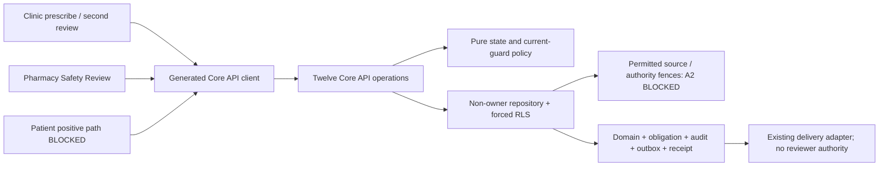

# Implementation Plan: F012 Prescription Safety and Governed Overrides

> Current disposition: C3 v0.3.0 PRODUCT_APPROVED; C2 post-sign direction approved, exact revised contract pending; C1 exact technical acceptance pending. See final reconciliation below; earlier dated summaries are historical. No PLAN_APPROVED.

**PLANNED / DRAFT_FOR_REVIEW — architecture acceptance BLOCKED.** Version 0.7.0-final-product-reconciliation, reconciled 2026-11-11. Product Owner: Yousef Osama. No PLAN_APPROVED, Tasks, implementation, runtime acceptance or professional approval.

Worktree: D:\ECU\Gradution-Project\.worktrees\f012-specify-20261023. Actual branch: codex/f012-specify-20261023. Approved Specify checkpoint: c571773d6432251d1f52bc94bb501c4e163f1571. Verified merged origin/main: 41696fae3bfaf3e54c947cd558b758c21864d894. Synchronized existing branch by local merge 0ad13689a170f325681a260d925e149f669e485a; approved checkpoint retained as first parent. No rebase/reset or push. The effective activated project override supplies this document's structure; preserved prospective template headers alone are not lifecycle authority.

## 1. Approved inputs

| Input                                                                    | Exact version / SHA-256                                                                                                                                                                                                                                                                              | Effective authority / limitation                                                                                  |
| ------------------------------------------------------------------------ | ---------------------------------------------------------------------------------------------------------------------------------------------------------------------------------------------------------------------------------------------------------------------------------------------------- | ----------------------------------------------------------------------------------------------------------------- |
| [Specification](spec.md)                                                 | f4d2e7f1113467f5997e27809394c7f03a191dba276bfc895e0398a1bb8fa15a                                                                                                                                                                                                                                     | SPEC_APPROVED 2026-10-23; unchanged                                                                               |
| [Checklist](checklists/requirements.md)                                  | afbf3788059845dbba8355d4fd23485689a69bc53c9ebd34b7d15f2e1e954499                                                                                                                                                                                                                                     | 16/16 document quality, no runtime PASS                                                                           |
| [Specification approval](readiness/specification-approval-2026-10-23.md) | de55e0fc7edfc4d2bdfcb678068171cce50afdfbb07a5ec39934f565ae5c2abb                                                                                                                                                                                                                                     | Exact candidate, bounded scope; no Plan approval                                                                  |
| [D1/D2/qualified-D3](readiness/po-decision-approval-2026-10-23.md)       | bf00eea22e8ffbdd4887e54716cdf7b691acbf0d3c91dd8b3323b3f1fbfb4b84                                                                                                                                                                                                                                     | T2+G; W-M/W-NA/N/E logical contexts; P/M/C/R intersections; positive patient path or BLOCKED                      |
| [Constitution](../../.specify/memory/constitution.md)                    | 3.0.1 / 4107a37ce43ae5c6efd6c8198771112b598eb167d3f0788c879d2b3fc747793c                                                                                                                                                                                                                             | Activated Article VI isolated engineering applicability, professional signatures separate                         |
| [PRD](../../shifaa-prd.md)                                               | 2.2.0 / eca3a8dd2955da8b6d91bb6fc0d9722f57801c39fae59a4ca4c3475af6b4ab0f                                                                                                                                                                                                                             | Active isolated scope                                                                                             |
| [Master](../../SHIFAA-Implementation-Plan-MASTER.md)                     | 2.2.1 / 47552ae429fabf0606af98b07080a3db342e6f490fe20d27553a14ddcc9cc63d                                                                                                                                                                                                                             | Architecture Completeness and stage gates                                                                         |
| [Reviewer contract](contract-amendment/reviewer-contract-v0.1.0.md)      | 0.1.0 / 6436f1ea96c50cc422f8cab51fb692b2245e859500123cca18a8784f47b0af63                                                                                                                                                                                                                             | Approved integrated twelve-operation successor; historical proposal header preserved                              |
| Governance integration                                                   | [Approval](decisions/graduation-governance-approval.md), [activation](decisions/graduation-governance-activation-receipt.md), [manifest](readiness/real-medicine-research/source-manifest.json)                                                                                                      | PRs 494/495/496/498 ancestry verified; PR 506 human squash integrated as 41696fae3bfaf3e54c947cd558b758c21864d894 |
| Scope and predecessors                                                   | [Frozen roadmap](../../docs/governance/SHIFAA-Remaining-Specs-Roadmap.md), [scope successor](contract-amendment/scope-successor.json), [F010](../010-encounters-referrals-contextual-chat/spec.md), [F011 boundary](../011-allergies-clinical-content-governance/contracts/governance-boundaries.md) | Ownership/gates preserved; no protected-content consumer                                                          |
| Preserved inputs                                                         | [Fixture approval](readiness/engineering-fixture-approval-2026-10-14.md), [original proposal](readiness/po-decision-resolution-proposal-2026-10-23.md), [initial receipt](readiness/specify-preflight-2026-10-23.json)                                                                               | Immutable originals; no executable vector acceptance                                                              |
| This stage                                                               | [Plan preflight](readiness/plan-preflight-2026-10-23.json)                                                                                                                                                                                                                                           | Separate explicit checkpoint + Plan authorization, provenance/pointer/preservation evidence                       |

Exact scope: closure FR-SAFE-001/003/004/005/006/007/011; prerequisite-only FR-SAFE-009 (F014 closure), FR-SAFE-010 (F019 closure). All 22 NFRs: NFR-SEC-001/002/003/004/005/006/007, NFR-PRIV-001/002/004, NFR-I18N-001, NFR-A11Y-001, NFR-PERF-001/002, NFR-AVAIL-002, NFR-DATA-001/002, NFR-API-001/002, NFR-OBS-001, NFR-QUALITY-001, NFR-PORT-001. SAFE-012 remains the professional obligation, not an eighth closure FR.

## 2. Constitution check

PASS means design conformance only, not executed or professional evidence. Pre-design reviewed the approved spec; post-design reviewed research/model/contract. Approval blockers remain ERROR; draft preparation does not cross them.

| Article                                | Pre-design                                 | Post-design result and evidence                                                                                                                                                                 |
| -------------------------------------- | ------------------------------------------ | ----------------------------------------------------------------------------------------------------------------------------------------------------------------------------------------------- |
| I Least privilege/default deny         | PASS — spec §§6/10                         | BLOCKED — A2/G1 current source and positive visibility proof; model §6 denies unproven access                                                                                                   |
| II Internal typed identity             | PASS — person/account separation           | PASS — proposed UUID identity FKs; server-derived person; no client authority                                                                                                                   |
| III Canonical care relationships       | PASS — current selected subject            | BLOCKED — G1 relationship exists, prescription visibility predicate not established                                                                                                             |
| IV Facility membership/attribution     | PASS — originating facility                | PASS — actual current workforce plus isolated roster, substitution negatives                                                                                                                    |
| V Patient-centric purpose-limited data | PASS — D3 maxima                           | BLOCKED — G1; no signed=release, no reviewer patient-history browsing                                                                                                                           |
| VI Dual clinical governance            | PASS — activated engineering boundary only | PASS — D1/D2 logical only, not_fully_checked; OPEN-CLIN-001 blocks actual clinical code/content/vectors/use                                                                                     |
| VII Regulated evidence gate            | PASS — no production authority             | PASS — all legal/facility/professional restrictions retained                                                                                                                                    |
| VIII Separation of duties              | PASS — underlying persons                  | PASS — three-person emergency, own assignment and immutable decision bindings; tests NOT RUN                                                                                                    |
| IX MFA/purpose                         | PASS — native AAL2/five minutes            | TECHNICAL_DESIGN_PREPARED — pinned NAC-1 user/session SHARE contract ready for exact acceptance/integration; scoped native checks passed, F012 enforcement not installed; no stale JWT fallback |
| X Portable domain logic                | PASS — canonical direction                 | PASS — pure core + API ports + repository/worker adapters                                                                                                                                       |
| XI One app per surface                 | PASS — six-app topology                    | PASS — Clinic/Pharmacy/Patient only; no F014 worklist expansion                                                                                                                                 |
| XII Arabic-first consent/privacy       | PASS — existing privacy                    | PASS — six bilingual source states; no unexplained F014 in patient copy                                                                                                                         |
| XIII Accessibility/localization        | PASS — obligations                         | BLOCKED — OPEN-UX-001 exact compositions/baselines pending                                                                                                                                      |
| XIV Safety UI clarity                  | PASS — warning/hard stop                   | BLOCKED — OPEN-UX-001; metadata-first, explicit confirmation/receipt, delivery ≠ review                                                                                                         |
| XV Human authority over AI             | PASS — human decisions                     | PASS — no autonomous clinical rule/classification/approval                                                                                                                                      |

### Engineering applicability and gate evaluation

The [preflight](readiness/plan-preflight-2026-10-23.json) binds activated authority, hashes, official 1.2.1 provenance and separate Plan authorization. Explicit SPECIFY_FEATURE_DIRECTORY=specs/012-prescription-safety-governed-overrides and official SPECIFY_FEATURE_NO_PERSIST=1 selected the existing feature. Local F012 and root F001 pointers remain unchanged. Setup JSON BRANCH is the feature-directory basename; the independently verified Git branch above is actual.

**Gate result: ERROR for approval/advancement; draft reconciliation only.** S1–S8 and P1/P2/P3 have attributable Product/Architecture approval; S4 is approved in principle within its narrow validation boundary. [source-fence decision](readiness/source-fence-architecture-approval-2026-10-23.md) and [source-consumption successor 0.1.0](contract-amendment/source-consumption-successor-v0.1.0.md) distinguish that authority from the unproven writer/native-currentness protocol. A2 technical admission, G1 positive visibility, exact supporting-contract integration and OPEN-UX-001 remain unresolved. No missing clinical input is converted into permission; overall assessment remains not_fully_checked.

G1 reporting satisfies qualified D3, but J-04/AC-13 positive acceptance remains BLOCKED. Master Architecture Completeness and the F012 pre-Plan clause provide no waiver merely for documenting a blocked capability. A positive resource-specific visibility predicate or an attributable governed disposition consistent with higher authority is still necessary; no such disposition is granted here.

## 3. Technical context

Repository [package.json](../../package.json) pins Node 24.22.1, pnpm 11.13.0, TypeScript 7.0.2, Vitest 4.1.11, Prettier 3.6.2; Data/RLS specifies PostgreSQL 17. Declared versions are not clean-build/SBOM evidence (OPEN-TECH-001).

Future ownership: packages/core/src pure policy; services/api/src use cases/repositories; services/worker delivery; existing generated contract/client package; existing Clinic, Pharmacy and Patient apps. No source/client/DDL changes occur now. F007 native authority, F010 encounter/care, F011 permitted allergy/status metadata and existing audit/outbox/idempotency are dependencies, not assumed new grants.

NFR targets: in-region reads p95 ≤400 ms, mutations ≤800 ms excluding vendors; patient-home LCP ≤3.0 s on the approved Android 1.6 Mbps/300 ms profile, interactive input ≤200 ms. Actual device/dataset/load profile OPEN-TECH-003; no measurement PASS. P1 five-minute nonrenewable assignment/thirty-minute request maximum is approved Product policy, bounded by earlier expiry/invalidation. Other draft limits/rates are technical proposals, not clinical intervals, throughput or retention policy.

## 4. Proposed design and dependency flow

No app-to-database/vendor/app call. No core-to-vendor import. Offline clinical mutations blocked; reconnect reauthorizes/reconciles original receipts. [Research](research.md) gives each choice's source, alternatives, rationale, owner, status, ACs and negatives. [Model](data-model.md) and [OpenAPI](contracts/openapi.yaml) make the proposed physical contract reviewable.

## 5. Work products

### Data and migration

[Model §§1–8](data-model.md) defines typed/nullability/key/index/history proposals for prescriptions/revisions/items/checks, evidence members, issues/acknowledgements, requests/lanes/assignments/decisions, isolated roster, immediate obligation and medication statements. Exact state/CAS/fingerprint/lock/event/receipt and migration/restore proposals are explicit. No DDL/grants executed. Current-source and native-authority writer participation remain required. No fabricated clinical backfill; retention/encryption/key restrictions preserved.

### API and generated clients

Exactly twelve operations: createPrescription, updatePrescription, runPrescriptionSafety, acknowledgeWarning, requestContraindicatedOverride, decideOverride, signPrescription, cancelPrescription, getPrescription, listPatientMedications, getOverrideReviewCases, transitionOverrideReviewAssignment. Nine mutations require idempotency. V set is update/check/decide/sign/cancel/R2. R1 accepts exactly discover/detail; R2 exactly claim/release_own/takeover_invalid.

Draft OpenAPI 3.1.1 defines closed request/response/query unions, field maxima, necessary projection, problem mappings, headers, ETags, cursor/rate/body limits and requirement/AC assignments. It is not generated active API or working implementation. Later OPEN-TECH-002 must prove full active OpenAPI/DDL/RLS/client parity; F014/reserved inventory unchanged.

### UI, localization and accessibility

Propose /safety-review inside each existing Clinic/Pharmacy app; exact spelling is unapproved. Clinic keeps prescribing, Pharmacy uses distinct Safety Review, F014 /worklist unchanged. Existing patient prescription/medication compositions retain scope with G1 positive journey BLOCKED. Metadata → self-claim → authorized detail → decision; no patient browser.

All states: loading, verified-empty/missing/unavailable/stale/partial/freshness-unknown, denied AAL/purpose/authority, pending/held-other/released/rejected/approved, conflict, cancelled/expired, blocked-unreviewed, offline/reconnect/uncertain receipt and failed delivery. Patient source language follows spec §14, never unexplained F014 or inferred “safe”.

ar-EG RTL/en-EG LTR at 360×800, 412×915, 768×1024, 1440×900; bundled IBM Plex Sans Arabic/Inter; approved tokens; bidi isolation; keyboard/focus restoration; SR/live receipts; 200% text/applicable 400% reflow; 44×44 targets and ≥48 px patient primary actions; contrast/reduced motion; zero decorative safety motion. No offline clinical queue, color-only or toast-only critical state. OPEN-UX-001 requires exact route/state/copy compositions and immutable baseline IDs; none invented. Native NVDA/TalkBack/device/live bilingual acceptance stays separate.

### Events, notifications and vendors

Model §7 proposes minimal versioned event names, aggregate sequencing, recipient reauthorization, transport lease/retry/dedup/DLQ and aging/failure owners. Both emergency lanes and pharmacist obligation commit at request creation; delivery failure never hides work. No new channel/template/notification endpoint/Emergency Contact grant. Worker cannot assign/decide/sign/mark reviewed. Production SMS remains conditional if selected, not an imported dependency.

### Security, privacy and abuse controls

Current native AAL2/five-minute factor, purpose/facility/subject/care/action, person independence and deployment designation are checked on read/mutation/replay. Forced RLS independently checks authority under non-owner API role; no service/owner bypass or client-forged GUC authority. No protected F011 body/code/vector/signer, real PHI/contact/credential, clinical free text or token telemetry. Required negative cases are independently enumerated in quickstart and spec; execution NOT RUN.

## 6. Test and evidence plan

[Quickstart](quickstart.md) specifies current safe checks and future gated validation. [Plan consistency](checklists/plan-consistency.md) records actual static results. Proposed future evidence directories are not existing runtime results.

| AC    | Future test/evidence family                                             | FR/NFR binding                                                           |
| ----- | ----------------------------------------------------------------------- | ------------------------------------------------------------------------ |
| AC-01 | Fifteen A/M/C rows; T1 vs T2+G; produced incomplete vs producer failure | SAFE-001/003; SEC-005; DATA-001                                          |
| AC-02 | Evidence invalidation; immutable signatures/acknowledgements/lineage    | SAFE-001/004/011; DATA-001/002                                           |
| AC-03 | Six degraded states, prior draft recovery, no offline queue             | SAFE-001/003; AVAIL-002                                                  |
| AC-04 | W-M/W-NA monitoring; N/E fields; no flag-derived classification         | SAFE-004/005; SEC-005                                                    |
| AC-05 | Normal independent discover/claim/detail/approve/reject/separate sign   | SAFE-005/006; SEC-001/004                                                |
| AC-06 | API and raw non-owner RLS identities/facility/cursor/selector negatives | SEC-001/003/004/007; API-002; PRIV-001                                   |
| AC-07 | Both lanes/obligation; 72 timing combinations plus unstarted/equality   | SAFE-007; DATA-001/002                                                   |
| AC-08 | Two claims, takeover protection, release, cross-lane CAS/digest         | SAFE-006/007; SEC-005; API-002                                           |
| AC-09 | Lost response, current replay, changed body 409, own terminal readback  | SEC-003/005/006; API-001/002                                             |
| AC-10 | Actual writer/session revocation/evidence/expiry/release/cancel races   | SEC-001/004/005/007; DATA-001                                            |
| AC-11 | Worker duplicate/reorder/crash/DLQ; pending/blocked obligation          | SAFE-007; AVAIL-002; OBS-001                                             |
| AC-12 | Every required write failure; raw domain/audit/outbox/receipt effects   | SEC-005/006; DATA-001                                                    |
| AC-13 | Every reader/status/field/source; positive patient BLOCKED, not PASS    | SAFE-001/011; PRIV-001/002; AVAIL-002                                    |
| AC-14 | Fixtures/research/protected-content isolation; not_fully_checked        | SAFE-003; SEC-002/007; PRIV-002                                          |
| AC-15 | Bilingual/native a11y/visual/performance; errors/events/log redaction   | I18N-001; A11Y-001; PERF-001/002; OBS-001; SEC-002                       |
| AC-16 | Twelve operations, 7+2 FR/22 NFR, scope/predecessor preservation        | SAFE-009/010 prerequisite only; API-001; QUALITY-001; PORT-001; PRIV-004 |

IDs in this table retain FR-/NFR- prefixes as assigned in the spec/contract. PRIV-004 additionally binds no deletion before retention schedule; PORT-001 pure domain boundary; QUALITY-001 all applicable later formatting/lint/type/unit/contract/RLS/migration/a11y/security/P0 checks, no documentation-only waiver. Unit, API, raw RLS, independent-session, worker, restore, load, visual and native/live acceptance are separate evidence classes.

## 7. Delivery sequence

Dependency proposal only, not Tasks: settle A2/G1/OPEN-UX-001 and exact architecture choices; obtain exact Plan approval and separate Tasks authorization; separately accept neutral executable vectors/harness; verify isolated resources/actual writer fences; contracts and negatives; expand-only schema/RLS; pure state policy; atomic API/replay; generated client; UI locale/state integration; worker/recovery; integrated races/rollback/restore/performance/a11y; trace/evidence manifest; gated release.

Disjoint contract/design review can proceed independently. No shared DB/Docker/harness concurrency is inferred from worktree/agent count; execution needs explicit isolation and authorization. No task IDs/tasks.md or implementation schedule assumes pending decisions are accepted.

## 8. Rollout, rollback and operations

Proposed exposure default off in isolated synthetic deployment; internal flag spelling not installed. A2 missing fence/current source fails closed; G1 patient journey remains retained and blocked. No clinical permissions, PHI, dispensing or production activation. Model §8 defines migration validation/no fabricated backfill, exposure rollback and roll-forward after durable signed history, original byte/hash/receipt/obligation/dedup restoration. No reset/down-migration or restore run now.

Pre-implementation engineering/security architecture decisions belong to Yousef under CLOSED OPEN-TEAM-001. Later API/Data implement consistency, Platform transport/restore, QA execution/evidence and Product behavior acceptance under separate authorization. Exact technical thresholds and restoration profile still require attributable acceptance; no production RPO/RTO or retention is invented. Issues #493/#502 and PR #506 remain unchanged.

## 9. Plan approval

| Gate / owner                                                                | Status                                                                                | Required evidence / restriction                                                                                                                                                                                                                                                                                             |
| --------------------------------------------------------------------------- | ------------------------------------------------------------------------------------- | --------------------------------------------------------------------------------------------------------------------------------------------------------------------------------------------------------------------------------------------------------------------------------------------------------------------------- |
| Pre-implementation architecture — Yousef / OPEN-TEAM-001                    | APPROVED_PRODUCT_ARCHITECTURE direction; TECHNICAL_DESIGN_PREPARED physical candidate | S1–S8, S4 boundary in principle, P1/P2/P3 approved; exact successor acceptance/integration remains outstanding; NAC-1 protocol is now specified with scoped compatibility evidence; installed writer/race proof belongs to implementation/verification. No individual implementation-team artifact signatures manufactured. |
| Positive patient path — Architecture/API/Data/Product                       | BLOCKED, retained scope                                                               | Actual current authorized record/source/status/field predicate; denial-only cannot pass AC-13                                                                                                                                                                                                                               |
| OPEN-UX-001 — Product + Design Lead                                         | OPEN; blocks affected PLAN_APPROVED                                                   | Exact compositions/routes/copy + immutable baseline IDs                                                                                                                                                                                                                                                                     |
| OPEN-TECH-001 — Architecture + Platform                                     | OPEN; IMPLEMENTING                                                                    | Runtime/OCI/lockfile/SBOM reproducibility                                                                                                                                                                                                                                                                                   |
| OPEN-TECH-002 — API + Data + QA                                             | OPEN; IMPLEMENTING                                                                    | Generated full active contract/DDL/RLS/client parity                                                                                                                                                                                                                                                                        |
| OPEN-UX-002 — Product + Design + QA                                         | OPEN; VERIFYING                                                                       | Actual renderer/font/mask/tolerance/visual acceptance                                                                                                                                                                                                                                                                       |
| OPEN-TECH-003 — QA + Platform + Product                                     | OPEN; VERIFYING                                                                       | Actual device/network/dataset/performance/a11y profile/results                                                                                                                                                                                                                                                              |
| Article VI / SAFE-012 / OPEN-CLIN-001 — Medical Director + Chief Pharmacist | OPEN                                                                                  | Before actual clinical code/content/vectors/use; prescribing RELEASE_APPROVED; genuine dual signatures/P01–P30                                                                                                                                                                                                              |
| OPEN-CLIN-002 / OPEN-LEGAL-003 — clinical/facility/regulatory/legal owners  | OPEN; affected RELEASE_APPROVED                                                       | Controlled/NTI lists, actual facility window, written workflow authority                                                                                                                                                                                                                                                    |
| OPEN-LEGAL-001/007/002 — Legal/DPO; Medical Director for retention          | OPEN; affected RELEASE_APPROVED                                                       | Lawful PHI, controlling Arabic memo, signed retention schedule                                                                                                                                                                                                                                                              |
| OPEN-PRODUCT-001 — Product + UX Research                                    | OPEN; RELEASE_APPROVED/UAT                                                            | Actual 5–8 target-user evidence                                                                                                                                                                                                                                                                                             |
| QA/Product exact Plan review                                                | PENDING                                                                               | Required architecture/UX decisions complete; no Tasks without separate authorization                                                                                                                                                                                                                                        |

[Spec retained gates](spec.md#later-stage-obligations-and-retained-gates) control exact owners/evidence/capability restrictions. Unrelated OPEN-LEGAL-005, OPEN-VENDOR-001/002/003, OPEN-CLIN-003, OPEN-PHARM-001 and OPEN-AI-001 stay unchanged and are not silently imported. No clinical/legal/credential/facility approval follows from design review.

## 10. Official workflow and extension hooks

Official SpecKit 1.2.1 integration, provenance and owned manifests were verified. Official setup-plan selected the approved input and copied the effective project override. Phase 0 produced research; Phase 1 produced model/contract/gated validation guide; post-design Constitution evaluation retains ERROR blockers. Generation is not accepted architecture.

After-plan hooks inspected again: optional agent-context; command /speckit-agent-context-update; description “Refresh agent context after planning”; prompt “Execute speckit.agent-context.update?”. To execute separately: /speckit-agent-context-update. Not executed: no AGENTS/context mutation required for this draft package. No mandatory before/after hook registered. No Clarify/Tasks/Analyze/Implement/install/runtime/database/publication operation.

## 11. Prior bounded architecture review — historical

**BLOCKED_BEFORE_PLAN_APPROVAL.** [Decision package](readiness/architecture-decision-resolution-2026-10-23.md) provides the exact F011 producer/writer/consumer matrix, patient proof verdict, source-derived constraints, the then-pending P1–P3 choices, now approved as recorded in §12, API/Data/Security/Platform decisions and OPEN-UX-001 Design package. It supersedes broad requests to approve entire proposal labels. No substantive Specify change or lifecycle command.

A2 has existing writers but no established F012-compatible complete-set/native-currentness protocol. G1 has no established positive prescription/medication source visibility for PAT/GUA/DEL: J-04/AC-13 BLOCKED and NOT ACCEPTED. Honest blocked reporting alone cannot grant PLAN_APPROVED. Source-dependent DTOs remain qualified; §12 and the successor now replace the initial rank-2 fence proposal with coordinated rank-zero admission. OPEN-UX-001 remains an actual pre-Plan approval blocker; actual policy SQL/generated parity/runtime proof retain their later stages, without deferring missing logical authority.

No complete OpenAPI validator is installed in the inspected local environments: VALIDATION_NOT_AVAILABLE. Qualified static/Schema/ref/security/union review is recorded separately from full document validation and architecture acceptance.

## 12. Owner-authorized architecture reconciliation — 2026-10-23 (historical; §14 supersedes N-1)

[source-fence decision](readiness/source-fence-architecture-approval-2026-10-23.md) records the latest authorization and binds the unchanged original proposal. [source-consumption successor 0.1.0](contract-amendment/source-consumption-successor-v0.1.0.md) supplies exact additive F011/API/Data clauses, writer inventory, lock graph obligations and P1/P2/P3 technical deltas; it does not replace historical canonical contracts.

| Area                                       | Current disposition                                                               | Exact consequence                                                                                                                                                                                                                                             |
| ------------------------------------------ | --------------------------------------------------------------------------------- | ------------------------------------------------------------------------------------------------------------------------------------------------------------------------------------------------------------------------------------------------------------- |
| S1–S8 / Alternative A                      | APPROVED_PRODUCT_ARCHITECTURE direction; TECHNICAL_DESIGN_PREPARED target         | Producer-owned generations plus deployment admission before existing locks. Shared database topology supports preparation, not current runtime participation. A is not admitted end-to-end; B/C have no proven equivalent.                                    |
| Writer/native authority fence              | BLOCKED_MISSING_EVIDENCE                                                          | F011 per-page/read/CAS locks and native session existence checks do not cover validation-to-commit. Every online/offline/maintenance writer must participate; native Auth ordering remains unproven. No dependent successful signing/review assumed.          |
| S4                                         | APPROVED_PRODUCT_ARCHITECTURE in principle; TECHNICAL_DESIGN_PREPARED exact delta | Internal current case/lane/assignment validation of captured permitted evidence only; no new records, protected content, prescriber impersonation, owner bypass, general role or public endpoint. Effective grant/enforcement not installed.                  |
| P1                                         | APPROVED_PRODUCT_ARCHITECTURE                                                     | Five-minute nonrenewable assignment and ≤thirty-minute request; authoritative-clock/equality/revocation/CAS realization prepared, not verified.                                                                                                               |
| P2                                         | APPROVED_PRODUCT_ARCHITECTURE intent; TECHNICAL_DESIGN_PREPARED wire/state        | Closed predecessor+expected-version intent on create, independent target authorization, unique atomic supersession only on separate successful sign. Actual correction permission is BLOCKED_MISSING_AUTHORITY pending effective resource-specific successor. |
| P3                                         | APPROVED_PRODUCT_ARCHITECTURE trigger; TECHNICAL_DESIGN_PREPARED writer/data      | One immutable prescribed statement per committed signed item/version in the same atomic sign; no release/active/dispensed inference. No existing writer/grant/runtime PASS claimed.                                                                           |
| Patient / UX                               | BLOCKED_MISSING_AUTHORITY / BLOCKED_MISSING_EVIDENCE respectively                 | V1–V8 remain unapproved; J-04/AC-13 retained. Product + Design Lead must supply actual required compositions and immutable baselines.                                                                                                                         |
| Actual races/RLS/recovery/generated parity | LATER_STAGE_VERIFICATION                                                          | Required at their applicable gates under separate implementation/harness authorization; no static check substitutes.                                                                                                                                          |

Exactly twelve operations, seven closure/two prerequisite FRs, 22 NFRs and AC-01–16 are unchanged. The approved Specification and six checkpoint files remain untouched. This reconciliation runs no SpecKit lifecycle command and grants no PLAN_APPROVED.

## 13. Architecture contract finalization candidate — 2026-10-23 (historical; §14 updates N-1)

The [single finalization package](readiness/architecture-contract-finalization-2026-10-23.md) refines the preserved 0.1.0 successor without editing it or any approval record. Its §§2–7 are the exact current technical acceptance candidate; §8 VP-1 is a separate unapproved Product choice. Earlier review sections remain history and must not be read as requiring installed F012 migrations/race tests before Plan approval.

| Area               | Final specified design / remaining gate                                                                                                                                                                                                                                                                                                   |
| ------------------ | ----------------------------------------------------------------------------------------------------------------------------------------------------------------------------------------------------------------------------------------------------------------------------------------------------------------------------------------- |
| A-DB / S1–S3/S5–S8 | Durable deployment/epoch row fence; exclusive writers/mutations, shared one-transaction complete internal capture, producer/scope generations and fresh current eligibility; READ COMMITTED same-connection ports and exact ranks. No public cursor upgrade or generation-only guarantee. Exact technical acceptance/integration pending. |
| S4                 | Closed internal case/assignment/version/captured-binding request; valid + same binding, invalid, or unavailable internal result. Current independent actor/facility/purpose/P1; forced-RLS validation-only successor ineffective until accepted/integrated. No new fact/general read/public operation.                                    |
| N-1                | Specific remaining design gap: pinned native session/factor/recovery/user-disable writer semantics and compatible retained-authority port/lock graph. Existing boolean + Auth HTTP is insufficient. Do not equate absent runtime tests with this missing protocol. Dependent reliance fails closed.                                       |
| P1/P2/P3           | Product choices already approved. Exact expiry equality/CAS, immutable replacement pair/current correction authority/unique atomic lineage and prescribed sign-owned exact-one writer contracts are prepared for Yousef's technical acceptance; not active grants/runtime PASS.                                                           |
| G1 / VP-1          | POSITIVE_PATH_NOT_ESTABLISHED — BLOCKED. Ready-to-approve subject-only currently signed P release and restricted offline synthetic withdrawal clauses are separate from V1–V8, not added to the active wire draft. M/managed-reader/other-status portions remain blocked and retained; partial P proof cannot pass all AC-13.             |
| OPEN-UX-001        | Six actual composition families, bilingual/applicable viewport source versions, immutable baselines and Product + Design Lead approval still required before affected Plan approval. No design acceptance fabricated.                                                                                                                     |
| Stage separation   | Master 343/394/396/511 and Reviewer 131 require accepted exact design now. Reviewer 134–135 / OPEN-TECH-001/002/003 and OPEN-UX-002 place installed migrations/clients, executed RLS/races/restore/device/native/live evidence later. Full validator availability is qualified separately, not an invented lifecycle gate.                |

**Overall BLOCKED_BY_SPECIFIC_DESIGN_GAP; PLANNED / DRAFT_FOR_REVIEW.** Exact A-DB/S4/P1–P3 contract acceptance and governed integration, N-1 native design compatibility, separate patient authorization resolution and actual OPEN-UX-001 evidence remain. No PLAN_APPROVED, Tasks, implementation or publication. No additional individual implementation-team approval is requested under OPEN-TEAM-001.

## 14. Current NAC-1 resolution — 2026-11-11

[Executed maintenance/handoff](readiness/nac-1-local-auth-maintenance-and-handoff-2026-11-11.md) and [NAC-1/0.1.0](contract-amendment/native-authority-nac1-successor-v0.1.0.md) supersede the earlier missing-source/configuration/design input. **NAC1_CONFIG_PINNED_CONTRACT_READY; TECHNICAL_DESIGN_PREPARED.** Exact technical acceptance/integration remains pending. The same existing stack now has a pinned healthy Auth startup; 9 configuration/preservation checks, 61 source-equivalent F007 tests and 28 native/SQL compatibility checks passed. These are scoped results, not installed F012 guard/RLS/atomicity acceptance.

Retained same-connection order: A-DB admission → idempotency → native user FOR SHARE → current session FOR SHARE → producer generations/local authority/domain ranks. Real native UPDATE/DELETE conflict is required; native writers do not honor A-DB. Native refresh can take session then user: bounded whole-transaction deadlock abort/revalidation/original-key recovery is required, and actual raw 500/40P01/fresh retry was observed. No network call under guarded locks; fresh post-wait deadline checks establish logical action ordering, not physical WAL-before-expiry.

The candidate prepares a narrow dedicated internal non-owner/NOBYPASSRLS helper executor and bound native policies; no role, grant, helper or migration was installed. Existing boolean-helper privileged ownership is not the proposed security model. Missing/changed deployment identity or unavailable authority fails closed. All source/local participating writers and independent forced-RLS enforcement remain future implementation obligations after exact contract acceptance.

**Overall BLOCKED_BEFORE_PLAN_APPROVAL; PLANNED / DRAFT_FOR_REVIEW.** Remaining pre-Plan items are exact NAC-1/A-DB/S4/API/Data/RLS/P1–P3 technical acceptance/integration, an actual approved positive patient path and actual OPEN-UX-001 compositions/baselines. P1–P3/S1–S8 approvals are not reopened. VP-1 is unapproved; J-04/AC-13 remains POSITIVE_PATH_NOT_ESTABLISHED — BLOCKED and in scope. Installed F012 migrations/clients and executed F012 security/race/failure tests remain later, not invented pre-Plan requirements. No lifecycle command or PLAN_APPROVED.

## 15. Post-maintenance synchronization and current Plan review — 2026-11-11

[Current review receipt](readiness/post-maintenance-plan-review-2026-11-11.md) records remote main, local merge, preserved files, exact prepared technical bundle and current gate classification. Earlier review sections remain historical. NAC-1 is configuration-pinned and ready for exact technical acceptance/integration; P1–P3 and S1–S8 Product/Architecture direction remain approved. No installed F012 guard or new permission is inferred. Positive patient P/M visibility remains BLOCKED; unapproved VP-1 is P-only and cannot alone satisfy all AC-13 branches. OPEN-UX-001 requires actual compositions and immutable approved baselines. Resolve these pre-Plan contracts/evidence, then obtain exact PLAN_APPROVED; do not rerun completed stages or begin Tasks.

## 16. Current exact Plan closure candidate — 2026-11-11

This section qualifies earlier chronological review rows: native source/configuration investigation is complete for its admitted target; exact technical acceptance/integration is pending. Compositions now exist as candidates, not approved designs. VP-1 remains an unchanged historical proposal; current complete P/M alternative is VP-2, not an effective grant.

The [single consolidated contract](contract-amendment/plan-closure-consolidated-v0.1.0.md), [exact-content approval package](readiness/plan-closure-2026-11-11/approval-package.md), [draft OpenAPI](contracts/openapi.yaml) and [candidate visual gallery](design/plan-closure-2026-11-11/gallery.html) are the current review surfaces. Existing P1–P3/S1–S8 decisions are not requested again. Six approved Specify files and original candidates remain immutable.

- C1: accept the exact workforce NAC-1/A-DB/S4/P1–P3/API/Data/RLS technical design. Durable deployment-row admission, complete internal evidence capture, retained native user then session SHARE, bounded deadlock abort/retry, immutable history and atomic domain/audit/outbox/idempotency are specified. No new installed helper or runtime PASS.
- C2: decide VP-2 subject-only independent P/M release with deliberate sign intent, resource-specific release authority, retained signed/cancelled/superseded/expired P visibility, prescribed-only M, separate audited withdrawal, no GUA/DEL audience grant, and the fixed subject-read native profile. Reject/defer keeps retained J-04/AC-13 positive functionality BLOCKED.
- C3: actual Product + Design Lead acceptance of the candidate source and immutable Arabic/English viewport PNG/hash manifest. Producing the assets alone does not close OPEN-UX-001.

Exact wire refinements remove mandatory absent clinical ItemP facts, minimize public source metadata, constrain admitted M statuses, and add the closed optional release intent only to existing signPrescription. R1 discover/detail and R2 claim/release_own/takeover_invalid stay closed; twelve operations, 7 closure FRs, 2 prerequisite FRs, 22 NFRs and AC-01–16 remain assigned.

Full OpenAPI document validation is VALIDATION_NOT_AVAILABLE; local ref/schema/operation/security/union checks and an explicit semantic review are bounded evidence, not a full validator PASS. Installed migrations, clients, independent raw forced-RLS/API/race/atomic tests, native accessibility and restoration demonstrations remain IMPLEMENTING/VERIFYING obligations. Master 343/394–396/475/511 requires exact design and applicable approval before Plan, not already-installed F012 code.

**DRAFT_FOR_REVIEW / BLOCKED_BEFORE_PLAN_APPROVAL.** C1/C2 acceptance and governed activation plus C3 evidence precede a separate exact PLAN_APPROVED decision. Tasks still requires separate authorization. Publication is only planned; no commit/push/PR or lifecycle command in this review.

## Current Product directive reconciliation — 2026-11-11 (supersedes earlier current-review summaries)

The [attributable decision](readiness/final-po-decisions-2026-11-11/product-owner-decision-record.md) records C3 v0.3.0 PRODUCT_APPROVED and C2 sign-time-or-post-sign direction APPROVED. Prior P1-P3/S1-S8 approvals stand; no repeated policy question. [Consolidated v0.2.0](contract-amendment/plan-closure-consolidated-v0.2.0.md) is the current exact C1/C2 candidate; v0.1.0 and all previous approvals/proposals/evidence stay immutable. Older signing-only/current C3-unapproved summaries above are historical, not the latest disposition.

Selected C2 proposal explicitly expands updatePrescription's existing PATCH carrier into closed draft-edit/release/withdrawal branches; this material boundary/wire/grant/Data/RLS change is NOT APPROVED by counting twelve IDs. No new public operation/role/app, no post-sign clinical edits or repeated sign/P2/P3 effects. Separate projection-control CAS/ETag and target history; current original-prescriber/care/facility/AAL2/fresh TOTP plus distinct release/withdrawal permissions. P and M explicit, independent, subject only, no automatic release/dispensing inference. Only currently signed/unexpired resources may receive new release; prior released cancelled/superseded/expired P remains visibly historical. Withdrawals are terminal for this exact target/revision. Exact §6 clauses and OpenAPI require final acceptance/integration; J-04/AC-13 stays POSITIVE_PATH_NOT_ESTABLISHED — BLOCKED until then.

C1 technical design is prepared, not accepted/integrated/implemented. C3 Product acceptance is final for the exact v0.3.0 source and delta/inherited hashes; no Design Lead approval is fabricated. [U1 resolution and new C2 UI delta](readiness/final-po-decisions-2026-11-11/ui-and-governance-resolution.md) identify the exact dual-acceptance rule, smallest proposed F012-only disposition and additional composition evidence. OPEN-UX-001 remains OPEN pending that resolution/evidence. No blanket re-review of accepted safety/history/mobile states.

Full OpenAPI 3.1.1 semantics remains VALIDATION_NOT_AVAILABLE; bounded static schemas/refs/security/unions/scope checks are separate. Runtime helpers/grants/clients/forced-RLS/races/atomic recovery/native accessibility remain later-stage work. Existing scoped NAC-1 results retain their actual scope. Approved Specification/requirements/decisions/fixtures/pointers and existing Supabase are unchanged. DRAFT_FOR_REVIEW / BLOCKED_BEFORE_PLAN_APPROVAL: exact C1/C2 acceptance and integration, U1 or actual dual attribution plus exact acceptance of the rendered new C2 compositions, then separate exact PLAN_APPROVED. No lifecycle stage, Tasks, implementation, publication or merge.
